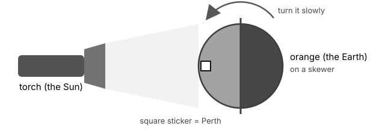

# Year 3 English — Week 31 Homework
## Topic: Day and night  ⏱ ~20 min

**Name:** ______________________ **Due:** ____________

## 1 · Read it again (5 min)

**1.** Read *Why Do We Have Day and Night?* **aloud** to an adult at home. Read it slowly and clearly.

Adult's initials: ________  How did the reading go? (adult to circle) **smooth** / **a few stumbles** / **needed help**

## 2 · Try it at home: the orange and the torch (5 min)

**You need:** an orange, a skewer or pencil, a sticker, a torch, a dark room, and an adult to help.

1. Push the skewer through the orange, from top to bottom. *(Ask your adult to do this part.)*
2. Put the sticker on the side of the orange. The sticker is **Perth**.
3. Turn off the room light. Ask your adult to shine the torch at the orange. The torch is the **Sun**.
4. Slowly turn the orange around on its skewer, like the spinning Earth.

**2.** When the sticker faces the torch, is it **day** or **night** in Perth? ____________

**3.** When the sticker turns away from the torch, is it **day** or **night** in Perth? ____________

**4.** Did the torch move? ______ What moved? ____________________

## 3 · Read a new text (5 min)

> ### Awake at Night
>
> Some animals sleep during the day and wake up at night. These animals are called **nocturnal** animals. In Australia, possums, many bats and owls are nocturnal.
>
> The tawny frogmouth is a bird that is active at night. In the daytime, it sits very still on a branch. Its grey feathers look just like tree bark, so it is hard to see.
>
> Nocturnal animals have special ways to find food in the dark. Many have very big eyes to see in dim light. Bats can find insects by listening for echoes.
>
> When the Earth spins and Perth turns towards the Sun, these animals go back to sleep!

**5. 👆 Right there.** What are animals that wake up at night called? ____________________

**6. 👆 Right there.** Name **two** Australian nocturnal animals.

<!-- lines:1 -->

**7. 🔍 Think and search.** How does the tawny frogmouth stay safe in the daytime?

<!-- lines:2 -->

**8. 💭 Author and me.** Why do you think many nocturnal animals have very big eyes?

<!-- lines:2 -->

## 4 · Spelling and sentences (5 min)

**9.** Write each word **two** times: *night, light, bright, high, tonight*

<!-- lines:3 -->

**10.** Fix these sentences. Add capital letters, full stops and question marks.

a) *possums wake up at night*

<!-- lines:1 -->

b) *do owls sleep in the day*

<!-- lines:1 -->

c) *i saw a bright light in the sky*

<!-- lines:1 -->

## 5 · Teach someone at home

**11.** Explain to someone at home **why we have day and night**. Use the orange and the torch to show them. Ask them to sign here if your explanation made sense.

Signed: ____________________

**12.** What question did they ask you? Write it here — don't forget the question mark!

<!-- lines:2 -->
