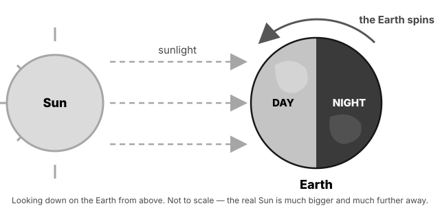

# Year 3 English — Week 31
## Content text: *Why Do We Have Day and Night?* (Science — Earth & Space: the Earth spins)
## Reading toolkit: 🎬 Visualise · Grammar: sentence types & capitals · Spelling: long *i* (*igh, i_e, y, ie*)

**Name:** ______________________ **Date:** ____________

**Learning intentions — by the end of this workbook I can:**
- *(world)* explain that day and night happen because **the Earth spins on its axis**, and that one spin takes about 24 hours
- *(world)* explain why the Sun **looks** like it moves across the sky, and why people once believed it did
- *(reading)* **visualise** while I read, and use my mind-picture to check that I understand
- *(reading)* answer **right there**, **think and search** and **author and me** questions
- *(grammar)* write the **four kinds of sentences** with the right punctuation, and use capitals for **names of places and people**
- *(spelling)* spell the long **i** sound in different ways: *n**igh**t*, *t**i**m**e***, *sk**y***, *p**ie***

---

## Part A · Warm-up ⏱ ~5 min

**1. Quick check.** Circle **true** or **false**.

| | | |
|---|---|---|
| a) Perth is the capital city of Western Australia. | true | false |
| b) The Earth is flat, like a plate. | true | false |
| c) The Sun is a star. | true | false |
| d) It is summer in Australia at Christmas. | true | false |
| e) Australia is a country **and** a continent. | true | false |
| f) The Moon gives out its own light, like the Sun. | true | false |

**2. Fix the sentences.** Add **four** capital letters and **two** full stops.

*on saturday we drove to rottnest island the sea was very calm*

<!-- lines:2 -->

**3. Spell it.** Your tutor will say five words. Write them here.

1. ______________ 2. ______________ 3. ______________ 4. ______________ 5. ______________

---

## Part B · Before reading ⏱ ~7 min

> **🌏 Big Idea**
> Day and night happen because **the Earth spins**. When our side of the Earth faces the Sun, it is day. When our side turns away from the Sun, it is night. The Sun does not travel around the Earth.

**4. What do I already think?** Before you read, finish the sentence. (There is no wrong answer yet — we will come back to it!)

*I think we have night because …*

<!-- lines:2 -->

**5. Key words.** Read each word and its meaning with your tutor. Then write or draw something to help you remember it.

| Word | What it means | My clue (word or picture) |
|---|---|---|
| **planet** | a very large, round object that travels around a star | |
| **spin** / **rotate** | to turn around and around on the spot | |
| **axis** | an imaginary line through the middle of something that spins | |
| **sphere** | a round shape like a ball | |
| **horizon** | the line far away where the land or sea seems to meet the sky | |
| **sunrise** | when the Sun first appears above the horizon in the morning | |
| **sunset** | when the Sun disappears below the horizon in the evening | |
| **scientist** | a person who studies the world carefully to find out how it works | |

> **🎬 Reading toolkit card: VISUALISE**
> Good readers make a **movie in their mind** while they read. They add details from the words: colours, shapes, sizes and movements. If the movie stops making sense, they **stop and re-read**.
>
> *Watch your tutor try it:* "The Earth is a giant ball." → *I picture a huge blue and green ball floating in black space.* "It spins on its axis." → *Now I push an imaginary stick through the middle, from top to bottom, and make the ball turn around the stick, like a top.* "The Sun lights up one half." → *I shine a big yellow light on one side. That side is bright; the other side is dark.*

---

## Part C · Read in chunks ⏱ ~15 min
*Read one chunk at a time. After each chunk, stop and do the 🛑 check before you read on.*

> ### Why Do We Have Day and Night?
>
> #### Chunk 1 · A giant spinning ball
> The Earth is the planet we live on. It is shaped like a giant ball, called a **sphere**. It is about 12 700 kilometres wide. If you could drive a car straight through the middle without stopping, it would take more than five days!
>
> The Earth is always **spinning**. It turns around an imaginary line called its **axis**. The axis goes right through the middle of the Earth, from the North Pole to the South Pole. Near the middle of the Earth, the ground is moving faster than a jet plane. So why can't we feel it? We cannot feel it because the spin is smooth and steady, and everything moves along with us. The ground, the oceans, the buildings and even the air all spin together.

**🛑 Stop and check 1.**
a) 🎬 Draw the movie in your mind: the Earth spinning on its axis. Draw and label the **axis**, the **North Pole** and the **South Pole**.

<!-- draw:5 -->

b) What is the name for a round shape like a ball? ____________________

> ### Chunk 2 · The Sun, our star
> The Sun is a star. It is an enormous ball of very hot, glowing gas. The Sun is so big that more than a million Earths could fit inside it! It looks small to us only because it is so far away — about 150 million kilometres. Even light, which is the fastest thing there is, takes about eight minutes to travel from the Sun to the Earth.
>
> The Sun gives the Earth **light** and **heat**. Without the Sun, our planet would be dark and frozen, and nothing could live here.

**🛑 Stop and check 2.**
a) Why does the Sun look small to us? ______________________________________
b) Name the **two** things the Sun gives the Earth. ______________ and ______________

> ### Chunk 3 · A day side and a night side
> The Sun can only shine on **one half** of the Earth at a time. Imagine shining a torch at a ball in a dark room. The side facing the torch is bright, but the back of the ball is in shadow. The Earth is just the same. The half facing the Sun has **day**. The other half faces away from the Sun, into dark space, so it has **night**.
>
> Because the Earth keeps spinning, places keep moving from the day side to the night side, and back again.

**🛑 Stop and check 3.**
a) Put your finger on the half of the Earth in the picture that has **day**. Is it the left or the right half of the Earth? ______________
b) 🎬 In Chunk 3, the writer asks you to imagine something. What is it?

<!-- lines:2 -->

> ### Chunk 4 · Sunrise and sunset
> As the Earth spins, our home turns slowly into the sunlight. We see the Sun appear over the **horizon** in the east. That is **sunrise**. As the Earth keeps turning, the Sun seems to climb high into the sky and then slide down towards the west. Finally, our home turns away from the Sun. That is **sunset**, and the sky grows dark.
>
> It really does look as if the Sun is moving. It is like riding on a merry-go-round. The trees and people around you seem to slide past, but really, **you** are the one turning. For thousands of years, most people believed that the Sun travelled around the Earth. Then, nearly 500 years ago, a scientist called Nicolaus Copernicus showed that the Earth moves instead. Many people did not believe him at first!

**🛑 Stop and check 4.**
a) 🎬 Close your eyes and picture riding a merry-go-round. What seems to move past you? ____________________
b) In which direction does the Sun **rise**? ______________ In which direction does it **set**? ______________

> ### Chunk 5 · One spin is one day
> The Earth takes about **24 hours** to spin around once. That is one whole day and one whole night. Because the Earth spins, different places get sunrise at different times. Sydney is east of Perth, so the Sun rises there before it rises here. When it is lunchtime in Perth, it is night-time on the other side of the world, in places like England. While you are eating your sandwiches, children in England are fast asleep!
>
> The Earth is also on a much longer journey. It travels all the way around the Sun, and that trip takes one whole **year**. During that trip, the Earth spins around about 365 times. So remember: **one spin is one day**, and **one trip around the Sun is one year**.

**🛑 Stop and check 5.**
a) How long does the Earth take to spin around once? ____________________
b) How many times does the Earth spin during one trip around the Sun? ____________________

> **Glossary**
> **imaginary** — not real; only in your mind · **enormous** — very, very big · **glowing** — giving out light · **shadow** — a dark area where light is blocked · **east** — the direction where the Sun rises · **west** — the direction where the Sun sets · **merry-go-round** — a fairground ride that turns in a circle · **journey** — a long trip

---

## Part D · After reading ⏱ ~15 min

*👆 Right there = the answer is in one place. 🔍 Think and search = put two or more parts together. 💭 Author and me = use the text **and** what you know.*

**6. 👆 Right there (Chunk 1).** Why can't we feel the Earth spinning? Give **two** reasons.

<!-- lines:3 -->

**7. 👆 Right there (Chunk 1).** Where does the Earth's axis go from and to?

<!-- lines:2 -->

**8. 👆 Right there (Chunk 2).** How long does light take to travel from the Sun to the Earth? ____________________

**9. 👆 Right there (Chunk 4).** Who showed that the Earth moves, and about how long ago?

<!-- lines:2 -->

**10. 🔍 Think and search (Chunks 3 and 4).** Number these in order, 1 to 4. Start with sunrise.

- ___ Our home turns away from the Sun. It is sunset.
- ___ Our home turns into the sunlight. It is sunrise.
- ___ Our home faces away from the Sun, into dark space. It is night.
- ___ Our home faces the Sun and the Sun is high in the sky. It is day.

**11. 🔍 Think and search (Chunks 2 and 5).** Complete the table.

| | How long it takes | What it makes |
|---|---|---|
| The Earth spins around once | | |
| The Earth travels around the Sun once | | |
| Light travels from the Sun to the Earth | | *(leave blank)* |

**12. 🔍 Think and search.** Match each main idea to its chunk. Write the chunk number (1–5).

| Main idea | Chunk |
|---|---|
| The Sun is a huge, faraway star that gives us light and heat. | |
| The spinning Earth gives different places sunrise at different times, and one spin takes a day. | |
| The Earth is a giant ball that spins on its axis. | |
| As we turn, the Sun looks like it moves across the sky, but really we are moving. | |
| The half of the Earth facing the Sun has day; the other half has night. | |

**13. 💭 Author and me.** The writer compares the Earth to a **ball lit by a torch** and to a **merry-go-round**. Choose one. How does it help you understand?

<!-- lines:3 -->

**14. 💭 Author and me.** Why do you think most people believed for thousands of years that the Sun travelled around the Earth?

<!-- lines:3 -->

**15. 💭 Author and me.** Your cousin in Sydney phones you early in the morning and says, *"The Sun has already come up here!"* It is still dark outside your window in Perth. How can that be true? Use Chunk 5.

<!-- lines:3 -->

**16. Word detective (vocabulary in context).** Find each word in the text. Circle the meaning that fits **how it is used**.

a) **enormous** (Chunk 2): tiny · very big · very hot
b) **steady** (Chunk 1): smooth and even · wobbly · slow and sleepy
c) **journey** (Chunk 5): a short walk · a long trip · a holiday

**17. Text features.** Look at the whole text.

a) Why does the writer give each chunk a **heading**?

<!-- lines:2 -->

b) Read the small writing at the bottom of the picture after Chunk 3. What does it warn you about?

<!-- lines:2 -->

c) Where would you look to find the meaning of **shadow**? ____________________

---

## Part E · Big Idea check ⏱ ~6 min

**18. Is Sam right?**

> Sam says: *"At night the Sun goes down behind the hills and goes to sleep until morning."*

Circle: **Sam is right** / **Sam is wrong**. Explain what really happens. Use the words **spins** and **faces**.

<!-- lines:4 -->

**19. True, false or not in the text?** Tick one box for each.

| | True | False | Not in the text |
|---|---|---|---|
| a) The Earth spins around an imaginary line called its axis. | ☐ | ☐ | ☐ |
| b) The Sun travels around the Earth once every day. | ☐ | ☐ | ☐ |
| c) Half of the Earth has day while the other half has night. | ☐ | ☐ | ☐ |
| d) The Earth takes about 24 hours to spin around once. | ☐ | ☐ | ☐ |
| e) The Sun rises in the west. | ☐ | ☐ | ☐ |
| f) Sydney gets sunrise before Perth. | ☐ | ☐ | ☐ |
| g) The Earth has seven continents. | ☐ | ☐ | ☐ |
| h) Copernicus was born in Poland. | ☐ | ☐ | ☐ |

**20. Look back.** Read what you wrote in **Question 4**. Was your idea right, partly right or wrong? Write the Big Idea in your own words.

*Now I know that …*

<!-- lines:3 -->

---

## Part F · Grammar & punctuation: four kinds of sentences ⏱ ~10 min

> **✏️ Rule box**
> Every sentence starts with a **capital letter**. Names of **people, places, days and months** also start with capitals: **P**erth, **S**ydney, **E**ngland, **N**icolaus **C**opernicus, **S**aturday. The word **I** is always a capital.

| Kind of sentence | What it does | Ends with | Example from the text |
|---|---|---|---|
| **statement** | tells you something | **.** | The Sun is a star. |
| **question** | asks something | **?** | So why can't we feel it? |
| **exclamation** | shows strong feeling or surprise | **!** | Many people did not believe him at first! |
| **command** | tells someone to do something | **.** or **!** | Imagine shining a torch at a ball. |

**21. What kind of sentence?** Write **S** (statement), **Q** (question), **E** (exclamation) or **C** (command). Then add the missing punctuation mark.

| Sentence | Kind | Punctuation |
|---|---|---|
| a) The Earth spins on its axis | | |
| b) How far away is the Sun | | |
| c) Wow, a million Earths could fit inside the Sun | | |
| d) Shine the torch at the ball | | |
| e) Why does the Sun look like it moves | | |
| f) Children in England are asleep at our lunchtime | | |

**22. Be an editor.** This paragraph has **10** missing capital letters and **4** missing full stops. Rewrite it correctly.

*last tuesday my class went to scitech in perth we watched a show about the earth and the sun mia asked a question about night-time i learned that the earth spins once every day*

<!-- lines:6 -->

**23. Your turn.** Write **one** sentence of each kind about day and night.

Statement:

<!-- lines:1 -->

Question:

<!-- lines:1 -->

Exclamation:

<!-- lines:1 -->

Command:

<!-- lines:1 -->

---

## Part G · Spelling: the long *i* sound ⏱ ~8 min

> **🔤 Spelling pattern: long i**
> The long **i** sound (as in *I*) can be spelt in different ways:
> - **igh** — n**igh**t, l**igh**t, h**igh** *(the g and h are silent)*
> - **i_e** — t**i**m**e**, sh**i**n**e** *(the e on the end is silent but makes the i say its name)*
> - **y** — sk**y**, wh**y** *(often at the end of a short word)*
> - **ie** — p**ie**, t**ie**, l**ie**

**24. Sort the words.** Write each word in the right column.

*night · shine · sky · pie · bright · smile · fly · tie · flight · wide · cry · lie · high · time · dry · die*

| igh | i_e | y | ie |
|---|---|---|---|
| | | | |
| | | | |
| | | | |
| | | | |

**25. Add an ending.** Add **-er**, **-est** or **-ly**. Write the new word.

a) bright + er = ______________ b) bright + est = ______________ c) bright + ly = ______________
d) light + er = ______________ e) high + er = ______________ f) night + ly = ______________

**26. Sound the same, spelt differently (homophones).** Choose the right word.

a) Please ______________ your name at the top. (**right** / **write**)
b) Turn ______________ at the corner. (**right** / **write**)
c) A ______________ wore shining armour. (**night** / **knight**)
d) The stars come out at ______________. (**night** / **knight**)

**27. Look, say, cover, write, check.**

| Word | Write it | ✓ | Write it again | ✓ |
|---|---|---|---|---|
| night | | | | |
| bright | | | | |
| sunlight | | | | |
| midnight | | | | |
| shine | | | | |
| sky | | | | |
| why | | | | |
| high | | | | |
| frighten | | | | |
| lightning | | | | |

**28. Dictation.** Your tutor will read **two** sentences. Write them carefully.

<!-- lines:4 -->

---

## Part H · Writing: explain it to a younger child ⏱ ~12 min

**Task:** A Year 1 child asks you, *"Where does the Sun go at night?"* Write an **explanation** of 80–120 words that answers the question. Then draw a labelled diagram to go with it.

**Plan first:**

| Part of my explanation | My notes |
|---|---|
| Opening: answer the question in one sentence | |
| What the Earth does (spins, axis, 24 hours) | |
| What makes day | |
| What makes night | |
| Why the Sun *looks* like it moves | |
| Closing sentence | |

**Word bank:** *spins · axis · faces · turns away · sunrise · sunset · horizon · merry-go-round · because · so · when*

> **Need a start?** *The Sun does not really go anywhere at night. …* · *The Earth is …* · *When our side …*

<!-- lines:14 -->

**My labelled diagram**

<!-- draw:6 -->

**Checklist** (tick when done)
- [ ] My first sentence answers the question.
- [ ] I explained what makes **day** and what makes **night**.
- [ ] I used at least **four** words from the word bank.
- [ ] I used **because** or **so** to explain a reason.
- [ ] Every sentence starts with a capital letter and has the right end mark.
- [ ] I re-read my writing to check it makes sense.

---
### Self-check
| I can… | 😀 | 🙂 | 😕 |
|---|---|---|---|
| explain why we have day and night | | | |
| explain why the Sun *looks* like it moves | | | |
| make a movie in my mind while I read | | | |
| answer right there, think and search and author and me questions | | | |
| write the four kinds of sentences | | | |
| spell the long **i** sound in different ways | | | |

---

## ⚡ Keep going ⏱ ~25 min
*Extra practice and challenge. Do as many as you can.*

**K1 ⭐ Word hunt.** Find **six** different words in the text with the long **i** sound. Write which spelling each one uses.

<!-- lines:3 -->

**K2 ⭐ Spin the children.** Four children (A, B, C and D) are standing on the Earth.

a) Which child is facing **straight towards** the Sun, in the middle of the day? ______
b) Which child is in the **middle of the night**? ______

**K3 ⭐⭐ Think harder.** The Earth spins the way the arrow points. Child **B** is just turning **into** the light. Child **D** is just turning **away** from the light.

a) Which child is seeing a **sunrise**? ______ b) Which child is seeing a **sunset**? ______
c) Explain how you worked it out.

<!-- lines:2 -->

**K4 ⭐⭐ Reading a table.** How fast do things move?

| Thing | Speed (kilometres per hour) |
|---|---|
| a person walking | about 5 |
| a car on the freeway | 100 |
| a passenger jet plane | about 900 |
| the ground near the middle of the Earth, as the Earth spins | about 1 670 |

a) Which is the slowest? ______________ b) Which is the fastest? ______________
c) Is the spinning ground near the middle of the Earth faster or slower than a jet plane? ______________
d) Which sentence in Chunk 1 does this table prove? Copy it.

<!-- lines:2 -->

**K5 ⭐⭐ Statements into questions.** Turn each statement into a question.

a) The Sun is a star. → ______________________________________
b) It is night in England. → ______________________________________
c) The Earth spins on its axis. → ______________________________________

**K6 ⭐⭐ Your day.** Draw lines to match each time to what the Earth is doing for us in Perth.

| | | |
|---|---|---|
| early morning | | Perth faces straight towards the Sun. |
| lunchtime | | Perth is turning away from the Sun. |
| evening | | Perth is turning into the sunlight. |
| midnight | | Perth faces away from the Sun. |

**K7 ⭐⭐⭐ A brave idea.** Nicolaus Copernicus said that the Earth moves, even though most people believed the Sun moved. Why do you think many people did not believe him at first? Give **two** reasons.

<!-- lines:4 -->

**K8 ⭐⭐⭐ Be a teacher.** Draw a comic with **four** boxes that shows sunrise, midday, sunset and midnight for a child in Perth. Under each box, write one sentence explaining what the Earth is doing.

<!-- draw:9 -->
