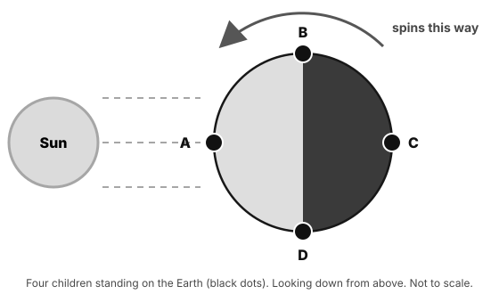

# Year 3 English — Week 31
## Content text: *Why Do We Have Day and Night?* (Science — Earth & Space: the Earth spins)
## Reading toolkit: 🎬 Visualise · Grammar: sentence punctuation · Spelling: *igh*

**Name:** ______________________ **Date:** ____________

**Learning intentions — by the end of this workbook I can:**
- *(world)* explain that day and night happen because **the Earth spins**, not because the Sun moves
- *(reading)* **visualise** — make a picture in my mind while I read — and use it to check that I understand
- *(reading)* find answers that are **right there** in the text, and answers I need to **think and search** for
- *(grammar)* start a sentence with a **capital letter** and end it with a **full stop** or **question mark**
- *(spelling)* spell words with **igh**, like *night* and *light*

---

## Part A · Warm-up ⏱ ~5 min

**1. Quick check.** Circle **true** or **false**.

| | | |
|---|---|---|
| a) Perth is a city in Western Australia. | true | false |
| b) The Earth is flat, like a plate. | true | false |
| c) The Sun is a star. | true | false |
| d) It is summer in Australia at Christmas. | true | false |

**2. Fix the sentence.** It needs **two** capital letters and a full stop.

*we went to the beach in perth*

<!-- lines:2 -->

**3. Spell it.** Your tutor will say three words. Write them here.

1. ______________ 2. ______________ 3. ______________

---

## Part B · Before reading ⏱ ~7 min

> **🌏 Big Idea**
> Day and night happen because **the Earth spins**. When our side of the Earth faces the Sun, it is day. When our side turns away from the Sun, it is night.

**4. What do I already think?** Before you read, finish this sentence. (There is no wrong answer yet! We will come back to it.)

*I think we have night because …*

<!-- lines:2 -->

**5. Key words.** Read each word and its meaning with your tutor. Then draw a tiny picture to help you remember.

| Word | What it means | My picture |
|---|---|---|
| **spin** | to turn around and around, like a top | |
| **Earth** | the planet we live on; it is shaped like a ball | |
| **sunlight** | the light that comes from the Sun | |
| **sunrise** | the time in the morning when the Sun first appears | |
| **sunset** | the time in the evening when the Sun disappears | |
| **planet** | a very big, round object that travels around the Sun | |

> **🎬 Reading toolkit card: VISUALISE**
> Good readers make a **movie in their mind** while they read. If the movie stops making sense, they **stop and re-read**.
>
> *Watch your tutor try it:* "The Earth is a giant ball." → *I picture a huge blue and green ball floating in black space. I can see Australia on it.* "It is spinning." → *Now I make my ball turn slowly, like a spinning top.*

---

## Part C · Read in chunks ⏱ ~15 min
*Read one chunk at a time. After each chunk, stop and do the 🛑 check.*

> ### Why Do We Have Day and Night?
>
> #### Chunk 1 · A giant spinning ball
> The Earth is the planet we live on. It is shaped like a giant ball. The Earth is always **spinning**. It turns around and around, like a spinning top. We cannot feel it moving, because everything on the Earth moves with it. The ground, the houses, the trees and the air all spin together.

**🛑 Stop and check 1.** 🎬 In the box, draw the movie in your mind: the Earth spinning in space.

<!-- draw:5 -->

What shape is the Earth? ____________________

> ### Chunk 2 · Light on one side
> The Sun is a star. It is a huge ball of very hot, glowing gas. The Sun gives us light and heat. The Sun can only light up **one half** of the Earth at a time. The half that faces the Sun is bright. It has **day**. The other half faces away from the Sun, into dark space. It has **night**.

**🛑 Stop and check 2.** Look at the picture below. Put your finger on the half of the Earth that has **day**.

Finish the sentence: *The half of the Earth that faces the Sun has* ________________.

> ### Chunk 3 · Sunrise and sunset
> As the Earth spins, our home turns slowly into the sunlight. That is **sunrise**, and morning begins. The Sun seems to climb up from the east. Later, our home turns away from the Sun. That is **sunset**, and the sky gets dark in the west. It looks like the Sun is moving across the sky. But the Sun is not moving around us. **We** are the ones moving! It is like riding on a merry-go-round. The trees and people around you seem to slide past, but really, you are the one turning.

**🛑 Stop and check 3.** 🎬 Close your eyes and picture riding a merry-go-round. What seems to move past you? ____________________

Is the Sun really moving around the Earth? Circle: **yes** / **no**

> ### Chunk 4 · One spin, one day
> The Earth takes about **24 hours** to spin around once. That is one whole day and one whole night. When it is day in Perth, it is night on the other side of the world, in places like England. While you are eating lunch, children in England are fast asleep! The Earth also travels around the Sun. That long trip takes one whole **year**. So remember: **one spin is one day**, and **one trip around the Sun is one year**.

**🛑 Stop and check 4.** How long does the Earth take to spin around once? ____________________

> **Glossary**
> **east** — the direction where the Sun rises · **west** — the direction where the Sun sets · **glowing** — giving out light · **merry-go-round** — a fairground ride that turns in a circle

---

## Part D · After reading ⏱ ~12 min

*👆 Right there = the answer is in one place. 🔍 Think and search = put two parts together. 💭 Author and me = use the text **and** what you know.*

**6. 👆 Right there (Chunk 1).** Why can't we feel the Earth spinning?

*We can't feel it because …*

<!-- lines:2 -->

**7. 👆 Right there (Chunk 2).** Tick (✓) the **two** things the Sun gives us.

☐ light  ☐ rain  ☐ heat  ☐ wind

**8. 👆 Right there (Chunk 4).** When it is day in Perth, what is it in England? ____________________

**9. 🔍 Think and search (Chunks 2 and 3).** Number these in order, 1 to 4.

- ___ Our home turns away from the Sun. It is sunset.
- ___ Our home turns into the sunlight. It is sunrise.
- ___ Our home faces away from the Sun. It is night.
- ___ Our home faces the Sun. It is day.

*(Start with sunrise as number 1.)*

**10. 🔍 Think and search (Chunks 3 and 4).** Match the beginning to the right ending. Draw a line.

| | | |
|---|---|---|
| One spin of the Earth … | | … takes one year. |
| One trip around the Sun … | | … is when morning begins. |
| Sunrise … | | … takes one day. |

**11. 💭 Author and me.** Why does the writer talk about a **merry-go-round**? How does it help you understand?

*The merry-go-round helps me understand that …*

<!-- lines:3 -->

**12. 💭 Author and me.** Your friend in England sends you a video at their lunchtime. Would it be light or dark outside your window in Perth? How do you know?

<!-- lines:3 -->

---

## Part E · Big Idea check ⏱ ~5 min

**13. Is Sam right?**

> Sam says: *"At night the Sun goes around to the back of the Earth and hides."*

Circle: **Sam is right** / **Sam is wrong**. Explain what really happens.

*Really, the Sun … The Earth …*

<!-- lines:3 -->

**14. True, false or not in the text?** Tick one box for each.

| | True | False | Not in the text |
|---|---|---|---|
| a) The Earth spins around and around. | ☐ | ☐ | ☐ |
| b) The Sun moves around the Earth every day. | ☐ | ☐ | ☐ |
| c) Half of the Earth has day while the other half has night. | ☐ | ☐ | ☐ |
| d) The Earth takes about 24 hours to spin around once. | ☐ | ☐ | ☐ |
| e) The Earth has seven continents. | ☐ | ☐ | ☐ |

**15. Look back.** Read what you wrote in **Question 4**. Was your idea right? Write the Big Idea in your own words.

*Now I know that we have night because …*

<!-- lines:3 -->

---

## Part F · Grammar & punctuation: sentences ⏱ ~8 min

> **✏️ Rule box**
> A **sentence** is a group of words that makes sense on its own.
> - Every sentence **starts with a capital letter**.
> - A **telling sentence** ends with a **full stop** ( **.** ) → *The Earth spins.*
> - An **asking sentence** (a question) ends with a **question mark** ( **?** ) → *Why do we have night?*
> - Names of people and places also get capitals: **P**erth, **E**ngland, **S**am.
> - The word **I** is always a capital letter.

**16. Telling or asking?** Put a full stop ( . ) or a question mark ( ? ) at the end of each sentence.

a) The Sun is a star ☐
b) Why does the Sun look like it moves ☐
c) It is night in England ☐
d) How long does the Earth take to spin ☐
e) I can see the sunset ☐

**17. Fix it.** Each sentence has **capital letter** and **full stop** mistakes. Write it correctly.

a) *the earth spins around once every day*

<!-- lines:2 -->

b) *at night i can see the moon and the stars*

<!-- lines:2 -->

c) *my cousin lives in england*

<!-- lines:2 -->

**18. Ask a question.** Write **one** question you still have about day and night. Remember the capital letter and the question mark!

<!-- lines:2 -->

---

## Part G · Spelling: *igh* ⏱ ~7 min

> **🔤 Spelling pattern: igh**
> The letters **i-g-h** together make the long **i** sound, like in *n**igh**t*. The **g** and **h** are quiet!
> Lots of these words end in **ight**: n**ight**, l**ight**, br**ight**.

**19. Fill the gap.** Write **igh** to finish each word, then read it aloud.

| | | |
|---|---|---|
| n _ _ _ t | l _ _ _ t | br _ _ _ t |
| s _ _ _ t | r _ _ _ t | t _ _ _ t |
| h _ _ _ | fl _ _ _ t | m _ _ _ t |

**20. Choose the word.** Use a word from the box to finish each sentence.

*night · bright · light · right · high*

a) The Sun gives us heat and ______________.
b) It is dark at ______________.
c) The midday Sun is very ______________, so wear a hat!
d) The Sun looks ______________ in the sky at lunchtime.
e) Is that the ______________ answer?

**21. Look, say, cover, write, check.** Look at the word. Say it. Cover it. Write it. Check it — tick if right!

| Word | Write it | ✓ | Write it again | ✓ |
|---|---|---|---|---|
| night | | | | |
| light | | | | |
| bright | | | | |
| right | | | | |
| sight | | | | |
| high | | | | |
| sunlight | | | | |
| tonight | | | | |

**22. Dictation.** Your tutor will read a sentence. Write it carefully, with a capital letter and a full stop.

<!-- lines:2 -->

---

## Part H · Writing: explain it to a younger child ⏱ ~10 min

**Task:** A Year 1 child asks you, *"Where does the Sun go at night?"* Use the sentence starters to explain. Then draw a picture to go with it.

**Sentence starters**
1. *The Earth is …*
2. *The Sun …*
3. *When our side of the Earth faces the Sun, …*
4. *When our side turns away from the Sun, …*
5. *So the Sun does not …*

<!-- lines:9 -->

**My picture**

<!-- draw:6 -->

**Checklist** (tick when done)
- [ ] I used the word **spins**.
- [ ] I said what makes **day** and what makes **night**.
- [ ] Every sentence starts with a capital letter.
- [ ] Every sentence ends with a full stop.

---
### Self-check
| I can… | 😀 | 🙂 | 😕 |
|---|---|---|---|
| explain why we have day and night | | | |
| make a movie in my mind while I read | | | |
| find "right there" answers | | | |
| put capital letters, full stops and question marks in the right places | | | |
| spell words with **igh** | | | |

---

## ⚡ Keep going ⏱ ~20 min
*Extra practice. Do as many as you can.*

**K1 ⭐ Word hunt.** Find **four** words in the text that have the **igh** pattern. (Hint: look in Chunks 2, 3 and 4.)

<!-- lines:2 -->

**K2 ⭐ Spin the children.** Look at the picture. Four children (A, B, C and D) are standing on the Earth.

a) Which child is facing **straight towards** the Sun, in the middle of the day? ______
b) Which child is in the **middle of the night**? ______

**K3 ⭐⭐ Think harder.** Look at the picture again. The Earth spins the way the arrow points. Child **B** is just turning **into** the light. Child **D** is just turning **away** from the light.

a) Which child is seeing a **sunrise**? ______
b) Which child is seeing a **sunset**? ______

**K4 ⭐⭐ Question or telling?** Turn each telling sentence into a question. The first one is done for you.

a) The Earth spins. → *Does the Earth spin?*
b) The Sun is a star. → ______________________________________
c) It is night in England. → ______________________________________

**K5 ⭐⭐ Make your own sentences.** Write a sentence for each word: **bright**, **night**.

<!-- lines:4 -->

**K6 ⭐⭐⭐ Your day.** Draw lines to match each time of day to what the Earth is doing for us in Perth.

| | | |
|---|---|---|
| 6 o'clock in the morning | | Perth faces right towards the Sun. |
| 12 o'clock (lunchtime) | | Perth is turning away from the Sun. |
| 7 o'clock in the evening | | Perth is turning into the sunlight. |
| midnight | | Perth faces away from the Sun. |

**K7 ⭐⭐⭐ Be a teacher.** Draw a comic with **three** boxes that shows how the Earth spins to make sunrise, day and sunset. Write one sentence under each box.

<!-- draw:8 -->
