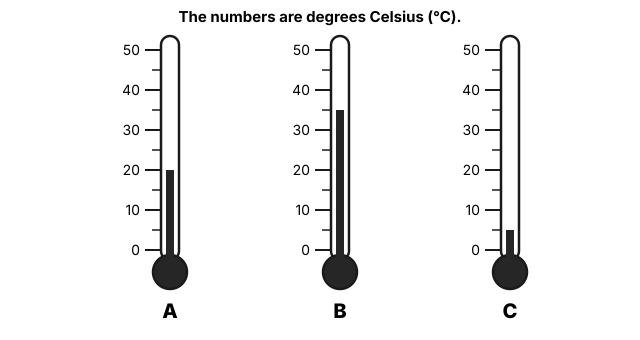
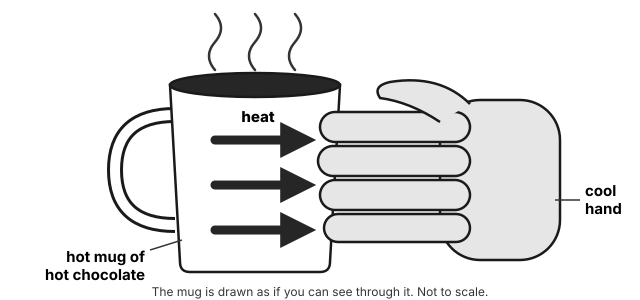
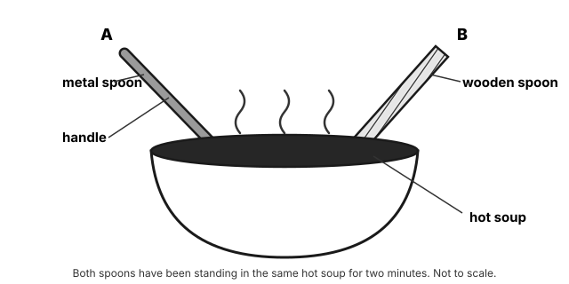
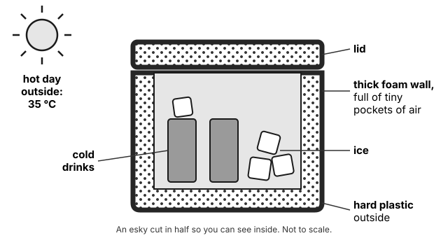

# Year 3 English — Week 32
## Content text: *The Great Ice Block Race* (Narrative · Science — Physical: heat moves from hot to cold)
## Reading toolkit: ➡️ Cause and effect · Grammar: past tense *-ed* · Spelling: *-ed* endings (three sounds)

**Name:** ______________________ **Date:** ____________

**Learning intentions — by the end of this workbook I can:**
- *(world)* explain that **heat always moves from something hotter to something colder**, until they are the same temperature
- *(world)* explain why things **feel** cold, why metal feels colder than wood, and how **insulators** like a jumper or an esky slow heat down
- *(reading)* find **causes and effects** using *because*, *so* and *as a result*
- *(reading)* talk about a story's **characters, setting, problem and resolution**, and compare a story, an information text and an advertisement
- *(grammar)* write verbs in the **past tense**, including *was, made, felt, froze*
- *(spelling)* hear the **three sounds of *-ed*** and use the rules for adding it: *stopped*, *baked*, *dried*

---

## Part A · Warm-up ⏱ ~5 min

**1. Quick check.** Circle **true** or **false**.

| | | |
|---|---|---|
| a) The Earth spins on its axis about once every 24 hours. | true | false |
| b) At night, the Sun goes to sleep behind the hills. | true | false |
| c) The Sun gives the Earth light and heat. | true | false |
| d) The Sun rises in the west. | true | false |
| e) A thick jumper makes heat. | true | false |
| f) Heat can move from one thing to another. | true | false |

**2. Fix the sentences.** Add capital letters and the correct end mark (**.** **?** **!**). Then write what kind of sentence each one is: **statement**, **question**, **exclamation** or **command**.

a) *why is it dark at night* → ______________

<!-- lines:1 -->

b) *wow, the sunset at cottesloe was amazing* → ______________

<!-- lines:1 -->

c) *shine the torch at the orange* → ______________

<!-- lines:1 -->

**3. Spell it.** Your tutor will say five words. Write them here.

1. ______________ 2. ______________ 3. ______________ 4. ______________ 5. ______________

---

## Part B · Before reading ⏱ ~7 min

> **🌏 Big Idea**
> Heat always moves **from something hotter to something colder**, until they are the same temperature. When something feels cold, it is because **heat is leaving your hand**. Cold does not move into things.

**4. What do I already think?** Before you read, finish the sentence. (There is no wrong answer yet — we will come back to it!)

*When I hold an ice block, my hand feels cold because …*

<!-- lines:2 -->

**5. Key words.** Read each word and its meaning with your tutor. Then write or draw something to help you remember it.

| Word | What it means | My clue (word or picture) |
|---|---|---|
| **heat** | a kind of energy that makes things warm or hot | |
| **temperature** | how hot or cold something is | |
| **degrees Celsius (°C)** | the units we use to measure temperature in Australia | |
| **thermometer** | a tool that measures temperature | |
| **conductor** | a material that lets heat move through it **quickly**, like metal | |
| **insulator** | a material that **slows heat down**, like wood, wool, plastic or foam | |
| **source** | the place something comes from; a source of heat gives out heat | |
| **friction** | rubbing between two things; it makes heat | |

> **➡️ Reading toolkit card: CAUSE AND EFFECT**
> A **cause** is *why* something happens. An **effect** is *what* happens.
> Signal words help you find them: **because** (the cause comes next) · **so** and **as a result** (the effect comes next).
> One effect can become the cause of the next thing. That makes a **chain**.
>
> *Watch your tutor try it:* "The Sun had been shining on the sand all morning, so it was very hot." → *I see the word* **so**. *The part after "so" is what happened: the sand was very hot. That's the* **effect**. *The part before "so" is why: the Sun had been shining on it. That's the* **cause**. *Then Leo stood on the hot sand, so his feet hurt. The hot sand was an effect — now it's a cause too! It's a chain: Sun shines → sand gets hot → Leo's feet burn.*

---

## Part C · Read in chunks ⏱ ~15 min

> **📚 Text types this week**
> **Text 1** is a **story** (a narrative): it has characters, a setting, a problem and a resolution.
> **Text 2** is an **information text**: it tells you facts.
> **Text 3** is an **advertisement**: it tries to make you buy something.
> All three are about heat. Watch how each one does a different job.

*Read one chunk at a time. After each chunk, stop and do the 🛑 check before you read on.*

> ### The Great Ice Block Race
>
> #### Chunk 1 · A scorching day
> It was the first Saturday of the summer holidays. The sign at Cottesloe Beach said the air was 35 °C. Ruby and her little brother Leo raced ahead of Nan.
>
> "Ouch! Ouch! OUCH!" Leo hopped from one foot to the other. The dry sand burned his feet like a hot frying pan, so he dashed down to the wet sand.
>
> "Why is the sand so hot?" he cried.
>
> "The Sun has been shining on it all morning," said Nan, as she dragged the esky into the shade. "The sand soaked up the Sun's heat, so now it is much hotter than your feet. Heat always moves from something hotter to something colder. That heat rushed into your feet!"
>
> Ruby splashed into the sea. The sign said the water was only 20 °C. "The water isn't hot at all!"
>
> "Water needs much more heat to warm up than sand does," Nan explained. "That's why the sea stays cool."

**🛑 Stop and check 1.**
a) **Setting:** Where and when does the story happen?

<!-- lines:2 -->

b) ➡️ Why did Leo's feet hurt? Use **because**.

<!-- lines:2 -->

> ### Chunk 2 · The challenge
> After a swim, Nan opened the esky. Between the cold drinks sat two big blocks of ice. Nan made them the night before. She filled two yoghurt tubs with water and put them in the freezer, and the water froze solid.
>
> "Here's a challenge," said Nan, and handed one to each child. "Whoever keeps their ice block frozen the longest wins the Great Ice Block Race."
>
> Leo grinned and grabbed a metal tray from the beach bag. Earlier, in the shady car park, he had touched it, and it felt icy cold. "Metal is cold," he said, "so I'll put my ice on this tray. The cold will stay in!" He put the tray on the sand in the sunshine.
>
> Ruby thought hard. Then she wrapped her ice block in a thick tea towel and pushed it back into the esky.
>
> Leo laughed. "A tea towel is like a jumper! It will make your ice warm, so it will melt first!"
>
> Ruby just smiled and closed the lid.

**🛑 Stop and check 2.**
a) **Characters:** Who are the three characters? ______________, ______________ and ______________

b) What was Leo's plan, and **why** did he think it would work?

<!-- lines:3 -->

> ### Chunk 3 · Leo's melting mistake
> Ten minutes later, Leo gasped. His ice block sat in a big puddle, and water was dripping off the tray.
>
> "The cold is leaking out of my ice!" he wailed.
>
> Nan shook her head. "Cold doesn't leak out, Leo. Cold isn't something that moves. It's the **heat** that moves. The Sun heated your tray. Now heat is moving from the hot tray and the hot air into your ice. As a result, your ice is melting."
>
> "But the tray felt cold this morning!" said Leo.
>
> "It only *felt* cold," said Nan. "In the shade, the tray was the same temperature as the air around it. But metal is a **conductor**. It carries heat away from your warm hand very quickly. Your hand loses heat, so the metal feels cold. Now the hot tray is carrying heat into your ice just as quickly!"

**🛑 Stop and check 3.**
a) ➡️ What made Leo's ice melt so fast? Finish the sentence: *Leo's ice melted quickly because …*

<!-- lines:2 -->

b) How did Leo **feel** when he saw the puddle? Which word tells you?

<!-- lines:2 -->

> ### Chunk 4 · Ruby's secret
> "Ruby's ice must be melting too," said Leo. "That tea towel is keeping it warm."
>
> "A tea towel doesn't make heat," said Nan. "Neither does a jumper. When you wear a jumper in winter, *your body* makes the heat. The jumper is an **insulator**. It traps air and slows down the heat leaving your body, so you stay warm."
>
> "So the tea towel slows the heat down too?" asked Ruby.
>
> "Exactly! It slows down the heat getting **in** to your ice. And the esky has thick foam walls. Foam is full of tiny pockets of air, so it is a good insulator. Heat from this hot day can only get in very slowly."
>
> Leo frowned at his puddle. "I picked a conductor," he said slowly, "and Ruby picked two insulators."

**🛑 Stop and check 4.**
a) Name the **two** insulators that kept Ruby's ice cold. ______________ and ______________

b) Nan says a jumper does **not** make heat. What does it do?

<!-- lines:2 -->

> ### Chunk 5 · The winner
> An hour later, Leo's tray held only a warm puddle. Ruby unwrapped her tea towel. Her ice block was smaller, but it was still frozen solid.
>
> "Ruby wins the Great Ice Block Race!" announced Nan.
>
> "Will her ice stay frozen forever if she keeps it in there?" asked Leo.
>
> "No," said Nan. "Heat always gets in, in the end. It keeps moving into the ice until the ice melts, and the water is the same temperature as everything around it. Insulators just make it happen more slowly."
>
> Leo tipped his puddle onto the sand and smiled. "Next time, I'm wrapping mine in **two** tea towels," he said, "and keeping it away from that tray!"
>
> Nan laughed and handed out ice blocks — the kind you eat. They ate them quickly, before the heat could win again.

**🛑 Stop and check 5.**
a) Who won the race? ______________

b) Will Ruby's ice stay frozen forever? Why not?

<!-- lines:2 -->

> **Glossary**
> **scorching** — very, very hot · **dashed** — ran quickly · **soaked up** — took in · **gasped** — took a quick, loud breath in surprise · **wailed** — cried out loudly and sadly · **frozen solid** — turned completely into ice · **announced** — told everyone

---

## Part D · After reading ⏱ ~18 min

*👆 Right there = the answer is in one place. 🔍 Think and search = put two or more parts together. 💭 Author and me = use the text **and** what you know.*

### Text 1 · The story

**6. 👆 Right there (Chunk 2).** How did Nan make the ice blocks?

<!-- lines:3 -->

**7. 🔍 Think and search (Chunks 1 and 4).** Three thermometers were used on the beach that day. One measured the **air**, one measured the **sea**, and one was inside the **esky** with the ice.

| Thermometer | Temperature it shows | What it measured (air, sea or esky) |
|---|---|---|
| A | ______ °C | |
| B | ______ °C | |
| C | ______ °C | |

**8. 🔍 Think and search.** ➡️ Fill in the **cause-and-effect chain** for Leo's ice block. Use Chunks 2, 3 and 5.

| | What happened |
|---|---|
| 1 | Leo put his ice block on a metal tray, out in the sunshine. |
| ⬇ *so* | |
| 2 | |
| ⬇ *so* | |
| 3 | Heat moved from the hot tray and the hot air into the ice. |
| ⬇ *as a result* | |
| 4 | |
| ⬇ *so* | |
| 5 | |

**9. 🔍 Story map.** Fill in the story map.

| Story part | My answer |
|---|---|
| **Characters** (who?) | |
| **Setting** (where and when?) | |
| **Problem** (what goes wrong for Leo?) | |
| **Resolution** (how does it end?) | |

**10. 💭 Author and me (Chunk 2).** *"Ruby just smiled and closed the lid."* Why do you think Ruby smiled instead of arguing with Leo?

<!-- lines:3 -->

**11. 💭 Author and me.** Leo said, *"Metal is cold."* Was he right? Explain why the tray **felt** cold in the car park.

<!-- lines:4 -->

**12. 💭 Author and me.** This is a story, but it teaches science. **How** does the writer help us understand the science? Give **one** example.

<!-- lines:3 -->

**13. Word detective.** Find each word in the story. Circle the meaning that fits **how it is used**.

a) **scorching** (Chunk 1 heading): very, very hot · burnt and black · windy
b) **wailed** (Chunk 3): whispered · laughed · cried out loudly and sadly
c) **ice block** means two different things in this story. What is the ice block in **Chunk 2**? What is the ice block at the end of **Chunk 5**?

<!-- lines:2 -->

**14. Text features.**
a) How do you know when a character is speaking?

<!-- lines:1 -->

b) Why is **OUCH!** in Chunk 1 written in capital letters?

<!-- lines:2 -->

### Text 2 · Information

> ### The Science Behind the Story
>
> #### Where does heat come from?
> Heat is a kind of energy. Things that give out heat are called **sources** of heat. The Sun is our biggest source. Fire, electricity (in toasters and heaters) and **friction** (rub your hands together quickly!) make heat too. Your body makes its own heat, so the inside of your body stays at about 37 °C.
>
> #### Heat moves from hot to cold
> Heat always moves from something hotter to something colder, until they are the same temperature. When heat moves between two things that are touching, it is called **conduction**. Things feel cold to touch because heat is leaving your body.
>
> #### Conductors and insulators
> **Conductors**, like most metals, let heat move through them quickly. **Insulators**, like wood, plastic, wool, foam and trapped air, slow heat down.
>
> #### Measuring temperature
> A **thermometer** measures temperature in **degrees Celsius** (°C). Water freezes at 0 °C and boils at 100 °C.

**15. 👆 Right there.** Name **three** sources of heat that are **not** the Sun.

<!-- lines:2 -->

**16. 🔍 Look at the dark arrows** in the mug picture.
a) Where does the heat **start**, and where does it **go**?

<!-- lines:2 -->

b) What will happen to the hot chocolate if you hold the mug for a long time? Why?

<!-- lines:3 -->

**17. 💭 Look at the spoons.** Which handle, **A** or **B**, would be too hot to hold? ______ Explain why, using the words **conductor** and **insulator**.

<!-- lines:4 -->

**18. 🔍 Think and search (Text 1 and Text 2).** Which heading in *The Science Behind the Story* would help you explain why Ruby won the race? ________________________________

### Text 3 · Advertisement

> ### Keep It Cool with the CHILL-MAX Esky!
>
> **Hot day? No worries!**
>
> Are you tired of warm drinks and melted ice at the beach? Then **you** need a Chill-Max!
>
> - Its thick foam walls are full of tiny pockets of air, so they slow down the heat trying to get in.
> - A tight lid keeps the hot air out.
> - Strong handles make it easy to carry across the sand.
>
> The Chill-Max keeps your ice frozen **FOREVER**! It is the best esky in the whole world, and every family in WA needs one!
>
> **Only $49. Get yours today!**
>
> ***Chill-Max — the coolest box on the beach!***
>
> *(The Chill-Max is a made-up product.)*

**19. Purpose.** Circle what this text is trying to do: **entertain** / **inform** / **persuade**

**20. Slogan.** A slogan is a short, catchy phrase that is easy to remember. Copy the slogan.

<!-- lines:1 -->

**21. 💭 Is it true?** The advertisement says the Chill-Max keeps your ice frozen **FOREVER**. Use what you learnt in the story to explain why this cannot be true.

<!-- lines:3 -->

**22. Fact or opinion?** A **fact** can be checked. An **opinion** is what someone thinks or feels. Tick one box for each.

| | Fact | Opinion |
|---|---|---|
| a) The Chill-Max costs $49. | ☐ | ☐ |
| b) It is the best esky in the whole world. | ☐ | ☐ |
| c) Foam is full of tiny pockets of air. | ☐ | ☐ |
| d) Every family in WA needs one. | ☐ | ☐ |

**23. Compare the texts.** Complete the table.

| | Text 1: story | Text 2: information | Text 3: advertisement |
|---|---|---|---|
| **Purpose** (entertain, inform or persuade) | | | |
| **Who is it for?** | | | |
| **One feature** that shows what type of text it is | | | |

---

## Part E · Big Idea check ⏱ ~6 min

**24. Is Sam right?**

> Sam says: *"My metal water bottle is colder than my plastic lunchbox. I can tell, because it feels colder when I touch it. They have both been in my school bag all morning."*

Circle: **Sam is right** / **Sam is wrong**. Explain. Use the words **same temperature**, **conductor** and **heat**.

<!-- lines:5 -->

**25. Explain the diagram.**
a) Draw **two** arrows on the esky picture to show which way the heat moves on this hot day.

b) Why does the esky have thick foam walls? Use **because** or **so**.

<!-- lines:3 -->

**26. True, false or not in the text?** Use all three texts. Tick one box for each.

| | True | False | Not in the text |
|---|---|---|---|
| a) Heat moves from hotter things to colder things. | ☐ | ☐ | ☐ |
| b) Cold moves from an ice block into your hand. | ☐ | ☐ | ☐ |
| c) A jumper makes heat to keep you warm. | ☐ | ☐ | ☐ |
| d) Foam is a good insulator. | ☐ | ☐ | ☐ |
| e) Water freezes at 0 °C. | ☐ | ☐ | ☐ |
| f) Leo's tray was colder than the air in the car park. | ☐ | ☐ | ☐ |
| g) Silver is one of the best conductors of heat. | ☐ | ☐ | ☐ |
| h) Nan lives in Fremantle. | ☐ | ☐ | ☐ |

**27. Look back.** Read what you wrote in **Question 4**. Was your idea right, partly right or wrong? Write the Big Idea in your own words.

*Now I know that …*

<!-- lines:3 -->

---

## Part F · Grammar & punctuation: past tense verbs ⏱ ~10 min

> **✏️ Rule box**
> A **verb** is a doing, being or feeling word. **Past tense** verbs tell us that something **already happened**. Stories are often told in the past tense.
> - Most verbs just add **-ed**: grab → grab**bed**, laugh → laugh**ed**, melt → melt**ed**, splash → splash**ed**
> - Some verbs change in their own way. These are **irregular**: is → **was**, make → **made**, feel → **felt**, freeze → **froze**, say → **said**, sit → **sat**
>
> *From the story:* "Leo **laughed**." · "The water **froze** solid overnight." · "It **felt** icy cold." · "The night before, Nan **made** them."

**28. Hunt in Chunk 2.** Find **four** past tense verbs that end in **-ed**, and **three** irregular past tense verbs.

| -ed verbs | Irregular verbs |
|---|---|
| | |
| | |
| | |
| | *(leave blank)* |

**29. Yesterday …** Write the verb in the **past tense**.

a) Yesterday it ______________ (is) very hot.
b) We ______________ (walk) to the beach after lunch.
c) The sand ______________ (feel) like a hot frying pan.
d) I ______________ (jump) over the waves.
e) Mum ______________ (make) some cheese sandwiches.
f) The water in my bottle ______________ (freeze) in the freezer.
g) My ice block ______________ (melt) in the sun.
h) I ______________ (wipe) my sticky hands on my towel.

**30. Be an editor.** This recount has **eight** verbs in the wrong tense. Find them and write them correctly in the past tense.

*Last Sunday my family go to Hillarys Boat Harbour. It is a very hot day. I run across the sand and splash into the cool water. Then Dad buy us ice blocks. Mine melt very fast, so it drip down my arm. My hand feel sticky, so I rinsed it in the sea.*

1. ____________ 2. ____________ 3. ____________ 4. ____________
5. ____________ 6. ____________ 7. ____________ 8. ____________

**31. Your turn.** Write **two** sentences about a time you felt very hot or very cold. Use the past tense. Use **because** in one sentence and **so** in the other.

<!-- lines:2 -->

<!-- lines:2 -->

---

## Part G · Spelling: *-ed* endings ⏱ ~8 min

> **🔤 Spelling pattern: -ed**
> **-ed** is always spelt the same, but it can make **three different sounds**. Say each word aloud and listen to the end.
> - /t/ as in jump**ed** · /d/ as in warm**ed** · /id/ as in melt**ed**
> *Tip:* you hear /id/ when the word ends in **t** or **d**: melt → melt**ed**, need → need**ed**.
>
> **Rules for adding -ed**
> - **Double it:** short vowel + one consonant → double the last letter: stop → sto**pp**ed, trap → tra**pp**ed
> - **Drop the e:** the word ends in **e** → just add **d**: bake → bak**ed**, smile → smil**ed**
> - **y → i:** consonant + **y** → change y to **i**: dry → dr**ied**, carry → carr**ied**
> - *But* a vowel + **y** keeps the y: play → play**ed**

**32. Say and sort.** Say each word aloud. Write it under the sound its **-ed** makes.

*jumped · melted · warmed · touched · heated · cooled · dripped · lifted · filled · kicked · needed · rained*

| /t/ (jumped) | /d/ (warmed) | /id/ (melted) |
|---|---|---|
| | | |
| | | |
| | | |
| | | |

**33. Use the rules.** Add **-ed**. Watch out for the rule!

a) stop → ______________ b) bake → ______________ c) dry → ______________
d) hug → ______________ e) use → ______________ f) carry → ______________
g) drip → ______________ h) smile → ______________ i) try → ______________
j) play → ______________ k) wrap → ______________ l) cry → ______________

**34. Look, say, cover, write, check.**

| Word | Write it | ✓ | Write it again | ✓ |
|---|---|---|---|---|
| warmed | | | | |
| cooled | | | | |
| melted | | | | |
| heated | | | | |
| jumped | | | | |
| touched | | | | |
| stopped | | | | |
| trapped | | | | |
| baked | | | | |
| used | | | | |
| dried | | | | |
| carried | | | | |

**35. Dictation.** Your tutor will read **two** sentences. Write them carefully.

<!-- lines:4 -->

---

## Part H · Writing: Leo's diary ⏱ ~12 min

**Task:** That night, Leo wrote in his diary. Write Leo's **recount** of the day (80–120 words). Tell what happened in the Great Ice Block Race, **and explain why** his ice melted first and Ruby's lasted longest. Write as Leo (use **I**), in the **past tense**.

**Plan first:**

| Part of my recount | My notes |
|---|---|
| When and where? Who was there? | |
| What I did with my ice block | |
| What Ruby did with hers | |
| What happened to my ice (the problem) | |
| **Why** it happened (heat moved from … to …) | |
| How it ended, and what I learned | |

**Word bank:** *scorching · melted · dripped · wrapped · puddle · heat · moved · hotter · colder · conductor · insulator · because · so · as a result · first · then · finally*

> **Need a start?** *Today Nan took Ruby and me to Cottesloe Beach. …* · *I put my ice block on …* · *Nan explained that …*

<!-- lines:18 -->

**Checklist** (tick when done)
- [ ] I said when, where and who at the start.
- [ ] I told the events in order, using time words (*first, then, finally*).
- [ ] I explained **why** using the idea that heat moves from hot to cold.
- [ ] I used **because**, **so** or **as a result** at least twice.
- [ ] All my verbs are in the **past tense**.
- [ ] Every sentence starts with a capital letter and has the right end mark.

---
### Self-check
| I can… | 😀 | 🙂 | 😕 |
|---|---|---|---|
| explain that heat moves from hot to cold | | | |
| explain why metal feels colder than wood | | | |
| find causes and effects (*because*, *so*, *as a result*) | | | |
| name the characters, setting, problem and resolution of a story | | | |
| tell a story, an information text and an advertisement apart | | | |
| write verbs in the past tense | | | |
| spell words ending in **-ed** | | | |

---

## ⚡ Keep going ⏱ ~25 min
*Extra practice and challenge. Do as many as you can.*

**K1 ⭐ Word hunt.** Find **six** verbs ending in **-ed** in Chunks 1 and 3. Write each one under the sound its **-ed** makes.

| /t/ | /d/ | /id/ |
|---|---|---|
| | | |
| | | |

**K2 ⭐ Conductor or insulator?** Sort these things.

*metal saucepan · woollen beanie · wooden spoon · steel fork · foam cup · plastic plate · aluminium foil · oven mitt*

| Conductor (heat moves through quickly) | Insulator (slows heat down) |
|---|---|
| | |
| | |
| | |
| | |

**K3 ⭐⭐ Thermometer maths.** Look at the thermometers again (Question 7).
a) How many degrees hotter was the **air** than the **sea**? ______ °C
b) How many degrees hotter was the **sea** than the **inside of the esky**? ______ °C
c) Late in the afternoon, the air cooled down by 10 degrees. What was the temperature then? ______ °C

**K4 ⭐⭐ A cooling drink.** Ruby made a mug of hot chocolate and left it on the kitchen bench. The kitchen was 22 °C. She checked it every 5 minutes with a thermometer.

| Time (minutes) | 0 | 5 | 10 | 15 | 20 | 25 | 30 |
|---|---|---|---|---|---|---|---|
| Temperature (°C) | 80 | 68 | 59 | 51 | 45 | 40 | 36 |

a) What was the temperature at the start? ______ °C b) After 15 minutes? ______ °C
c) How much did it cool in the **first** 5 minutes? ______ °C d) In the **last** 5 minutes? ______ °C
e) ➡️ Why did the hot chocolate cool down? Use **because**.

<!-- lines:2 -->

f) ⭐⭐⭐ If Ruby forgot about it all day, would the hot chocolate ever get as cold as 10 °C on the bench? Explain.

<!-- lines:3 -->

**K5 ⭐⭐ A poem.** Read this poem aloud.

> ### Hot Sand
> The sand is a frying pan, hot on my feet,
> I hop to the water to get out of the heat.
> The cool waves are taking the heat out of me,
> I float on my back in the shimmering sea.
> My ice block is dripping, it's sticky and sweet —
> The Sun's heat is stealing my cold summer treat!

a) Find **three** pairs of rhyming words. ______ / ______ ______ / ______ ______ / ______
b) The poet says "the sand is a frying pan". What does this tell you about the sand?

<!-- lines:2 -->

c) Which line shows the poet knows that heat moves **from hot to cold**? Copy it.

<!-- lines:2 -->

**K6 ⭐⭐⭐ Was the race fair?** Ruby used a tea towel **and** the esky. Leo used a metal tray **in the sun**. Was it a fair test of which material is best? Explain, then plan a fairer race. What would you keep **the same**?

<!-- lines:5 -->

**K7 ⭐⭐⭐ What happened next?** The next Saturday, Leo and Ruby had a rematch. Write the next part of the story (6–8 sentences). Use dialogue, the past tense, and **because** or **so** to show the science.

<!-- lines:10 -->
