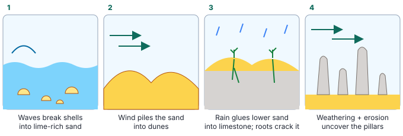

# Year 4 English — Week 1
## Content text: *The Pinnacles: Statues Carved by Time* (Science — Earth & Space: Earth's changing surface)
## Literacy focus: Main idea & detail · Noun groups · Precise adjectives · Topic vocabulary

**Name:** ______________________ **Date:** ____________

**Learning intentions — by the end of this worksheet I can:**
- *(content)* explain the difference between **weathering** and **erosion**, and how they made the Pinnacles
- *(content)* explain why national parks have rules for visitors
- *(skill)* find the main idea of a paragraph and the details that support it
- *(skill)* build noun groups and choose precise adjectives
- *(skill)* write an informative paragraph with a strong topic sentence

---

## Part A · Warm-up ⏱ ~5 min

1. Sort these words into **nouns**, **verbs** and **adjectives**:
   *rock · crumble · jagged · wind · enormous · blow · desert · ancient · carry*

| Nouns | Verbs | Adjectives |
|---|---|---|
| | | |

2. Fix the sentence (there are **three** mistakes):
   *the wind blowed the sand across the beach and into the dunes*

<!-- lines:2 -->

---

## Part B · Read ⏱ ~10 min

> ### The Pinnacles: Statues Carved by Time
>
> **¶1 A strange desert**
> About two hundred kilometres north of Perth, near the small fishing town of Cervantes, lies one of the strangest landscapes in Australia. In Nambung National Park, thousands of tall limestone pillars rise out of a sea of golden sand. Some are no bigger than a pencil, while the tallest are about three and a half metres high — twice as tall as an adult. Visitors often say it looks like the surface of another planet. These pillars are called the Pinnacles.
>
> **¶2 Made from the sea**
> The story of the Pinnacles begins in the ocean. Over a very long time, the shells of countless sea creatures were broken into tiny pieces by the waves. These pieces were rich in lime, a chalky substance. The wind blew the shell sand inland, where it piled up into enormous sand dunes.
>
> **¶3 Turning sand into stone**
> Next, rain soaked down through the dunes. It slowly dissolved some of the lime and carried it deeper, where it acted like cement and glued the sand grains together. Gradually, the lower layers of the dunes hardened into soft limestone. Plants grew on top, and their roots pushed down into cracks in the rock.
>
> **¶4 Weathering and erosion**
> Two powerful natural processes shaped the limestone into pillars. **Weathering** is when rock is broken down or worn away where it stands, for example by rainwater slowly dissolving it. **Erosion** is when wind, water or ice carries the loose pieces away. Over many thousands of years, rainwater weathered the limestone along its cracks, leaving harder columns standing. Then, when the plants on top disappeared, strong coastal winds eroded the loose sand that had covered them. Bit by bit, the hidden pillars were uncovered, like statues being unwrapped.
>
> **¶5 A landscape that is still changing**
> The Pinnacles are not finished. Today, the wind still blows sand across the desert, uncovering some pillars and burying others. Rain and wind continue to wear away the limestone grain by grain. Hundreds of years from now, the landscape will look different again.
>
> **¶6 Caring for Country**
> The Yued people, who are part of the Noongar nation, are the Traditional Custodians of this land and have cared for it for many thousands of years. Today the national park is also managed by the Western Australian Government. Visitors must follow rules: they must stay on the marked paths, must not climb on the pillars and must not take any rocks away. Although the Pinnacles look tough, the limestone is surprisingly fragile, and one careless climber can snap off a pillar that took thousands of years to form.

> **Glossary**
> **landscape** — the shape and appearance of an area of land · **limestone** — a rock made mostly of lime, often from old shells · **dissolve** — to mix into a liquid and disappear · **fragile** — easily broken · **Traditional Custodians** — the Aboriginal people who have cared for an area of Country for many generations

---

## Part C · Understanding the content ⏱ ~10 min

**1.** *(Find it)* Where are the Pinnacles? Give **two** details.

<!-- lines:2 -->

**2.** *(Find it)* What are the Pinnacles made of, and where did that material first come from?

<!-- lines:2 -->

**3.** *(Order it)* Number the steps in the order they happened (1–6).
- ___ Rain dissolved lime and glued the sand into limestone.
- ___ Waves broke shells into tiny pieces.
- ___ Wind blew away the loose sand and uncovered the pillars.
- ___ The wind blew shell sand inland into dunes.
- ___ Rainwater weathered the limestone along its cracks.
- ___ Plants grew on top and their roots pushed into cracks.

**4.** *(Explain it)* In your own words, what is the difference between **weathering** and **erosion**?
Weathering:

<!-- lines:2 -->
Erosion:

<!-- lines:2 -->

**5.** *(Sort it)* Write **W** for weathering or **E** for erosion.
- ___ A river carries pebbles downstream.
- ___ Rainwater slowly dissolves a limestone cliff.
- ___ Wind blows sand off a dune.
- ___ Tree roots split a rock apart.

**6.** *(Think about it)* The writer says the pillars were uncovered "like statues being unwrapped". Why is this a good comparison?

<!-- lines:3 -->

**7.** *(Think about it)* Why do you think the rules say visitors must not take any rocks away, even small ones? Give **two** reasons.

<!-- lines:4 -->

**8.** *(Think about it)* The writer says the Pinnacles "are not finished". What does this mean? What evidence does ¶5 give?

<!-- lines:3 -->

### 🔗 Connections — English meets maths and HASS
**9.** The text says the tallest Pinnacles are about 3.5 metres, "twice as tall as an adult". If an adult is about 1.75 m tall, is the writer correct? Show how you know.

<!-- lines:2 -->

**10.** The Pinnacles are about 200 km from Perth. If a car travels about 100 km each hour, about how long is the drive? ________ How long is the return trip? ________

**11.** Look at the diagram. Which panel shows **weathering**? Which shows **erosion**? (Hint: one panel shows both!)

<!-- lines:3 -->

**12.** The Yued people are the Traditional Custodians of the Pinnacles area. Find out the name of the Traditional Custodians of the land where **you** live. ________________________

---

## Part D · How the text works ⏱ ~13 min

### D1 Main idea and detail
Each paragraph has **one main idea**. The other sentences give **details** that support it. Often the main idea is in the first sentence — the **topic sentence**.

**13.** Write the main idea of each paragraph in **five words or fewer**. (Don't just copy the heading!)
- ¶2 ______________________________
- ¶3 ______________________________
- ¶5 ______________________________
- ¶6 ______________________________

**14.** Here is a detail: *"Some are no bigger than a pencil."* Which paragraph is it from, and which main idea does it support?

<!-- lines:2 -->

### D2 Noun groups
A **noun group** is a group of words built around a noun. It can include an **article** (a, the), **numbers**, **adjectives** and other describing words. Noun groups help writers give more information in fewer words.

> pillars → limestone pillars → thousands of tall limestone pillars
> wind → winds → strong coastal winds

**15.** Underline the **noun group** and circle the **main noun** in each.
a) *the strangest landscape in Australia*
b) *the shells of countless sea creatures*
c) *a sea of golden sand*
d) *the small fishing town of Cervantes*

**16.** Build each noun into a noun group with **at least three** words in front of it.
a) rock → ________________________________
b) dune → ________________________________
c) wind → ________________________________

### D3 Precise adjectives
Writers choose **precise** adjectives instead of general ones like *big*, *nice* or *good*.

**17.** Replace the underlined general word with a more precise adjective from the box. Use each once.

*towering · fragile · jagged · ancient · gritty*

a) The pillar had **sharp** edges. → ________
b) The **very tall** pinnacle cast a long shadow. → ________
c) The **old** limestone formed thousands of years ago. → ________
d) The thin pillar was **easy to break**. → ________
e) The wind blew **rough** sand into our eyes. → ________

---

## Part E · Vocabulary ⏱ ~5 min

**18.** Match each word to its meaning.

| Word | | Meaning |
|---|---|---|
| a) weathering | | 1) to slowly mix into a liquid |
| b) erosion | | 2) the breaking down of rock where it is |
| c) dissolve | | 3) a long period of time |
| d) gradually | | 4) the carrying away of rock, soil or sand |
| e) fragile | | 5) slowly, a little at a time |
| f) countless | | 6) too many to count |
| | | 7) easily broken |

a) ___ b) ___ c) ___ d) ___ e) ___ f) ___

**19.** Use **erosion** and **gradually** in one sentence of your own about a beach.

<!-- lines:2 -->

---

## Part F · Writing: informative paragraph ⏱ ~15 min

**Task:** Write one paragraph that explains **how the Pinnacles were formed** to someone who has never heard of them.

**Plan first:**

| Topic sentence (main idea) | |
|---|---|
| Detail 1 | |
| Detail 2 | |
| Detail 3 | |
| Concluding sentence | |

**Success criteria** (tick when done)
- [ ] starts with a clear topic sentence
- [ ] explains the steps **in order** (use *first, next, then, over time, finally*)
- [ ] uses **weathering** and **erosion** correctly
- [ ] includes at least **three noun groups** (underline them)
- [ ] includes at least **two precise adjectives**
- [ ] ends with a concluding sentence
- [ ] 80–120 words, in my own words

<!-- lines:16 -->

---

## Part G · Challenge ⏱ ~10 min

**20.** The text says rain "acted like cement". Find **one more** comparison (simile) in the text. Then write **two** of your own similes about the Pinnacles.

<!-- lines:4 -->

**21.** Why do you think the writer put ¶6 (*Caring for Country*) **last**? What does the writer want readers to think or do?

<!-- lines:3 -->

---
### Self-check

| I can… | 😀 | 🙂 | 😕 |
|---|---|---|---|
| explain the difference between weathering and erosion | | | |
| explain how the Pinnacles formed | | | |
| find the main idea of a paragraph | | | |
| build noun groups | | | |
| choose precise adjectives | | | |
| write a paragraph with a topic sentence | | | |

---

## ⚡ Fast-finisher bank ⏱ ~35 min
*Keep going! ⭐⭐⭐⭐ = very challenging.*

**F1 ⭐⭐** Find **five** noun groups in the text that are **not** in Part D. Order them from shortest to longest.

<!-- lines:4 -->

**F2 ⭐⭐ More sorting.** Weathering (**W**) or erosion (**E**)?
- ___ Ocean waves drag pebbles along the beach.
- ___ Water freezes inside a crack and splits the rock.
- ___ A desert rock cracks after years of hot days and cold nights.
- ___ A glacier slowly pushes boulders down a valley.

**F3 ⭐⭐⭐ Read a second text.**

> **Wave Rock**
> Near the town of Hyden, in the Wheatbelt of Western Australia, stands a huge granite cliff shaped like an ocean wave about to break. It is about fifteen metres high and more than one hundred metres long. The granite is extremely old — around 2.7 billion years. Scientists think the wave shape began **underground**: moisture in the soil slowly weathered the rock at its base, wearing it into a curve. Later, the soil around it was eroded away, revealing the curved cliff. Rain has since painted dark and light stripes down its face.

a) List **two** ways Wave Rock and the Pinnacles are **similar**.

<!-- lines:2 -->
b) List **two** ways they are **different**.

<!-- lines:2 -->
c) Which happened first at Wave Rock — weathering or erosion? How do you know?

<!-- lines:2 -->

**F4 ⭐⭐⭐ Upgrade the sentence.** Rewrite each sentence using a noun group and a precise adjective.
a) *The rock was big.*

<!-- lines:1 -->
b) *We saw a nice view.*

<!-- lines:1 -->
c) *The wind was strong.*

<!-- lines:1 -->

**F5 ⭐⭐⭐ Sign-writer (civics).** Design a sign for the entrance to the Pinnacles. Include:
- a heading that grabs attention
- **three** rules, each with a **reason** (use *because* or *so that*)
- a sentence that respects the Traditional Custodians

<!-- work:10 -->

**F6 ⭐⭐⭐⭐ Be the Pinnacle.** Write 120–150 words in the voice of one Pinnacle telling its life story, from shell to statue. Use the correct order of events, at least two noun groups, and **personification** (giving human feelings to things — e.g. *the wind tickled my sides*).

<!-- lines:20 -->

**F7 ⭐⭐⭐⭐ Scientist's plan.** Plan an experiment to show wind erosion using a tray of sand, a few small stones and a drinking straw.
- What will you do? (3–4 numbered steps)
- What do you **predict** will happen to the sand around the stones?
- How does this model the Pinnacles?

<!-- lines:8 -->
