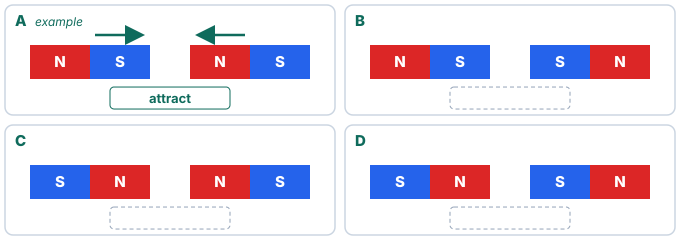
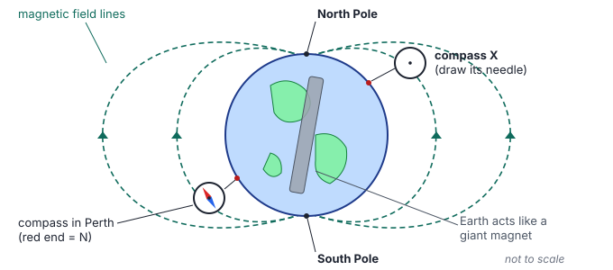
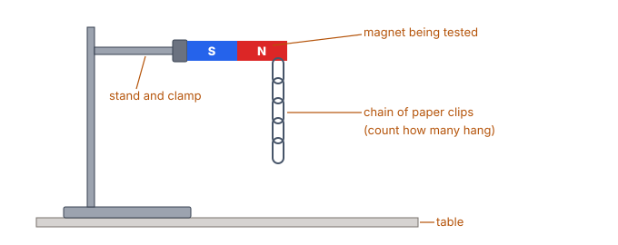
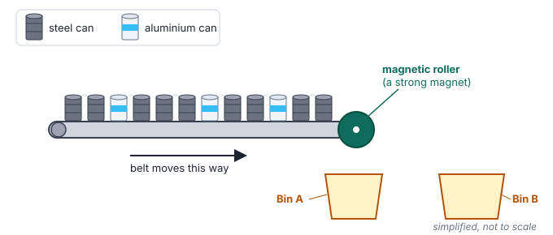
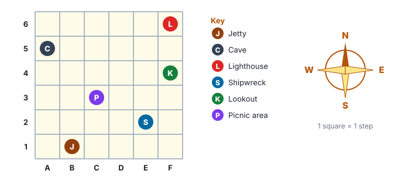

# Year 4 English — Week 31
## Content text: *Magnets Everywhere* (Science — Physical: forces, non-contact forces)
## Literacy focus: Adverbs & adverbial phrases · Fronted adverbials + comma · Precise adverbs

**Name:** ______________________ **Date:** ____________

**Learning intentions — by the end of this worksheet I can:**
- *(content)* explain why magnetic force is a **non-contact force** and which materials a magnet attracts
- *(content)* explain how **poles** behave and how Earth's magnetism makes a **compass** work
- *(content)* describe how people use magnets, from fridges and recycling plants to maglev trains
- *(skill)* find adverbs and adverbial phrases that tell **how, when, where, why** and **how often**
- *(skill)* use a **fronted adverbial** followed by a comma, and choose precise adverbs
- *(skill)* write a clear explanation that uses adverbials to add detail

---

## Part A · Warm-up ⏱ ~5 min

*Remember Week 5 (Invisible Pushes and Pulls), Week 7 (apostrophes) and Week 13 (complex sentences)?*

1. Write **C** for a **contact** force or **N** for a **non-contact** force.
- ___ friction slowing a skateboard
- ___ gravity pulling a dropped apple to the ground
- ___ your hand pushing a door open
- ___ a magnet pulling a paper clip across a table

2. Fix the apostrophes (there are **three** mistakes — there is one magnet and one compass):
*The magnets north pole was painted red, but the compasses needle didnt move.*

<!-- lines:2 -->

3. Join the two simple sentences into **one complex sentence** using *because* or *although*.
*The paper clip moved. It was not touching the magnet.*

<!-- lines:2 -->

---

## Part B · Read ⏱ ~12 min

> ### Magnets Everywhere
>
> **¶1 A force you cannot see**
> Look carefully at your fridge door. A small magnet may be holding a drawing or a shopping list there, quietly doing its job all day long. A magnet is an object that can pull on certain materials without touching them. Scientists call this kind of push or pull a **non-contact force**. Gravity is another one. Magnetic force can even work through paper, plastic and water, which is why a fridge magnet can hold a sheet of paper firmly in place.
>
> **¶2 Which materials stick?**
> Surprisingly, magnets do not attract every metal. They attract iron, nickel and cobalt, and they also attract most kinds of steel, because steel is made mostly of iron. Many other materials, including aluminium, copper, wood, plastic and glass, are not pulled at all. If you hold a magnet near a drink can, nothing usually happens, because most drink cans in Australia are made of aluminium.
>
> **¶3 Poles that push and pull**
> Every magnet has two ends called **poles**: a north pole and a south pole. The force is strongest at the poles. When two magnets come close, **like** poles (north and north, or south and south) push each other away. We say they **repel**. **Unlike** poles (north and south) pull towards each other. We say they **attract**. The space around a magnet where its force acts is called its **magnetic field**. If you gently sprinkle iron filings near a magnet, they line up neatly in curved lines that show the shape of the field.
>
> **¶4 A giant magnet beneath our feet**
> Deep inside, Earth behaves like a giant magnet, and its magnetic field stretches around the whole planet. A compass needle is a tiny, light magnet that can spin freely. When you hold a compass flat and still, its needle slowly turns until it lines up with Earth's magnetic field, so one end points roughly north. For hundreds of years, sailors and explorers have used compasses to find their way, even on cloudy nights when they could not see the stars.
>
> **¶5 Magnets at work**
> Magnets hide in many everyday objects. Inside the rubber seal of most fridge doors, a bendy magnetic strip pulls the door tightly shut so that cold air stays in. Speakers and headphones use magnets to turn electrical signals into sound. At scrapyards, huge **electromagnets** lift heavy loads of scrap metal. An electromagnet works only while electricity flows through it, so the crane driver can drop the load simply by switching off the power. In recycling plants, mixed cans travel along a conveyor belt past a strong magnet. The magnet pulls the steel cans out of the stream, while the aluminium cans keep going, so each metal can be recycled separately.
>
> **¶6 Trains that float**
> Maglev is short for **magnetic levitation**, which means "lifting with magnets". A maglev train has no wheels rolling on rails. Instead, powerful magnets lift it slightly above its track and push it forwards. Because nothing rubs against the track, there is very little friction. Since the early 2000s, a maglev train in Shanghai, China, has carried passengers between Pudong Airport and the city, and it is one of the fastest passenger trains in the world.
>
> **¶7 Nature's compasses**
> Scientists think that some animals can sense Earth's magnetic field. Young sea turtles, like those that hatch on beaches along the Ningaloo coast, and some migrating birds may use it as a built-in compass on long journeys. Researchers are still working out exactly how.

> **Glossary**
> **non-contact force** — a push or pull that works without touching · **attract** — to pull towards · **repel** — to push away · **pole** — one of the two ends of a magnet, where its force is strongest · **magnetic field** — the area around a magnet where its force acts · **electromagnet** — a magnet that works only when electricity flows through it · **levitation** — rising or floating in the air

---

## Part C · Understanding the content ⏱ ~10 min

**1.** *(Find it)* Why is magnetic force called a **non-contact force**? Give one example of it from ¶1.

<!-- lines:4 -->

**2.** *(Sort it)* Tick (✓) the materials a magnet would attract. Cross (✗) the rest.
iron nail ___ · aluminium foil ___ · steel spoon ___ · copper wire ___ · nickel ___ · glass marble ___ · wooden peg ___

**3.** *(Explain it)* Ellie says, "Magnets stick to all metals." Use evidence from ¶2 to explain why she is wrong.

<!-- lines:4 -->

**4.** *(Use the diagram)* Example **A** shows two magnets that attract. For **B**, **C** and **D**, write **attract** or **repel** in each dashed box, then draw arrows to show which way each magnet would move.

**5.** *(Explain it)* Write a rule that tells you when two magnets will **repel**. Use the words *like poles*.

<!-- lines:2 -->

**6.** *(Use the diagram)* Look at the Earth diagram. Draw the needle on **compass X** (colour the north end red). Then explain why the needle points that way.

<!-- lines:4 -->

**7.** *(Think about it)* Why would a compass be especially useful to sailors on a cloudy night?

<!-- lines:4 -->

**8.** *(Think about it)* An electromagnet works only while electricity flows through it. Why is this **more useful** than an ordinary magnet in a scrapyard?

<!-- lines:4 -->

**9.** *(Think about it)* In ¶7 the writer says scientists *think* some animals sense Earth's magnetic field, and that animals *may* use it. Why doesn't the writer just say "Turtles use a magnetic compass"?

<!-- lines:4 -->

### 🔗 Connections — English meets maths, mapping and earlier science ⏱ ~10 min

**Fair test.** Mia tested how strong five magnets were. She hung a chain of paper clips from each magnet and counted how many it could hold.

| Magnet | Paper clips held |
|---|---|
| Bar magnet | 8 |
| Horseshoe magnet | 12 |
| Ring magnet | 4 |
| Wand magnet | 6 |
| Fridge magnet | 2 |

**10.** Order the magnets from **strongest** to **weakest**.

<!-- lines:2 -->

**11.** a) How many **more** clips did the strongest magnet hold than the weakest? ________
b) The horseshoe magnet held how many **times** as many clips as the ring magnet? ________
c) How many paper clips were held **altogether**? ________

**12.** Look at the diagram. Name **two** things Mia must keep **the same** each time to make it a fair test.

<!-- lines:3 -->

**13.** On a separate piece of grid paper, draw a **column graph** of Mia's results. Remember a title, labelled axes and a sensible scale.

**Recycling sorter.** Use the diagram below.

**14.** a) What **fraction** of the cans on the belt are steel? ________ Aluminium? ________
b) If the belt carried 120 cans in a minute, and the same fraction were aluminium, how many aluminium cans would that be? ________

**15.** Which bin collects the **steel** cans — A or B? Explain using the word **attract**.

<!-- lines:5 -->

**Compass directions.** Use the grid map below.

**16.** Start at the **Jetty**, facing **north**. Walk 3 squares forwards. Make a **quarter turn clockwise**. Walk 4 squares forwards. Where are you? ______________ (grid reference ______)

**17.** Write directions from the **Jetty** to the **Lighthouse** using compass directions and at least **one adverbial of place** (e.g. *along the bottom row*).

<!-- lines:5 -->

**18.** *(Forces link)* Remember Week 5: **friction** slows moving things down. Explain why a maglev train has very little friction and why that helps it go fast.

<!-- lines:5 -->

---

## Part D · How the text works ⏱ ~13 min

### D1 Adverbs and adverbial phrases
An **adverb** adds information to a verb, telling us **how**, **when**, **where**, **why** or **how often** something happens. An **adverbial phrase** is a group of words that does the same job.

> The needle **slowly** turns. *(how?)* · Sailors used compasses **on cloudy nights**. *(when?)*
> Cans travel **along a conveyor belt**. *(where?)* · The door shuts **so that cold air stays in**. *(why?)* · The magnet **always** holds the list. *(how often?)*

**19.** Each adverbial below is from the text. Write what it tells us: **how**, **when**, **where**, **why** or **how often**.
a) *quietly* ________
b) *all day long* ________
c) *inside the rubber seal of a fridge door* ________
d) *neatly* ________
e) *since the early 2000s* ________
f) *so that cold air stays in* ________

**20.** Find **two more** adverbials in ¶3 or ¶4 that tell us **how**.

<!-- lines:2 -->

### D2 Fronted adverbials
A **fronted adverbial** is moved to the **front** of the sentence. It is followed by a **comma**.

> The magnet pulls the steel cans out **in recycling plants**. → **In recycling plants, the magnet pulls the steel cans out.**

**21.** Find **two** sentences in the text that **start** with a fronted adverbial. Copy just the adverbial **and** the comma.

<!-- lines:2 -->

**22.** Rewrite each sentence with the adverbial **fronted**. Don't forget the comma!
a) *The compass needle swung round wildly during the storm.*

<!-- lines:2 -->
b) *Iron filings line up in curved lines near a magnet.*

<!-- lines:2 -->

**23.** *(Craft)* Why do you think the writer started ¶2 with *Surprisingly,*? What does it make the reader expect?

<!-- lines:4 -->

### D3 Precise adverbs
Writers choose **precise** adverbs instead of weak ones like *very* or *really*.

**24.** Replace the words in bold with **one** precise adverb from the box. Use each once.

*instantly · firmly · gradually · gently · rapidly*

a) The magnet held the paper **really well**. → ________
b) The compass needle turned **a little bit at a time** until it pointed north. → ________
c) The scrap metal dropped **straight away** when the power went off. → ________
d) Tap the compass **softly** so the needle can swing. → ________
e) The maglev train sped **very fast** towards the airport. → ________

---

## Part E · Vocabulary ⏱ ~5 min

**25.** Match each word to its meaning.

| Word | | Meaning |
|---|---|---|
| a) attract | | 1) to push away |
| b) repel | | 2) the area around a magnet where its force acts |
| c) pole | | 3) to pull towards |
| d) magnetic field | | 4) rising or floating in the air |
| e) levitation | | 5) one end of a magnet, where the force is strongest |
| f) navigate | | 6) to find your way from place to place |
| | | 7) a force that needs touching |

a) ___ b) ___ c) ___ d) ___ e) ___ f) ___

**26.** Use **repel** and an **adverb** in one sentence of your own about two magnets.

<!-- lines:2 -->

---

## Part F · Writing: an explanation ⏱ ~15 min

**Task:** Choose **one** question and write an explanation (about **100–130 words**) for a Year 3 student.
- **Option 1:** *How does a compass help you find your way?*
- **Option 2:** *How do recycling plants use magnets?*

**Plan first:**

| Opening statement (what is it?) | |
|---|---|
| Step / reason 1 | |
| Step / reason 2 | |
| Step / reason 3 | |
| Concluding sentence (why it matters) | |

**Success criteria** (tick when done)
- [ ] opens with a clear statement that says what I am explaining
- [ ] explains **how** and **why**, using cause-and-effect words (*because, so, as a result*)
- [ ] uses correct science words (e.g. *attract, pole, magnetic field, non-contact force*)
- [ ] includes at least **four adverbials** (underline them)
- [ ] includes at least **one fronted adverbial followed by a comma**
- [ ] uses at least **one precise adverb** (not *very* or *really*)
- [ ] includes at least **one complex sentence** and a **noun group** that gives detail
- [ ] ends with a concluding sentence; 100–130 words, in my own words

<!-- lines:21 -->

---

## Part G · Challenge ⏱ ~10 min

**27.** Moving an adverbial can change what a sentence **means**. Explain the difference between these two sentences.
a) *Only the magnet pulled the steel cans.*
b) *The magnet pulled only the steel cans.*

<!-- lines:5 -->

**28.** Zac has two magnets with **no labels** on their poles. He knows one end of magnet 1 is **north**. Explain, step by step, how he could use it to find the north pole of magnet 2. Use at least **two adverbials** of time (e.g. *first, next, after that*).

<!-- lines:8 -->

**29.** The text uses the heading *Magnets Everywhere*. Using **three** pieces of evidence from different paragraphs, explain whether this is a good title.

<!-- lines:6 -->

---
### Self-check

| I can… | 😀 | 🙂 | 😕 |
|---|---|---|---|
| explain why magnetism is a non-contact force | | | |
| say which materials magnets attract | | | |
| predict whether two poles attract or repel | | | |
| explain how a compass works | | | |
| find adverbials that tell how, when, where, why, how often | | | |
| use a fronted adverbial with a comma | | | |
| choose precise adverbs | | | |

---

## ⚡ Fast-finisher bank ⏱ ~35 min
*Keep going! ⭐⭐⭐⭐ = very challenging.*

**F1 ⭐⭐ Adverbial sort.** Write each adverbial in the correct column.
*carefully · at the scrapyard · every morning · because it was cloudy · under the table · at midnight · silently · twice a week · so that the door stays shut · beside the compass*

| How? | When? | Where? | Why? | How often? |
|---|---|---|---|---|
| | | | | |
| | | | | |

**F2 ⭐⭐ Add an adverbial.** Add the type of adverbial in brackets to improve each sentence.
a) *The magnet picked up the pins.* (how?)

<!-- lines:2 -->
b) *The turtles swam.* (where?)

<!-- lines:2 -->
c) *The scrapyard crane lifted the old car.* (when? — make it fronted!)

<!-- lines:2 -->

**F3 ⭐⭐⭐ Read a second text.**

> **The Stone That Pointed North**
> Long ago, people discovered a strange dark rock that could pull on pieces of iron. This natural magnet is called **lodestone**, and it is a kind of rock called magnetite. When people hung a piece of lodestone from a thread, or floated it on water, it slowly turned until it pointed in the same direction every time. Later, people learned that rubbing an iron needle with lodestone turned the needle into a magnet too. Historians think compasses were being used to guide ships in China about a thousand years ago, and over time the idea spread to many other parts of the world. Today, a compass is still a useful tool for bushwalkers, sailors and pilots, especially when other equipment stops working.

a) What is lodestone?

<!-- lines:2 -->
b) Find **three** adverbials in the text. Label each **how**, **when** or **where**.

<!-- lines:3 -->
c) Why do you think hanging the lodestone from a thread or floating it on water was important for it to turn? (Think about **friction**.)

<!-- lines:5 -->
d) Why do you think the writer uses the phrase *Historians think*?

<!-- lines:2 -->

**F4 ⭐⭐⭐ Plan a fair test.** Plan an experiment to answer: *Does magnetic force get weaker when there are more sheets of cardboard between the magnet and a paper clip?*
- What will you **change**? What will you **measure**? What will you **keep the same** (at least three things)?
- Write your **prediction** using *because*.
- Write **three** numbered steps, each starting with an imperative verb and including an adverbial (remember Week 16!).

<!-- lines:13 -->

**F5 ⭐⭐⭐ Upgrade the sentence.** Rewrite each sentence with a **fronted adverbial**, a **precise adverb** and a **noun group**.
a) *The magnet moved.*

<!-- lines:3 -->
b) *The train went fast.*

<!-- lines:3 -->
c) *The compass was useful.*

<!-- lines:3 -->

**F6 ⭐⭐⭐ Sign-writer.** Design a sign for a museum's **Magnet Discovery Table**. Include:
- a heading that grabs attention
- **three** instructions for visitors (imperative verbs + adverbs, e.g. *Gently slide…*)
- **one** fact from the text
- **one** safety rule with a reason (use *because* or *so that*)

<!-- work:10 -->

**F7 ⭐⭐⭐⭐ The magnet speaks.** Write 120–150 words in the voice of a **fridge magnet**, a **compass needle** or a **maglev train** describing one day. Use at least **five** adverbials (two fronted, with commas), **personification**, and **two** correct science facts from the text.

<!-- lines:24 -->

**F8 ⭐⭐⭐⭐ Detective puzzle.** You have two steel bars that look exactly the same. One is a magnet; the other is plain steel that is **not** a magnet. You have nothing else. How can you work out which is the magnet? (Hint: where is a magnet's force **weakest**?)

<!-- lines:9 -->

**F9 ⭐⭐⭐⭐ Debate prep.** *"Perth should build a maglev train."* Write **one** argument **for** and **one** argument **against**, each with a reason. Then write a rhetorical question you could use to open a speech (remember Weeks 24 and 28).

<!-- lines:9 -->
