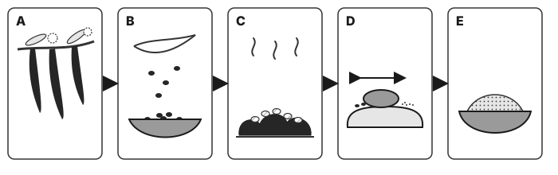
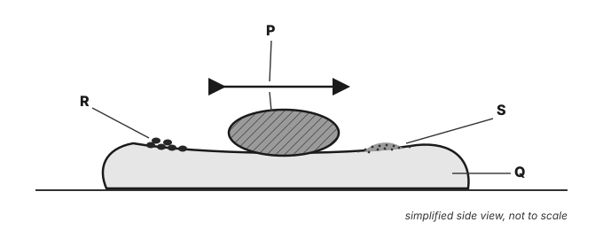

# Year 4 English — Week 32
## Content text: *From Seed to Flour* (Science — Chemical: natural & processed materials · History — Aboriginal food knowledge)
## Literacy focus: Procedural texts & recipes · Imperative verbs · Precise measurement words · Time & sequence words

**Name:** ______________________ **Date:** ____________

**Learning intentions — by the end of this worksheet I can:**
- *(content)* explain what wattles are and why you must **never** eat wild seeds without expert knowledge
- *(content)* describe how Aboriginal peoples have turned seeds into flour for thousands of years, and how colonisation changed this
- *(content)* explain how roasting and grinding turn a **natural** material into a **processed** one, and how its properties change
- *(skill)* name the parts of a procedure: **goal**, **You will need** and **numbered steps**
- *(skill)* use **imperative verbs**, precise **measurements and units**, **time and sequence words** and **precise adverbs**
- *(skill)* compare four text types and their **purposes**, and write a clear recipe or procedure

---

## Part A · Warm-up ⏱ ~5 min

*Remember Week 31 (adverbials and magnets), Week 16 (instructions) and Week 7 (natural and processed materials)?*

1. Underline the **three** adverbials. Above each one, write whether it tells **how**, **when** or **where**.
*Every spring, wattles flower brightly along the river.*

2. Rewrite this sentence with the comma in the right place.
*After the rain the wattle pods split open.*

<!-- lines:2 -->

3. Kai drops a **steel** spoon and an **aluminium** measuring cup into a bag of flour. Which one could he fish out with a magnet? Why?

<!-- lines:3 -->

4. a) Circle the **imperative (command) verbs**: *Gently push the shoe. The block slides. Record the distance. Repeat the test.*
b) Write **N** (natural) or **P** (processed): wool ___ · woollen jumper ___ · cotton plant ___ · wheat grain ___ · bread ___

---

## Part B · Read ⏱ ~12 min

> **Text types this week.** You will read **four** short texts about seeds, wattles and bush foods. Each one was written for a different **purpose**.
> **Text 1** *From Seed to Flour* — information text (Part B) · **Text 2** *Wattleseed Damper* — recipe (Part B) · **Text 3** *Wattle Time* — poem (Part D) · **Text 4** *A Letter to the Principal* — persuasive letter (Part D)

> ### Text 1 · From Seed to Flour
>
> **¶1 Australia's wattles**
> In late winter and spring, many parts of Australia light up with the fluffy yellow flowers of wattle trees and shrubs. Wattles belong to a large group of plants called ***Acacia***. Australia has hundreds of different kinds, more than any other country, and the golden wattle is our national floral emblem. Like peas and beans, wattles grow their seeds inside **pods**. When the pods dry out, they split open and the small, hard seeds drop to the ground. Many wattle seeds can lie in the soil for years. The heat of a bushfire can crack their tough coats, and when rain comes, new plants sprout.
>
> **¶2 Not every seed is food**
> Only some kinds of wattle have seeds that are safe to eat. Others can make people sick, and many wattles look very alike. That is why you should **never** eat wild seeds or plants unless someone with expert knowledge has shown you exactly which ones are safe.
>
> **¶3 Thousands of years of knowledge**
> Aboriginal peoples have known which wattles to use, and when their seeds are ripe, for thousands of years. In many parts of Australia, people collected the seeds, roasted them in hot coals or sand, and then ground them on **grindstones**. A grindstone has two parts: a large, flat lower stone and a smaller stone held in the hand. Rubbing the top stone firmly backwards and forwards crushed the seeds into flour. Mixed with water, the flour made a dough that could be cooked in hot ashes as a flat bread, a little like damper. Seeds from some grasses and other plants were ground in the same way. **Archaeologists** have found old grindstones in many parts of Australia, and this knowledge has been passed down from generation to generation.
>
> **¶4 Changes to Country**
> After British **colonisation**, large areas of land were cleared for farms, and sheep and cattle grazed where people had once gathered seeds. Many Aboriginal people were forced off their Country, which made it much harder to collect and prepare traditional foods. Even so, knowledge of bush foods survived. Today, some Aboriginal communities and businesses harvest and sell bush foods, including wattleseed.
>
> **¶5 A bush food in the shops**
> You can now buy roasted, ground wattleseed in some shops. Cooks add small amounts to bread, biscuits, pikelets and even ice-cream. People often describe its flavour as a little like coffee, chocolate or hazelnut.
>
> **¶6 From natural to processed**
> A raw wattle seed is a **natural material**: it comes straight from a plant. It is small, very hard and almost impossible to bite. Roasting heats the seeds until they turn dark brown, smell toasty and become crisp and **brittle**, so they crack easily. This change cannot be undone: a roasted seed can never become a raw seed again. Grinding then breaks the brittle seeds into tiny pieces, making a fine, slightly gritty powder that mixes easily into dough. Ground wattleseed is a **processed material**, because people have changed it to make it more useful. Each step changes the seed's **properties**.

> **Glossary**
> ***Acacia*** — the scientific name for the wattle group of plants · **pod** — a long case that holds a plant's seeds · **grindstone** — a pair of stones used to crush seeds into flour · **archaeologist** — a scientist who studies objects people left behind long ago · **colonisation** — when people from another country take over land and set up a colony · **brittle** — hard but easily cracked or snapped · **natural material** — a material that comes straight from nature · **processed material** — a material that people have changed · **property** — a feature of a material, such as how hard, rough or smelly it is

> ### Text 2 · Wattleseed Damper
>
> *Makes 1 small damper (serves 6) · Make this with an adult · Use only store-bought, roasted ground wattleseed*
>
> **You will need**
> *Ingredients:* 2 cups (300 g) self-raising flour · ½ teaspoon salt · 2 teaspoons ground roasted wattleseed · 2 tablespoons (40 mL) hot water · 30 g cold butter, cut into small cubes · ¾ cup (185 mL) milk, plus a little extra if needed
> *Equipment:* measuring cups and spoons, kitchen scale, sieve, large bowl, small cup, butter knife, baking tray, baking paper, oven mitts, wire rack
>
> **Method**
> 1. Ask an adult to preheat the oven to 200 °C (180 °C fan-forced). Line a baking tray with baking paper.
> 2. Stir the wattleseed into the hot water in a small cup. Leave it to soak for 10 minutes.
> 3. Meanwhile, sift the flour and salt into a large bowl.
> 4. Using your fingertips, lightly rub the butter into the flour until the mixture looks like fine breadcrumbs.
> 5. Make a well in the centre. Pour in the milk and the soaked wattleseed.
> 6. Mix gently with a butter knife until the mixture just comes together as a soft dough. If it is too dry, add a little more milk.
> 7. Turn the dough onto a lightly floured bench. Knead it gently for about 30 seconds, until smooth.
> 8. Shape the dough into a round about 15 cm wide and place it on the tray. Using a knife, carefully cut a cross about 1 cm deep across the top.
> 9. Bake for 25–30 minutes, until the damper has risen and sounds hollow when you tap the bottom.
> 10. Ask an adult to take the tray out of the oven with oven mitts. Cool the damper on a wire rack for 10 minutes before slicing.
>
> **Safety:** The oven, tray and damper will be very hot, so only an adult should use the oven. Never eat wild wattle seeds.
>
> *Serve warm with butter or a drizzle of honey.*

---

## Part C · Understanding the content ⏱ ~8 min

**1.** *(Find it)* Why should you **never** eat wild wattle seeds? Give **two** reasons from ¶2.

<!-- lines:3 -->

**2.** *(Use the diagram)* The diagram shows five stages, **A** to **E**, on the journey from seed to flour.

Write the letter of the stage where:
a) the seeds are roasted ___ b) the seeds become flour ___ c) the seeds are still growing on the plant ___ d) the seeds are collected ___
e) Between which **two** stages do the seeds become crisp and brittle? ___ and ___

**3.** *(Use the diagram)* Look at the grindstone.

a) Which letter shows the stone held in the hand? ___ Which shows the large lower stone? ___
b) Explain what happens to the seeds as they move from **R** to **S**. Use one precise adverb from ¶3.

<!-- lines:3 -->

**4.** *(Table)* Use ¶6 to describe the seed's **properties** at each stage.

| Property | Raw seed | Roasted seed | Ground wattleseed |
|---|---|---|---|
| How hard is it? | | | |
| What is it like to touch or bite? | | | |

**5.** *(Think about it)* ¶4 describes how colonisation made it harder to gather traditional foods, then begins a sentence with *Even so*. What does *Even so* tell the reader?

<!-- lines:4 -->

**6.** *(Think about it)* Why do you think people roast the seeds **before** grinding them? Use the word **brittle**.

<!-- lines:3 -->

### 🔗 Connections — English meets maths, science and HASS ⏱ ~10 min

**7.** a) How much milk is in **Jug A**? ________ mL
b) Text 2 needs ¾ cup (185 mL) of milk. How much milk will be **left** in the jug after you pour out what the recipe needs?

<!-- work:2 -->

**8.** a) How much flour is on **Scale B**? ________ g
b) How much **more** flour is needed for one damper? ________ g c) For a **double** batch? ________ g

<!-- work:3 -->

**9.** *(Scaling)* Text 2 serves 6. Complete the table.

| Ingredient | Half batch (3 people) | Recipe (6 people) | Double batch (12 people) |
|---|---|---|---|
| self-raising flour | ______ g | 300 g | ______ g |
| butter | ______ g | 30 g | ______ g |
| ground wattleseed | ______ tsp | 2 tsp | ______ tsp |
| salt | ______ tsp | ½ tsp | ______ tsp |

**10.** Use spoon set **C**. How many **teaspoons** fill one Australian **tablespoon**? ________ So 8 teaspoons of wattleseed = ________ tablespoons.

**11.** *(Time)* Lily puts her damper in the oven at **11:45 am**. It bakes for 30 minutes, then cools for 10 minutes. At what time can her family eat it? Write **am** or **pm**. ______________

**12.** *(Science)* Can each change be **undone**? Write **yes** or **no**.
roasting wattle seeds ______ · melting butter ______ · baking dough into damper ______ · freezing water into ice ______

**13.** *(HASS — remember Week 14 and our Economics work on resources)* Write **natural**, **human** or **capital** resource: wattle seeds ________ · a grindstone ________ · knowing when seeds are ripe and how to prepare them ________
Why is knowing Country (seasons, plants and places) so important when gathering seed foods?

<!-- lines:3 -->

---

## Part D · Other text types ⏱ ~10 min

> ### Text 3 · Wattle Time
>
> When winter's chill begins to fade
> and magpies carol from the shade,
> the wattle shakes its fluffy head
> and sprinkles gold on every bed.
>
> A thousand tiny suns appear.
> The bees hum loudly, "Spring is here!"
> Then flowers fall, and pods hang down
> like skinny purses, dry and brown.
>
> They twist, they crack, they split, they pop!
> The seeds come tumbling, drop by drop,
> and in the soil, in jackets tough,
> they sleep through summers hot and rough.
>
> Then fire sweeps by. The ground grows warm.
> The jackets crack. Rain clouds form.
> A tiny shoot, a leaf, a stem:
> the wattle's story starts again.

**14.** *(Figurative language — remember Week 11)* Find one example of each in Text 3.
a) a **simile** ____________________________
b) a **metaphor** ____________________________
c) **personification** ____________________________

**15.** What are the seeds' *jackets* in stanzas 3 and 4? Which **fact** from Text 1 ¶1 does the last stanza turn into poetry?

<!-- lines:4 -->

> ### Text 4 · A Letter to the Principal
>
> Dear Principal,
>
> Imagine walking past our bare, dusty garden bed and finding it buzzing with bees and full of plants that have fed people for thousands of years. Our school should grow a bush food garden, and here is why.
>
> Firstly, bush food plants belong here. Many are suited to Perth's hot, dry summers, so once they are established they usually need less watering than a thirsty lawn.
>
> Secondly, the garden would be a wonderful outdoor classroom. We could learn which plants are safe to eat and invite a local Noongar Elder or Aboriginal educator to share their knowledge, if they would like to.
>
> Finally, it would welcome wildlife back. Flowering wattles and grevilleas attract birds, bees and other insects.
>
> Some people might worry that students will eat the wrong plants. That is why every plant would have a clear label, and we would only taste food when an expert says it is safe.
>
> Please don't let that sad, empty patch go to waste. Say yes to a bush food garden, and let's plant it together this spring!
>
> Yours sincerely,
> Ari, Year 4

**16.** *(Persuasive devices — remember Weeks 12 and 24)* Copy:
a) the **call to action** ________________________________________________
b) **two emotive words or phrases** ________________________________________________

**17.** Why does Ari write *Some people might worry…*? How does this make the letter **more** persuasive?

<!-- lines:4 -->

**18.** Ari writes that bush food plants *usually* need less watering. Why is *usually* a careful, honest word choice here?

<!-- lines:3 -->

**19.** *(Compare the texts)* Complete the table. Text 1 has been started for you.
Purpose: **inform**, **instruct**, **entertain** or **persuade**.

| | Purpose | Audience (who is it for?) | Structure | Language features |
|---|---|---|---|---|
| Text 1 *From Seed to Flour* | inform | | headings, paragraphs, glossary | |
| Text 2 *Wattleseed Damper* | | | | |
| Text 3 *Wattle Time* | | | | |
| Text 4 *Letter to the Principal* | | | | |

**20.** All four texts are about seeds and bush foods. Which text taught **you** the most, and which one made you **feel** the most? Explain both choices.

<!-- lines:4 -->

---

## Part E · How procedural texts work ⏱ ~12 min

### E1 The parts of a procedure
A **procedure** tells someone **how to do or make something**. It usually has a **goal** (the title), a **You will need** list, and **numbered steps** in order. Recipes often add serving size, safety notes and a serving tip.

**21.** Why does Text 2 list the ingredients and equipment **before** the steps, and why are the steps **numbered** instead of written as a paragraph?

<!-- lines:4 -->

### E2 Imperative verbs
Each step starts with (or soon reaches) an **imperative verb**, a "bossy" verb that gives a command: ***Sift** the flour.* The subject (*you*) is hidden.

**22.** Find **six different** imperative verbs in Text 2.
________ ________ ________ ________ ________ ________

**23.** Rewrite each sentence as a command that starts with an imperative verb.
a) *You should put the dough on the tray.*

<!-- lines:2 -->
b) *The butter needs to be rubbed into the flour by you.*

<!-- lines:2 -->

### E3 Precise words: measurements, time and adverbs
Good procedures never say *some*, *a bit* or *for a while*. They use **amounts with units** (*300 g*, *185 mL*, *2 tsp*, *200 °C*, *10 minutes*), **time and sequence words** (*meanwhile*, *until*, *before*) and **precise adverbs** (*lightly*, *gently*).

**24.** Write the abbreviation: grams ______ · millilitres ______ · teaspoon ______ · tablespoon ______ · degrees Celsius ______ · centimetres ______

**25.** Replace each vague phrase with the **precise** words from Text 2.
a) *a bit of salt* → ________ b) *a hot oven* → ________ c) *bake it for a while* → ________ d) *some milk* → ________

**26.** Step 6 says *Mix **gently** … **until** the mixture just comes together.* What does each bold word tell the cook? What might go wrong without them?

<!-- lines:4 -->

### E4 Fix it!
> *pikelets*
> You will need flour and milk and an egg and some sugar. First you cook them in the pan. You should mix all the stuff together a bit. Butter goes in the pan and it should be hot. Then you put some of the mixture in and wait for a while and then you turn them over. Oh and before that you need to put the egg in. Eat them. They are really yummy!

**27.** List **four** problems with this procedure.

<!-- lines:5 -->

---

## Part F · Writing: a procedure ⏱ ~13 min

**Task:** Write a procedure (about **100–140 words**). Choose **one**:
- **Option 1:** *Wattleseed Pikelets*: rewrite the pikelet procedure from E4 properly, using the facts in the box.
- **Option 2:** *How to Measure Ingredients Accurately*: a guide for a Year 2 cook, using the tips in the box and diagram C.

> **Option 1 facts** · Makes about 12 · 1 cup (150 g) self-raising flour · 1 tablespoon caster sugar · 1 teaspoon ground roasted wattleseed (store-bought) · 1 egg · ¾ cup (185 mL) milk · a little butter for the pan · whisk the egg and milk together · stir into the flour, sugar and wattleseed until smooth · an adult heats a frying pan over medium heat · grease the pan with butter · drop 1 tablespoon of batter for each pikelet · cook until bubbles appear on top (about 1 minute) · flip with an egg flip · cook another 30–60 seconds
>
> **Option 2 tips** · spoon flour into the cup, don't press it down · level the top with the flat edge of a knife · put a jug on a flat bench and read it with your eyes level with the line · a level spoonful, not a heaped one · set the scale to zero with the empty bowl on it

**Success criteria** (tick when done)
- [ ] a clear **goal** as the title, and a **You will need** list with amounts and units
- [ ] **numbered steps** in the right order, each beginning with (or quickly reaching) an **imperative verb**
- [ ] at least **three** precise measurements with units (g, mL, tsp, tbsp, °C, minutes)
- [ ] at least **three** time or sequence words (*first, meanwhile, until, after, before*)
- [ ] at least **two precise adverbs** and **one fronted adverbial with a comma**
- [ ] a **safety** note that says why (use *because* or *so that*)
- [ ] no vague words (*some, stuff, a bit, a while*); 100–140 words

<!-- lines:20 -->

---

## Part G · Challenge ⏱ ~10 min

**28.** ¶3 of Text 1 **describes** how seed flour was made in the past. Rewrite it as a short procedure with **four** numbered steps for a museum display, *How seeds were made into flour*. Each step must start with an imperative verb and include a time or sequence word.

<!-- lines:8 -->

**29.** A recipe says *Bake until done.* Rewrite it for someone who has **never** baked before, then explain what makes your version better.

<!-- lines:4 -->

**30.** Jack says: *"Wattleseed is natural, so all wattle seeds are healthy and safe. Processed food is always bad."* Use evidence from Text 1 to explain what Jack has got wrong.

<!-- lines:6 -->

---
### Self-check

| I can… | 😀 | 🙂 | 😕 |
|---|---|---|---|
| explain why wild seeds must never be eaten without expert knowledge | | | |
| describe how seeds were roasted and ground into flour | | | |
| explain how roasting and grinding change a seed's properties | | | |
| name the parts of a procedure | | | |
| use imperative verbs, precise measurements and sequence words | | | |
| say the purpose and audience of four different text types | | | |

---

## ⚡ Fast-finisher bank ⏱ ~35 min
*Keep going! ⭐⭐⭐⭐ = very challenging.*

**F1 ⭐⭐ Cooking verbs.** Match each imperative verb to its meaning.

| Verb | | Meaning |
|---|---|---|
| a) sift | | 1) press and fold dough with your hands |
| b) whisk | | 2) heat the oven before you start |
| c) knead | | 3) shake through a sieve to remove lumps |
| d) preheat | | 4) beat quickly to mix in air |
| e) grease | | 5) pour slowly in a thin stream |
| f) drizzle | | 6) spread fat on a pan so food won't stick |

a) ___ b) ___ c) ___ d) ___ e) ___ f) ___

**F2 ⭐⭐ Sensible units.** Write the best unit (**g, kg, mL, L, °C, minutes, cm**).
a) Preheat the oven to 180 ______. b) A bag of flour holds 1 ______. c) Add 2 ______ of vanilla essence. d) Soak the seeds for 10 ______. e) A bottle of milk holds 2 ______. f) Roll the dough 2 ______ thick.

**F3 ⭐⭐⭐ Read a second text.**

> ### A Spoonful of Difference
> Not all spoons are equal! In Australia, a standard measuring **tablespoon** holds **20 millilitres**, which is the same as **four** teaspoons. In many other countries, including the United States and the United Kingdom, a tablespoon holds about **15 millilitres**, or three teaspoons. A standard metric **cup** in Australia holds 250 millilitres. This is why careful cooks check where a recipe comes from. If you use an Australian tablespoon for an overseas recipe, you will add about one-third more than the writer meant. For most foods this small difference doesn't matter, but in baking, too much baking powder or salt can spoil the result.

a) How many teaspoons make an Australian tablespoon? An American one? ________ / ________
b) An overseas recipe needs 3 tablespoons of sugar (3 × 15 mL). How many **mL** is that? ______ How many **Australian** tablespoons would give **the same** amount? ______

<!-- work:3 -->
c) Why does the writer say *For most foods this small difference doesn't matter, but…*? What job does *but* do here?

<!-- lines:3 -->

**F4 ⭐⭐⭐ How to be a wattle seed.** Use Text 1 ¶1 and Text 3 to write a funny procedure (80–100 words) for a wattle seed: goal, *You will need* (e.g. *1 tough coat*) and at least **five** numbered steps with imperative verbs and time words. *e.g. 1. Wait patiently in your pod until it dries.*

<!-- lines:14 -->

**F5 ⭐⭐⭐ Café advertisement.** Design a poster advertising a made-up bush-food café, *The Wattle Tree Café*. Include a catchy heading, **two** menu items using wattleseed, **one** emotive phrase, **one** rhetorical question and a **call to action**. (Persuasive, like Text 4!)

<!-- draw:10 -->

**F6 ⭐⭐⭐ Reply to Ari.** Write the principal's reply to Text 4 (60–80 words). Thank Ari, agree with **one** reason, raise **one** concern (e.g. cost or watering in the holidays) and ask **one** question. Use a polite, formal tone.

<!-- lines:12 -->

**F7 ⭐⭐⭐⭐ Damper for the whole class.** A class of 27 students and their teacher each want **one serve** of Text 2's damper. One damper serves 6.
a) How many dampers must be made? b) How many **kilograms** of flour? c) How much butter? d) How many teaspoons of wattleseed, and how many Australian **tablespoons** is that? e) The oven fits **two** dampers at a time and each round takes 30 minutes. If the first round goes in at 9:15 am, when does the last round come out?

<!-- work:8 -->

**F8 ⭐⭐⭐⭐ The no-peeking test.** Write instructions (numbered steps) that tell a partner how to draw the **grindstone diagram** without seeing it. Use precise position words (*in the centre, on the left*), sizes and adverbs. Then test them with someone at home and write what you would improve.

<!-- lines:12 -->

**F9 ⭐⭐⭐⭐ Same seed, two writers.** Text 1 ¶1 and Text 3's last two stanzas both describe what happens to seeds in the soil. Compare **how** each writer does it (purpose, word choices, sentence types). Use one quotation from each.

<!-- lines:9 -->
