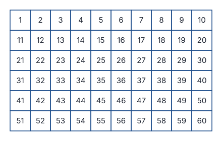
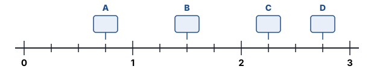
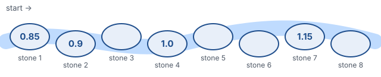
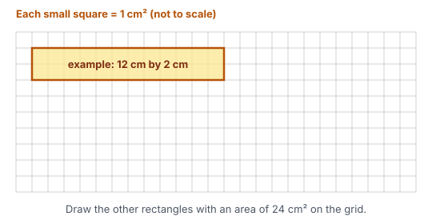
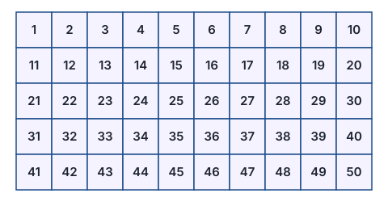

# Year 4 Mathematics — Week 31
## Topic: Number Detectives — multiples, factors and patterns with fractions and decimals

**Name:** ______________________ **Date:** ____________

**Learning intentions — by the end of this worksheet I can:**
- list multiples of a number and find common multiples of two numbers
- find all the factors and factor pairs of a number (using arrays) and find common factors
- use divisibility tricks to test whether a number divides by 2, 3, 5, 9 or 10
- find the rule for a pattern that counts by fractions or decimals, extend it and fill in missing terms
- *(Challenge)* sort numbers into prime and composite

---

## Part A · Warm-up ⏱ ~8 min
*Welcome to Term 4! These questions come from Terms 1, 2 and 3. Show working only if you need it.*

| | |
|---|---|
| a) *(Week 3)* 6 × 70 = ____ | b) *(Week 9)* 2:45 pm in 24-hour time = ____ |
| c) *(Week 11)* 236 × 4 = ____ | d) *(Week 13)* ¾ of 48 = ____ |
| e) *(Week 22)* A square-based pyramid has ____ edges. | f) *(Week 23)* An angle bigger than a right angle but smaller than a straight angle is called ____ |

---

## Part B · Learn ⏱ ~10 min

### Multiples
A **multiple** of 6 is any answer in the 6 times table: **6, 12, 18, 24, 30, …** — they go on forever!
A **common multiple** of two numbers is in *both* lists.
> Multiples of 4: 4, 8, **12**, 16, 20, **24**, …
> Multiples of 6: 6, **12**, 18, **24**, 30, …
> 12 and 24 are common multiples of 4 and 6. The **smallest** common multiple is **12**.

### Factors and factor pairs
A **factor** divides into a number exactly (no remainder). Factors come in **pairs** that multiply to make the number — just like the rows and columns of an **array**.
> 12 dots can make a 1 × 12, a 2 × 6 or a 3 × 4 array.
> Factor pairs of 12: 1 × 12, 2 × 6, 3 × 4. Factors of 12: **1, 2, 3, 4, 6, 12**.

**Tip:** work upwards from 1 (1, 2, 3, …) and stop when the pairs start to repeat — then you know you have them all.
A **common factor** of two numbers is a factor of *both*.

### Divisibility tricks

| A number divides by… | if… | Example |
|---|---|---|
| 2 | its ones digit is even (0, 2, 4, 6, 8) | 3 4**6** ✔ |
| 5 | it ends in 0 or 5 | 7 23**5** ✔ |
| 10 | it ends in 0 | 4 13**0** ✔ |
| 3 | its **digit sum** divides by 3 | 4 527 → 4 + 5 + 2 + 7 = 18 ✔ |
| 9 | its **digit sum** divides by 9 | 4 527 → 18 ✔ (4 527 = 9 × 503) |

### Patterns with fractions and decimals
Remember from Week 7: a pattern has a **rule**, like *start at 2, add 3 each time*. The jumps can be fractions or decimals too!
> Counting by quarters: ¼, ½, ¾, 1, 1¼, 1½, … Rule: *start at ¼, add ¼*.
> Counting by 0.25: 0.25, 0.5, 0.75, 1, 1.25, … (the same pattern in decimals!)
> To find the rule, look at the **gap** between terms: 2.3, 2.45, 2.6, … → each jump is **+ 0.15**.

---

## Part C · Practice ⏱ ~25 min

### C1 ⭐ Fluency

**1. Multiples.**
a) The first eight multiples of 7:

<!-- lines:1 -->
b) The first eight multiples of 12:

<!-- lines:1 -->
c) Which numbers between 50 and 100 are multiples of 9?

<!-- lines:1 -->

**2. Common multiples on the chart.**

On the chart, **circle** every multiple of 4 and draw a **cross** on every multiple of 6.
a) Which numbers have both a circle and a cross? ________________________
b) What is the smallest common multiple of 4 and 6? ________
c) What do you notice about the gaps between the common multiples?

<!-- lines:2 -->

**3. Factor pairs.** List all the factor pairs.
a) 18:

<!-- lines:1 -->
b) 20:

<!-- lines:1 -->
c) 36:

<!-- lines:1 -->
d) 17:

<!-- lines:1 -->

**4. Arrays.** Each array below has **24** dots.

a) Write the factor pair each array shows. Array A: ____ × ____ Array B: ____ × ____
b) Find the **other** factor pairs of 24. How many factor pairs does 24 have altogether? ________

<!-- lines:1 -->
c) List all the factors of 24 in order:

<!-- lines:1 -->

**5. Divisibility detective.** Use the tricks — no dividing! Tick (✔) each box that works.

| Number | Digit sum | ÷ 2 | ÷ 3 | ÷ 5 | ÷ 9 | ÷ 10 |
|---|---|---|---|---|---|---|
| 135 | | | | | | |
| 248 | | | | | | |
| 1 260 | | | | | | |
| 3 474 | | | | | | |
| 5 005 | | | | | | |
| 7 299 | | | | | | |

### C2 ⭐⭐ Understanding

**6. Common factors.**
a) You listed the factors of 24 in Q4. Now list the factors of 30:

<!-- lines:1 -->
Common factors of 24 and 30: ________________ The **greatest** common factor: ________
b) Common factors of 16 and 40: ________________ Greatest: ________

<!-- work:2 -->

**7. Counting by fractions.** This number line goes from 0 to 3. Each whole is split into quarters.

a) Write the number (use mixed numbers) that belongs in each box.
A ________ B ________ C ________ D ________
b) Count on by **thirds**: 1⅓, 1⅔, 2, ________, ________, ________
c) Count back by **halves**: 5½, 5, 4½, ________, ________, ________

**8. Find the rule, then extend.**

| Pattern | Next two terms | Rule |
|---|---|---|
| a) 2¼, 2¾, 3¼, … | | |
| b) 5, 4⅔, 4⅓, … | | |
| c) 0.25, 0.5, 0.75, … | | |
| d) 2.7, 2.8, 2.9, … | | |
| e) 1.85, 1.9, 1.95, … | | |
| f) 6.3, 6.05, 5.8, … | | |

**9. Missing terms.** Each pattern adds (or takes away) the same amount every time.
a) 1.2, ________, 1.6, 1.8, ________
b) 1½, ________, ________, 3, 3½
c) 0.15, ________, ________, 0.9
*Hint for c): three equal jumps get you from 0.15 to 0.9.*

<!-- work:2 -->
d) ________, 4.7, ________, 5.3

<!-- work:2 -->

**10. Stepping stones.** The numbers on these stones follow a pattern.

a) What is the rule? ________________
b) Fill in stones 3, 5, 6 and 8: ________ ________ ________ ________
c) If the path kept going, what number would be on stone 20? ________

<!-- work:3 -->

### C3 ⭐⭐⭐ Reasoning

**11. True or false? Explain.**
a) Every multiple of 6 is also a multiple of 3.

<!-- lines:2 -->
b) Every multiple of 3 is also a multiple of 6.

<!-- lines:2 -->
c) If a number's digits add up to 12, it divides exactly by 9.

<!-- lines:2 -->

**12. Who am I?**
- I am a multiple of 9 between 50 and 100.
- I am even.
- I am also a multiple of 4.

I am ________. Show how you found me.

<!-- lines:2 -->

**13. Missing digit.** Look at the number **4 7□2**.
a) Which digit in the box makes it divisible by **9**? ________
b) Which digits make it divisible by **3**? ________________
c) Can any digit make it divisible by 5? Explain.

<!-- lines:2 -->

**14. Odd one out.** Factors usually come in pairs, so most numbers have an **even** number of factors.
a) Count the factors of 16, 25 and 36. ________ ________ ________
b) Why do these numbers have an **odd** number of factors? (Hint: look at their factor pairs.)

<!-- lines:3 -->

---

## Part D · Problem Solving ⏱ ~10 min

**15. Sausage sizzle.** For a school sausage sizzle, sausages come in packs of **6** and bread rolls come in packs of **8**. Mr Nguyen wants exactly the same number of sausages and rolls.
a) What is the smallest number of each he can buy? ________
b) How many packs of sausages and how many packs of rolls is that? ________ packs of sausages, ________ packs of rolls

<!-- work:3 -->

**16. Excursion snack bags.** A teacher has **36** apples and **48** muesli bars. She packs them into identical bags with nothing left over.
a) What is the **greatest** number of bags she can make? ________
b) What is in each bag? ________ apples and ________ muesli bars

<!-- work:3 -->

**17. Assembly chairs.** 48 chairs are set out in equal rows. Each row must have at least 4 and no more than 12 chairs. List every way this can be done.

<!-- work:3 -->

**18. Frog jumps.** A frog jumps **1¾ m** each jump.
a) How far has it travelled after 2, 3 and 4 jumps? ________ ________ ________
b) How many jumps until it has gone **more than 10 m**? ________

<!-- work:3 -->

### 🔗 Connections — factors and patterns meet area, time, money and measurement ⏱ ~10 min
*Remember Weeks 17–18 (area and perimeter), Week 9 (am/pm time), Week 15 (money) and Week 8 (capacity)? Factors, multiples and patterns live inside them!*

**X1. Rectangles and factors.** How many different rectangles with whole-number sides have an **area of 24 cm²**?

a) Draw each rectangle on the grid (12 by 2 is done for you), then complete the table. *(A 4 by 6 rectangle is the same as a 6 by 4 rectangle — count it once.)*

| Length (cm) | Width (cm) | Area (cm²) | Perimeter (cm) |
|---|---|---|---|
| 12 | 2 | 24 | |
| | | 24 | |
| | | 24 | |
| | | 24 | |

b) What do the lengths and widths have to do with factors?

<!-- lines:2 -->
c) Which rectangle has the **smallest** perimeter? ________ What do you notice about its shape?

<!-- lines:2 -->

**X2. Buses together again.** *(Hypothetical timetable.)* At a Perth bus station, the Route A bus leaves every **12 minutes** and the Route B bus leaves every **15 minutes**. Both buses leave together at **7:50 am**.
a) When will they next leave at the same time? ________

<!-- work:3 -->
b) How many times will they leave together from 7:50 am up to 12:30 pm (count 7:50 am)? ________

<!-- work:2 -->

**X3. Saving pattern.** Ella has **\$5.00** in her money box. She saves **\$2.45** every week.

| Week | 0 | 1 | 2 | 3 | 4 | 5 |
|---|---|---|---|---|---|---|
| Savings | \$5.00 | | | | | |

a) Complete the table.
b) She wants a book set that costs **\$26.50**. After how many weeks can she first buy it? How much will she have left over?

<!-- work:4 -->

**X4. Pikelets.** One batch of pikelets needs **¾ cup** of flour.
a) Count by ¾ to show the flour for 1 to 6 batches: ¾, ________, ________, ________, ________, ________
b) How many batches can you make with exactly **6 cups** of flour? ________
c) An Australian metric cup holds **250 mL**. How many mL of flour do **4 batches** need? ________

<!-- work:2 -->

---

## Part E · Challenge ⏱ ~12 min — prime and composite numbers

> A **prime number** has **exactly two** factors: 1 and itself (e.g. 7 → 1 and 7).
> A **composite number** has **more than two** factors (e.g. 8 → 1, 2, 4, 8).
> **1 is neither** — it has only one factor!

**19. The Sieve of Eratosthenes.** About 2 200 years ago, a Greek mathematician named Eratosthenes found a clever way to catch prime numbers.

Step 1: Cross out **1**.
Step 2: Circle **2**, then cross out every other multiple of 2.
Step 3: Circle **3**, then cross out every other multiple of 3.
Step 4: Do the same for **5** and then **7**.
Step 5: Circle every number that is left.

a) List the prime numbers up to 50.

<!-- lines:2 -->
b) How many are there? ________
c) Why didn't you need to cross out the multiples of 11 separately?

<!-- lines:3 -->

**20. Prime or composite?** If it is composite, give a factor pair that proves it (not 1 × the number).
a) 51 ________ b) 53 ________ c) 57 ________ d) 91 ________ e) 97 ________
*Hint: try the divisibility tricks first, then try 7.*

<!-- work:3 -->

**21. Twin primes** are two primes with a difference of 2, like 3 and 5. List every pair of twin primes below 50.

<!-- lines:2 -->

**22.** Write **30** as the sum of two prime numbers in as many ways as you can.

<!-- work:2 -->

**23.** Lily says, "All prime numbers are odd." Is she right? Explain.

<!-- lines:3 -->

---
### Self-check

| I can… | 😀 | 🙂 | 😕 |
|---|---|---|---|
| list multiples and find common multiples | | | |
| find all factor pairs of a number using arrays | | | |
| use divisibility tricks for 2, 3, 5, 9 and 10 | | | |
| find and extend a fraction or decimal pattern | | | |
| fill in missing terms in a pattern | | | |
| tell prime numbers from composite numbers | | | |

---

## ⚡ Fast-finisher bank ⏱ ~35 min
*Keep going! ⭐⭐⭐⭐ questions are very tricky — even adults find them hard.*

**F1 ⭐⭐** a) List all the factors of 60. How many are there?

<!-- lines:2 -->
b) Write the first three common multiples of 6 and 9. ________________

**F2 ⭐⭐ Patterns.**
a) 9.6, 9.35, 9.1, ________, ________ b) 4, 3⅔, 3⅓, ________, ________
c) What is the 10th term of 0.05, 0.1, 0.15, …? ________

**F3 ⭐⭐** Without dividing, is **123 456 789** divisible by 2? ________ by 5? ________ by 9? ________ Explain the last one.

<!-- lines:2 -->

**F4 ⭐⭐⭐** What is the smallest number that divides exactly by 2, 3, 4, 5 **and** 6? ________
What is the smallest number bigger than 1 that leaves a **remainder of 1** when divided by 2, 3, 4, 5 or 6? ________

<!-- work:3 -->

**F5 ⭐⭐⭐ Flashing lights.** *(Hypothetical.)* Three lights flash every 6, 8 and 9 seconds. They all flash together at the start. After how many seconds will they next flash together? Write your answer in minutes and seconds.

<!-- work:4 -->

**F6 ⭐⭐⭐** A pattern goes ¼, 1, 1¾, 2½, …
a) What is the rule? ________________ b) What is the 10th term? ________
c) Will the number 8 ever appear in this pattern? Explain.

<!-- work:3 -->

**F7 ⭐⭐⭐** Find the smallest 4-digit number that is divisible by 9 and has **four different digits**. ________

<!-- work:3 -->

**F8 ⭐⭐⭐** Which of the numbers from 1 to 6 on a dice are prime? ________ composite? ________ neither? ________
When you roll a fair dice, is a prime or a composite number more likely? Write the chance of each as a fraction.

<!-- lines:2 -->

**F9 ⭐⭐⭐⭐** Which number from 1 to 50 has the **most** factors? ________ How many does it have? ________

<!-- work:4 -->

**F10 ⭐⭐⭐⭐** Find every number below 50 that has **exactly three** factors. What do they have in common?

<!-- lines:3 -->

**F11 ⭐⭐⭐⭐** Ava writes the pattern 0.05, 0.1, 0.15, 0.2, … and stops when she writes 5.
a) How many numbers does she write? ________ b) How many of them are whole numbers? ________

<!-- work:3 -->

**F12 ⭐⭐⭐⭐ Investigation — the locker puzzle.** A school corridor has 20 lockers, numbered 1 to 20, all closed. Student 1 opens every locker. Student 2 goes to every 2nd locker (2, 4, 6, …) and closes it. Student 3 goes to every 3rd locker and changes it (opens it if closed, closes it if open). This keeps going until Student 20 changes locker 20.
a) Which lockers are open at the end? ________________
b) Explain why, using what you found in Question 14.

<!-- lines:5 -->
