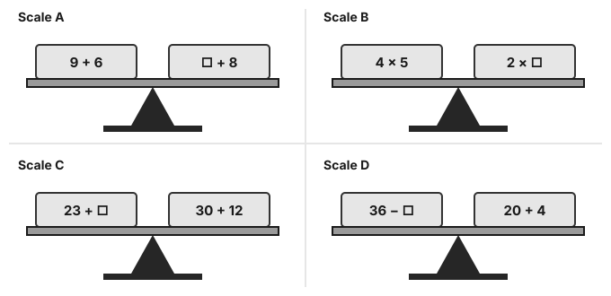
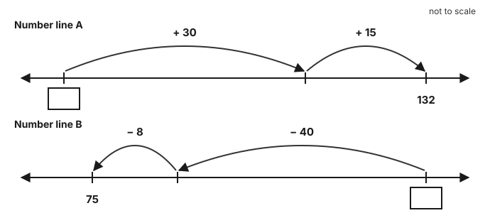
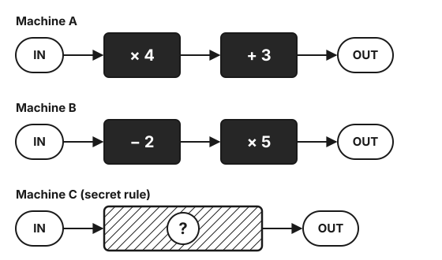
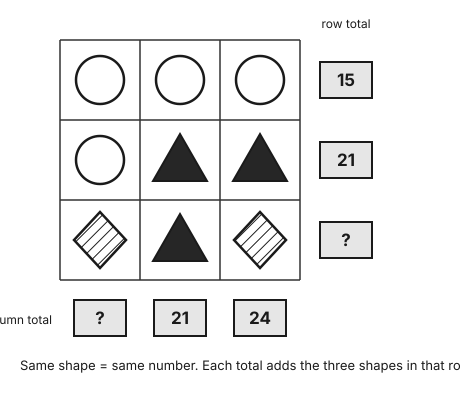
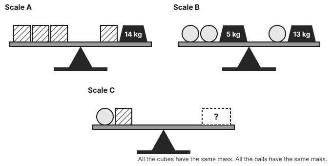

# Year 4 Mathematics — Week 32
## Topic: Balance Detectives — equivalent number sentences, unknowns and inverse operations

**Name:** ______________________ **Date:** ____________

**Learning intentions — by the end of this worksheet I can:**
- explain that the equals sign means "is the same value as", like a balance
- decide whether a number sentence is true or false, and make equivalent number sentences
- find an unknown number (□) in all four operations using inverse operations and fact families
- write a number sentence with □ for a word problem and solve it
- find missing numbers in patterns and tables
- *(Challenge)* solve two-step unknowns like 3 × □ + 4 = 25, and use function machines

---

## Part A · Warm-up ⏱ ~8 min
*Spaced retrieval: last week and Terms 1, 2 and 3. Show working only if you need it.*

| | |
|---|---|
| a) *(Week 31)* The smallest common multiple of 6 and 9 = ____ | b) *(Week 31)* Next term: 3.4, 3.65, 3.9, ____ |
| c) *(Week 2)* 4 003 − 1 768 = ____ | d) *(Week 6)* Change from \$50 after spending \$27.80 = ____ |
| e) *(Week 12)* 735 ÷ 5 = ____ | f) *(Week 9)* 17:20 in am/pm time = ____ |
| g) *(Week 17)* 9 rows of 6 one-centimetre squares make an area of ____ | h) *(Week 23)* A quarter turn makes a ____ angle. |

<!-- work:2 -->

---

## Part B · Learn ⏱ ~10 min

### The equals sign means "is the same value as"
Think of **=** as a **balance**. Whatever is on the left must be worth exactly the **same** as whatever is on the right.
> 8 + 7 = 10 + □
> Left side: 8 + 7 is worth 15. So the right side must also be worth 15: 10 + **5** = 15.
> □ = **5** (not 15!)

**Watch out!** The equals sign does **not** mean "write the answer next". The sentence 8 + 7 = 15 + 4 is **false**, because 15 is not the same as 19. We can write 15 ≠ 19 (≠ means "is not equal to").

### True or false?
A number sentence is **true** when both sides balance.
> 4 × 6 = 3 × 8 → 24 and 24 → **true** 20 − 5 = 10 + 4 → 15 and 14 → **false**

### Equivalent number sentences — keep the balance
- **Adding:** if one number goes **up** by 2, the other must go **down** by 2. 8 + 7 = 10 + 5
- **Multiplying:** if one number is **halved**, the other must be **doubled**. 6 × 4 = 3 × 8

### Unknowns and inverse operations
Remember from Week 2 and Week 4: **addition and subtraction undo each other**, and **multiplication and division undo each other**. A **fact family** shows this: 6 × 9 = 54, 9 × 6 = 54, 54 ÷ 6 = 9, 54 ÷ 9 = 6.

| Number sentence | Undo it with… | □ | Check by putting □ back in |
|---|---|---|---|
| □ + 27 = 63 | 63 − 27 | 36 | 36 + 27 = 63 ✔ |
| □ − 15 = 40 | 40 + 15 | 55 | 55 − 15 = 40 ✔ |
| 50 − □ = 18 | 50 − 18 (50 is the whole) | 32 | 50 − 32 = 18 ✔ |
| □ × 6 = 48 | 48 ÷ 6 | 8 | 8 × 6 = 48 ✔ |
| □ ÷ 4 = 9 | 9 × 4 | 36 | 36 ÷ 4 = 9 ✔ |
| 72 ÷ □ = 8 | 72 ÷ 8 | 9 | 72 ÷ 9 = 8 ✔ |

**Tip:** always **check** — put your number back into the sentence and see if it balances.

---

## Part C · Practice ⏱ ~25 min

### C1 ⭐ Fluency

**1. True or false?** Work out the value of each side, then write T or F.

| Number sentence | Left side | Right side | T or F |
|---|---|---|---|
| a) 9 + 6 = 15 | | | |
| b) 15 = 9 + 6 | | | |
| c) 9 + 6 = 15 + 2 | | | |
| d) 7 + 8 = 10 + 5 | | | |
| e) 4 × 6 = 3 × 8 | | | |
| f) 20 − 6 = 16 − 2 | | | |
| g) 36 ÷ 4 = 18 ÷ 2 | | | |
| h) 5 × 6 = 5 + 6 | | | |
| i) 48 + 0 = 48 × 0 | | | |
| j) 100 − 35 = 95 − 30 | | | |

**2. Balance scales.** Each scale below is perfectly balanced, so both sides have the same value.

Find the number that belongs in the □ on each scale.
A □ = ________ B □ = ________ C □ = ________ D □ = ________

<!-- work:3 -->

**3. Undo it!** Write the inverse calculation you will use, then find □. Check each one in your head.

| Number sentence | Inverse calculation | □ = |
|---|---|---|
| a) □ + 38 = 91 | | |
| b) 125 − □ = 67 | | |
| c) □ − 46 = 79 | | |
| d) 7 × □ = 63 | | |
| e) □ ÷ 8 = 12 | | |
| f) 84 ÷ □ = 7 | | |
| g) □ × 9 = 108 | | |
| h) 1 000 − □ = 365 | | |

**4. Fact families.**
a) Write the four facts in the fact family of **7, 8 and 56**.

<!-- lines:2 -->
Use your fact family: 56 ÷ □ = 7, so □ = ________
b) Write the four facts in the fact family of **145, 68 and 213**.

<!-- lines:2 -->
Use your fact family: 213 − □ = 145, so □ = ________

### C2 ⭐⭐ Understanding

**5. Equivalent number sentences.** Make each sentence balance. Try to use a shortcut instead of working out both sides.

| | |
|---|---|
| a) 9 + 8 = 10 + □ □ = ____ | b) 8 × 6 = 4 × □ □ = ____ |
| c) 46 + 29 = 45 + □ □ = ____ | d) 63 − 18 = 65 − □ □ = ____ |
| e) 12 × 5 = 6 × □ □ = ____ | f) 15 × 4 = □ × 2 □ = ____ |
| g) 72 ÷ 8 = 36 ÷ □ □ = ____ | h) □ + 199 = 400 + 21 □ = ____ |

Explain the shortcut you used for c) **or** d).

<!-- lines:3 -->

**6. Spot the mistake.**
a) Ruby solved 8 + 7 = □ + 4 and wrote **□ = 15**. Explain her mistake and give the correct answer.

<!-- lines:3 -->
b) Theo wrote his working like this: **9 + 5 = 14 + 6 = 20**. Why is this not a true number sentence? Write his working correctly.

<!-- lines:3 -->

**7. Jumping backwards.** Each number line starts at an unknown number in the empty box, then makes the jumps shown.

a) Number line A shows □ + 30 + 15 = 132. The start is □ = ________
b) Number line B shows □ − 40 − 8 = 75. The start is □ = ________

<!-- work:3 -->

**8. Word problems.** Write a number sentence with □ for the unknown, then solve it.
a) Mia had some stickers. Her friend gave her 45 more, and now she has 132.
Number sentence: ________________________ □ = ________

<!-- work:2 -->
b) A Fremantle bakery packs muffins in boxes of 6. Today it packed 84 muffins. How many boxes?
Number sentence: ________________________ □ = ________

<!-- work:2 -->
c) Josh had a 250 cm ribbon. He cut some off and 185 cm was left. How much did he cut off?
Number sentence: ________________________ □ = ________

<!-- work:2 -->
d) A bag of marbles was shared equally among 8 friends. Each friend got 15 marbles. How many marbles were in the bag?
Number sentence: ________________________ □ = ________

<!-- work:2 -->

### C3 ⭐⭐⭐ Reasoning

**9. Missing numbers in patterns and tables.** Remember Week 31: find the rule first!
a) 4, 9, 14, ________, 24, ________
b) 96, 48, ________, 12, ________
c) 2.5, ________, 3.7, ________, 4.9
d) Triangles are made from matchsticks in a row (1 triangle uses 3 matchsticks; each new triangle adds 2 more).

| Number of triangles | 1 | 2 | 3 | 4 | 5 | 10 |
|---|---|---|---|---|---|---|
| Matchsticks | 3 | 5 | 7 | | | |

e) How many triangles can you make in a row with exactly **41** matchsticks? ________

<!-- work:3 -->

**10. Without calculating.** Explain why each sentence must be true **without** working out either side.
a) 37 + 48 = 38 + 47

<!-- lines:3 -->
b) 25 × 8 = 50 × 4

<!-- lines:3 -->

**11. Many ways to balance.** 6 × 8 = 48. Write **three** different number sentences that balance with 6 × 8, using +, − and ÷ (for example, 6 × 8 = 40 + 8).

<!-- lines:3 -->

**12. True or false? Explain.**
a) If □ + 25 = 70, then 70 − 25 = □.

<!-- lines:2 -->
b) If 48 ÷ □ = 6, then □ = 48 × 6.

<!-- lines:2 -->

---

## Part D · Problem Solving ⏱ ~10 min

**13. Parcel on the scales.** A parcel and a 250 g mass balance exactly with a 500 g mass, a 200 g mass and a 100 g mass. Write a number sentence and find the mass of the parcel.

<!-- work:2 -->
Parcel = ________ g

**14. Think of a number.** Find each secret number.
a) I think of a number and multiply it by 4. I get 92. ________
b) I think of a number and subtract 37. I get 58. ________
c) I think of a number and divide it by 6. I get 15. ________

<!-- work:2 -->

**15. Footy scores.** In Australian Rules football a **goal** is worth **6 points** and a **behind** is worth **1 point**. *(These games are made up.)*
a) The Dockers scored 75 points. They kicked 9 behinds. How many goals did they kick? ________

<!-- work:3 -->
b) The Eagles kicked 12 goals and scored 80 points altogether. How many behinds did they kick? ________

<!-- work:2 -->

**16. Excursion buses.** 96 students and 4 teachers are going to Perth Zoo. They travel in 4 buses with the same number of people on each bus.
a) How many people are on each bus? Write a number sentence with □. ________

<!-- work:2 -->
b) Each bus has 57 seats. How many seats are empty on each bus? ________

<!-- work:2 -->

### 🔗 Connections — unknowns meet perimeter, area, money and time ⏱ ~10 min
*Remember Weeks 17–18 (area and perimeter), Week 15 (money) and Week 9 (time)? An unknown □ can hide inside all of them!*

**X1. Missing sides.** Use the perimeters given under shapes A to D. Equal marks on sides mean those sides are the same length. Write a number sentence with □, then find □.

| Shape | Number sentence | □ = |
|---|---|---|
| A (rectangle) | | |
| B (triangle) | | |
| C (square) | | |
| D (house) | | |

<!-- work:3 -->

**X2. Missing side from the area.** Look at shape E.
a) 24 = 6 × □, so □ = ________ cm
b) What is the perimeter of shape E? ________ cm
c) A rectangular garden bed has an area of 63 m² and is 9 m long. How wide is it? ________ m

<!-- work:2 -->

**X3. Money.**
a) Sam paid with a \$20 note and got \$6.35 change. Fill in: \$20 − □ = \$6.35. Sam spent ________

<!-- work:2 -->
b) Pens cost \$3.50 each. Lena spent \$17.50 on pens. Fill in: □ × \$3.50 = \$17.50. She bought ________ pens.

<!-- work:2 -->

**X4. Catching the bus.** *(Hypothetical timetable.)* The bus ride to school takes 35 minutes, and the bus must arrive by **9:15 am**.
a) What is the latest time the bus can leave? □ + 35 min = 9:15 am, so □ = ________
b) Ava walks 12 minutes to the bus stop. What is the latest time she can leave home to catch that bus? ________

<!-- work:2 -->

---

## Part E · Challenge ⏱ ~12 min — two-step unknowns

> Some unknowns are **wrapped up twice**. In 3 × □ + 4 = 25, the □ was **multiplied by 3** and **then 4 was added**.
> To unwrap it, undo the steps **in reverse order** — like taking off your shoes before your socks!
> Undo + 4: 25 − 4 = 21. Undo × 3: 21 ÷ 3 = 7. So □ = **7**.
> Check: 3 × 7 + 4 = 21 + 4 = 25 ✔

**17. Unwrap the unknown.**
a) 3 × □ + 4 = 25 □ = ________ b) 5 × □ − 7 = 38 □ = ________
c) □ × 8 + 15 = 95 □ = ________ d) □ ÷ 3 + 12 = 20 □ = ________
e) Add 6 to □, then multiply by 4. The answer is 52. □ = ________
f) 100 − 4 × □ = 64 □ = ________ *(Hint: what must 4 × □ be?)*

<!-- work:5 -->

**18. Function machines.** A number goes IN, the machine does each step in order, and a number comes OUT.

a) Machine A

| IN | 5 | 8 | | |
|---|---|---|---|---|
| OUT | | | 43 | 3 |

b) Machine B

| IN | 7 | 12 | |
|---|---|---|---|
| OUT | 25 | | 60 |

c) Machine C has a secret two-step rule.

| IN | 1 | 2 | 3 | 10 | |
|---|---|---|---|---|---|
| OUT | 5 | 8 | 11 | | 50 |

The secret rule is ________________. Fill in the two gaps in the table.

<!-- work:4 -->

**19. Two different unknowns.** The same shape always stands for the same number.
a) △ + △ = 12 and △ + □ = 10. △ = ________ □ = ________
b) ○ + ○ + ○ = 27 and ○ − ◇ = 4. ○ = ________ ◇ = ________
c) □ × □ = 49 and □ + △ = 20. □ = ________ △ = ________

<!-- work:3 -->

**20. Shape-value puzzle.** In the grid, each shape stands for a number. The totals show what each row or column adds up to.

a) circle = ________ triangle = ________ diamond = ________
b) Fill in the two missing totals: bottom row ________ first column ________
c) Explain which shape you found first, and why.

<!-- lines:3 -->

**21. Balance puzzles with objects.** Look at Scales A, B and C.

a) What is the mass of one cube? ________ kg Explain what you can take off **both** sides of Scale A.

<!-- lines:3 -->
b) What is the mass of one ball? ________ kg

<!-- work:2 -->
c) What mass belongs in the box with the question mark on Scale C? ________ kg

---
### Self-check

| I can… | 😀 | 🙂 | 😕 |
|---|---|---|---|
| explain that = means "the same value as" | | | |
| decide if a number sentence is true or false | | | |
| make equivalent number sentences | | | |
| find □ using inverse operations and fact families | | | |
| write and solve a number sentence for a word problem | | | |
| solve two-step unknowns like 3 × □ + 4 = 25 | | | |

---

## ⚡ Fast-finisher bank ⏱ ~35 min
*Keep going! ⭐⭐⭐⭐ questions are very tricky — even adults find them hard.*

**F1 ⭐⭐ Mixed unknowns.**
a) 345 + □ = 1 000 □ = ________ b) □ × 12 = 144 □ = ________
c) 4.5 + □ = 7.2 □ = ________ d) ¾ + □ = 2 □ = ________
e) □ − 2.75 = 4.5 □ = ________ f) 360 ÷ □ = 40 □ = ________

<!-- work:3 -->

**F2 ⭐⭐ Balance it.**
a) 99 + 47 = 100 + □ □ = ________ b) 16 × 25 = 4 × □ □ = ________
c) 3 × 14 = 6 × □ □ = ________ d) 1 000 − 368 = 999 − □ □ = ________

<!-- work:2 -->

**F3 ⭐⭐ In and out.** The rule is **multiply by 3, then subtract 1**.

| IN | 2 | 5 | | 10 |
|---|---|---|---|---|
| OUT | | 14 | 26 | |

<!-- work:2 -->

**F4 ⭐⭐⭐ Show tickets.** *(Prices are made up.)* Tickets to a show cost \$12 each, plus a \$5 booking fee for each order. Priya's order cost \$77. How many tickets did she buy? Write a number sentence with □.

<!-- work:3 -->

**F5 ⭐⭐⭐ Apple balance.** Three identical apples and a 100 g mass balance one apple and a 500 g mass. What is the mass of one apple? ________

<!-- work:3 -->

**F6 ⭐⭐⭐** △ + □ = 15 and △ − □ = 3. Find △ and □. △ = ________ □ = ________

<!-- work:3 -->

**F7 ⭐⭐⭐ Consecutive numbers.** Three numbers in a row (like 5, 6, 7) add up to **84**. What are they? ________________

<!-- work:3 -->

**F8 ⭐⭐⭐** □ × △ = 36 and □ + △ = 13. Find □ and △ (whole numbers). ________________

<!-- work:3 -->

**F9 ⭐⭐⭐ Backwards machine.** A machine **divides by 2, then adds 18**. The OUT number is **50**. What was the IN number? ________

<!-- work:2 -->

**F10 ⭐⭐⭐⭐ Ages.** Leo's mum is 3 times as old as Leo. Their ages add up to 48. How old is each of them? Leo ________ Mum ________

<!-- work:4 -->

**F11 ⭐⭐⭐⭐ Star and dot.** ★ + ★ + ● = 23 and ★ + ● + ● = 19. Find ★ and ●.
*Hint: what do you get if you add both sentences together?*
★ = ________ ● = ________

<!-- work:4 -->

**F12 ⭐⭐⭐⭐ Investigation — rules that keep the balance.** In Part B you saw that 8 + 7 = 10 + 5: one number goes up and the other goes down by the same amount.
a) Test it on subtraction: is 63 − 18 = 64 − 17 true? Is 63 − 18 = 64 − 19 true? ________ ________
b) Write a rule for changing a **subtraction** so that it still balances.

<!-- lines:3 -->
c) Write a rule for **multiplication** (try 12 × 6 = 24 × □ and 12 × 6 = 4 × □).

<!-- lines:3 -->
d) What about **division**? Test 48 ÷ 6 = 96 ÷ □ and 48 ÷ 6 = 24 ÷ □, then write a rule.

<!-- lines:4 -->
