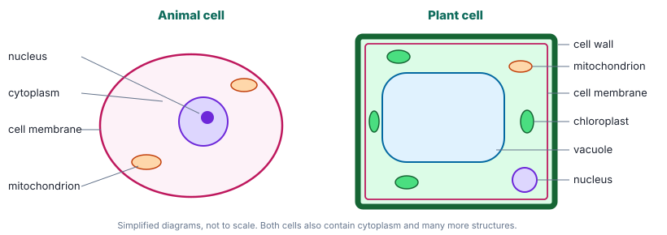

# Year 8 English — Week 1
## Content text: *Little Rooms: How Cells Were Discovered* (Science — Biological sciences; Science as a Human Endeavour)
## Literacy focus: Summarising · Complex sentences · Latin & Greek roots

**Name:** ______________________ **Date:** ____________

**Learning intentions — by the end of this worksheet I can:**
- *(content)* explain the three ideas of cell theory and how they were discovered over two centuries
- *(content)* explain why scientific knowledge changes when new technology and evidence appear
- *(skill)* identify main and subordinate clauses and use complex sentences for precision
- *(skill)* summarise a paragraph and a whole text concisely
- *(skill)* use Latin and Greek roots to work out unfamiliar scientific words

---

## Part A · Warm-up ⏱ ~5 min

1. Label the **noun**, **verb**, **adjective** and **adverb** in this sentence:
   *The patient scientist carefully adjusted the brass microscope.*
   Noun(s): __________ Verb: __________ Adjective(s): __________ Adverb: __________

2. Rewrite the sentence correctly (there are **five** errors):
   *their are many different type's of cell's in the human body, each has it's own job.*

<!-- lines:2 -->

3. Join these two sentences into one using the word **which**:
   *Hooke published a book in 1665. The book contained detailed drawings of insects.*

<!-- lines:2 -->

---

## Part B · Read ⏱ ~12 min

> ### Little Rooms: How Cells Were Discovered
>
> **¶1** Every living thing you have ever seen — a gum tree, a dolphin, the mould on old bread, your own hand — is built from tiny units called cells. Your body alone contains tens of trillions of them. Yet for almost all of human history, nobody knew that cells existed. Their discovery was not a single "eureka" moment; it was a slow puzzle, assembled over two centuries by people who often disagreed, who built better tools, and who were sometimes completely wrong.
>
> **¶2** The story begins in England in 1665, when Robert Hooke published *Micrographia*, a book of astonishing drawings made through a microscope. Hooke magnified fleas, the eye of a fly and the point of a needle, which looked jagged and blunt under the lens. When he examined a thin slice of cork, he saw that it was full of tiny, empty compartments arranged like a honeycomb. Because they reminded him of small rooms, he called them *cells*, from the Latin *cella*, meaning "a small room". What Hooke had actually seen were the walls of plant cells that had died long before; the living contents had disappeared. He named the cell, but he had no idea how important it was.
>
> **¶3** A few years later, a cloth merchant in the Dutch city of Delft took the investigation much further. Antonie van Leeuwenhoek had no university training, but he was extraordinarily skilled at grinding tiny glass lenses. His simple, single-lens microscopes could magnify objects more than two hundred times, which was better than any other instrument of the day. In drops of pond water, rainwater and even the scrapings from his own teeth, he observed swarms of moving creatures that he called *animalcules* — "little animals". When he described them in letters to the Royal Society in London, some members doubted him, since nobody else could see what he claimed to see. Only after Hooke built improved microscopes and confirmed the observations did the scientific community accept them. Van Leeuwenhoek had become the first person to describe single-celled organisms, including bacteria.
>
> **¶4** For more than a century and a half after that, progress was slow. Early lenses blurred and coloured the edges of images, so fine details remained invisible. It was not until the 1830s, when better microscopes had been developed, that two German scientists drew the observations together. In 1838 the botanist Matthias Schleiden concluded that all plants are made of cells. The following year, the physiologist Theodor Schwann, after comparing animal tissues with plant tissues, argued that animals are also made of cells. Together their work produced a bold idea: the cell is the basic unit of all living things.
>
> **¶5** There was, however, a gap in the theory. Where did new cells come from? Schleiden believed that cells could form spontaneously from the fluid inside organisms, almost like crystals growing in a solution. The answer came from careful observation of cells dividing. The Polish-German scientist Robert Remak observed cell division in animal tissue in the 1850s, and in 1855 the influential doctor Rudolf Virchow published the famous Latin phrase *omnis cellula e cellula* — "every cell comes from a cell". Virchow is usually given the credit, although historians now point out that he relied heavily on Remak's evidence without fully acknowledging it.
>
> **¶6** By the second half of the nineteenth century, cell theory rested on three ideas that are still taught today. First, all living things are made of one or more cells. Second, the cell is the basic unit of structure and function in living things. Third, all cells come from pre-existing cells. These ideas changed medicine. If disease begins in cells, then doctors could look for it there, and Virchow himself argued that illnesses such as cancer start when cells behave abnormally.
>
> **¶7** The story did not end in the 1800s. When the electron microscope was invented in the 1930s, scientists could see structures thousands of times smaller than a light microscope reveals, such as the folded inner membranes of mitochondria, the cell's energy-releasing structures. Each new tool has added detail, and occasionally forced scientists to rethink what they believed. That is the real lesson of the cell: scientific knowledge is never finished. It grows, and sometimes changes direction, whenever new technology allows people to gather better evidence.

> **Glossary**
> **botanist** — scientist who studies plants · **physiologist** — scientist who studies how living bodies function · **tissue** — a group of similar cells working together · **spontaneously** — happening by itself, without an outside cause · **mitochondria** (sing. *mitochondrion*) — structures in cells that release energy from food

---

## Part C · Understanding the content ⏱ ~10 min

**1.** *(Literal)* Why did Hooke choose the word *cell*? What had he really been looking at?

<!-- lines:3 -->

**2.** *(Literal)* Number these events in the order they happened (1–6).
- ___ Schwann argues that animals are made of cells
- ___ The electron microscope is invented
- ___ Hooke publishes *Micrographia*
- ___ Van Leeuwenhoek describes "animalcules"
- ___ Virchow publishes *omnis cellula e cellula*
- ___ Schleiden concludes that plants are made of cells

**3.** *(Literal)* State the three ideas of cell theory **in your own words**.
*Idea 1:*
<!-- lines:2 -->

*Idea 2:*
<!-- lines:2 -->

*Idea 3:*
<!-- lines:2 -->

**4.** *(Inferential)* Why do you think some members of the Royal Society doubted van Leeuwenhoek? Give **two** possible reasons, at least one of which is not directly stated in the text.

<!-- lines:4 -->

**5.** *(Inferential)* Hooke named cells in 1665, but cell theory was not complete until the 1850s. Using evidence from ¶3–¶5, explain why it took so long.

<!-- lines:5 -->

**6.** *(Evaluative)* Is it fair that Virchow is usually given credit for *omnis cellula e cellula*? Give your opinion and justify it with evidence from ¶5.

<!-- lines:5 -->

**7.** *(Connection)* Explain how the third idea of cell theory proved Schleiden partly wrong.

<!-- lines:3 -->

### 🔗 Connections — linking the history to the science (and maths)
*Use the cell diagrams above, the text, and what you learnt about living things in Year 7 science.*

**8.** Hooke's cork was **dead plant tissue**. Which **one** labelled structure in the plant cell could he still see? Why would the others have disappeared?

<!-- lines:3 -->

**9.** List **three** structures found in plant cells but not animal cells. For each, suggest why a plant needs it and an animal doesn't. *(Hint: plants make their own food and do not have skeletons.)*

<!-- lines:6 -->

**10.** Bacteria — van Leeuwenhoek's "animalcules" — are single cells with **no nucleus**. Which idea of cell theory do bacteria still obey, and why does that matter?

<!-- lines:3 -->

**11. Maths link.** A typical human cell is about 0.02 mm across.
a) How many such cells would fit side by side across 1 cm? ________
b) Van Leeuwenhoek's best lenses magnified about 200 times. How wide would a 0.02 mm cell appear through them? ________
c) Hooke saw cork cells with a microscope magnifying about 50 times. Use your answers to explain why van Leeuwenhoek could see things Hooke missed.

<!-- lines:3 -->

---

## Part D · How the text works ⏱ ~13 min

### Mini-lesson: complex sentences
A **clause** is a group of words with a verb and its subject.
- A **main (independent) clause** makes sense on its own.
- A **subordinate (dependent) clause** adds information but cannot stand alone. It usually begins with a **subordinating conjunction** (*because, when, although, since, after, until, if, unless, while*) or a **relative pronoun** (*who, which, that, whose, where*).
- A **complex sentence** = main clause + at least one subordinate clause.

> *[Because they reminded him of small rooms,]* **he called them cells.**
> subordinate clause (reason) + **main clause**
>
> When the subordinate clause comes **first**, put a comma after it.

A **relative clause** can be *embedded* in the middle of a main clause:
> **Robert Remak,** *[who observed cell division in animal tissue,]* **is less famous than Virchow.**

**12.** For each sentence from the text, **underline the main clause** and put [square brackets] around each subordinate clause. Then write the conjunction or relative pronoun that begins the subordinate clause.

a) *When he examined a thin slice of cork, he saw that it was full of tiny, empty compartments.* ________
b) *Van Leeuwenhoek had no university training, but he was extraordinarily skilled at grinding tiny glass lenses.* ________ *(Careful — is this sentence complex?)*
c) *Some members doubted him, since nobody else could see what he claimed to see.* ________
d) *Virchow is usually given the credit, although historians now point out that he relied heavily on Remak's evidence.* ________

**13.** Combine each set of simple sentences into **one** complex sentence. Use a different conjunction or relative pronoun each time. Do not just use *and*.

a) Schwann compared animal and plant tissue. He concluded that animals are made of cells.

<!-- lines:2 -->
b) Early microscopes blurred images. Scientists could not see fine details inside cells.

<!-- lines:2 -->
c) Van Leeuwenhoek was a cloth merchant. He discovered bacteria.

<!-- lines:2 -->

**14.** Rewrite your answer to 13(b) so the subordinate clause is in a **different position**. How does moving the clause change the emphasis?

<!-- lines:4 -->

### Summarising
A good summary keeps the **main idea** and the **essential supporting points**, removes examples and detail, and uses **your own words**.

**15.** Summarise ¶3 in **no more than 30 words**.

<!-- lines:3 -->

**16.** Summarise the **whole text** in **one sentence of no more than 35 words**. (Hint: a complex sentence is useful here.)

<!-- lines:3 -->

---

## Part E · Vocabulary: roots ⏱ ~5 min

| Root | Origin | Meaning |
|---|---|---|
| *micro-* | Greek | small |
| *-scope* | Greek | look at, examine |
| *cyto-* / *-cyte* | Greek | cell (lit. "hollow vessel") |
| *bio-* | Greek | life |
| *-logy* | Greek | study of |
| *-graph* / *-graphy* | Greek | write, draw, record |
| *chloro-* | Greek | green |
| *-phyll* | Greek | leaf |
| *-cule* | Latin | small (a diminutive ending) |

**17.** Use the roots to define each word.
a) *Micrographia* ______________________________
b) *cytology* ______________________________
c) *chlorophyll* ______________________________
d) *microbiology* ______________________________
e) *animalcule* ______________________________
f) *leucocyte* (*leuco-* = white) ______________________________

**18.** Invent a word using at least two roots from the table for something that doesn't exist yet. Give its definition.

<!-- lines:2 -->

---

## Part F · Writing: analytical paragraph ⏱ ~15 min

**Prompt:** *"Scientific knowledge changes when new technology and new evidence appear."* Use the history of the cell to support this statement.

Write one **TEEL** paragraph (150–200 words):
- **T**opic sentence — state your argument clearly
- **E**xplanation — develop the idea
- **E**vidence — at least two specific examples from the text (names, dates, discoveries)
- **L**ink — connect back to the statement

**Success criteria** (tick when done)
- [ ] clear topic sentence that answers the prompt
- [ ] at least two pieces of specific evidence with dates
- [ ] at least **three complex sentences** (highlight the subordinating conjunctions)
- [ ] at least **two** words containing roots from Part E
- [ ] own words — no copied sentences longer than five words
- [ ] linking sentence that refers back to the prompt

<!-- lines:20 -->

---

## Part G · Challenge ⏱ extra

**19.** Viruses can only reproduce by entering a host cell, and they are not made of cells. Using the three ideas of cell theory, write a short argument (80–120 words) on whether viruses should be considered alive. Acknowledge the opposing view in a sentence beginning with *Although…*.

<!-- lines:11 -->

**20.** The text says knowledge "sometimes changes direction". Find **one** sentence in the text that is evidence of science being *wrong* and later corrected. Explain how the text signals this.

<!-- lines:4 -->

---
### Self-check

| I can… | 😀 | 🙂 | 😕 |
|---|---|---|---|
| explain the three ideas of cell theory | | | |
| explain how microscopes changed what scientists knew | | | |
| identify main and subordinate clauses | | | |
| write complex sentences with correct commas | | | |
| summarise in a set number of words | | | |
| use roots to work out scientific words | | | |

---

## ⚡ Fast-finisher bank ⏱ ~40 min
*Work through in order. ⭐⭐⭐⭐ = Year 9–10 level.*

**F1 ⭐⭐ Openings.** Why does the writer open ¶1 with a list of very different living things (*a gum tree, a dolphin, the mould on old bread, your own hand*)? What effect do the dashes have?

<!-- lines:3 -->

**F2 ⭐⭐ Careful language.** Find **three** words or phrases where the writer avoids claiming too much (e.g. *usually*). Why would a writer about the history of science be careful in this way?

<!-- lines:4 -->

**F3 ⭐⭐⭐ A primary source.** Here is part of what Hooke himself wrote in *Micrographia* (1665), in his original spelling:

> *"I could exceedingly plainly perceive it to be all perforated and porous, much like a Honey-comb, but that the pores of it were not regular."*

a) What does *perforated* mean? Use the context and the root *per-* ("through").

<!-- lines:1 -->
b) List **two** features of the language that show this was written over 350 years ago.

<!-- lines:2 -->
c) What does this source give a historian that the article in Part B does not? What does the article give that this source does not?

<!-- lines:4 -->

**F4 ⭐⭐⭐ Sentence craft.** Write four sentences about microscopes or cells. Each must begin with a different kind of subordinate clause:
a) time (*When…, After…, Until…*)

<!-- lines:2 -->
b) reason (*Because…, Since…*)

<!-- lines:2 -->
c) concession (*Although…, Even though…*)

<!-- lines:2 -->
d) condition (*If…, Unless…*)

<!-- lines:2 -->
e) Now write one sentence with a relative clause **embedded** in the middle, punctuated with commas.

<!-- lines:2 -->

**F5 ⭐⭐⭐ Change the audience.** Rewrite ¶4 for a Year 4 student in **no more than 60 words**. Then name three specific changes you made and why.

<!-- lines:9 -->

**F6 ⭐⭐⭐ Timeline.** Draw a timeline from 1650 to 1950 to scale (e.g. 1 cm = 25 years). Mark the six events from Part C Q2, each with a caption of **no more than 10 words**. What does the scale make visible that a list does not?

<!-- work:9 -->

**F7 ⭐⭐⭐⭐ Historical voice.** Write a diary entry (≈250 words) as Antonie van Leeuwenhoek on the night he first sees animalcules in a drop of water. Include:
- accurate details from the text (Delft, lenses, magnification, the Royal Society)
- at least three complex sentences and one embedded relative clause
- a sense of his excitement *and* his worry that he will not be believed

<!-- lines:24 -->

**F8 ⭐⭐⭐⭐ Argue both sides.** *"Credit in science should go to whoever publishes first."* Plan a debate: three points **for** and three points **against**, each supported by an example (Virchow and Remak is one; you may know others).

| For | Against |
|---|---|
| 1. | 1. |
| 2. | 2. |
| 3. | 3. |

**F9 ⭐⭐⭐⭐ Research (needs a book or internet).** Find out one thing scientists have discovered about cells since 1950 (e.g. DNA's double helix, 1953; stem cells; seeing proteins with cryo-electron microscopy). Write a 100-word explanation in your own words that names your source and the technology that made the discovery possible.

<!-- lines:10 -->
