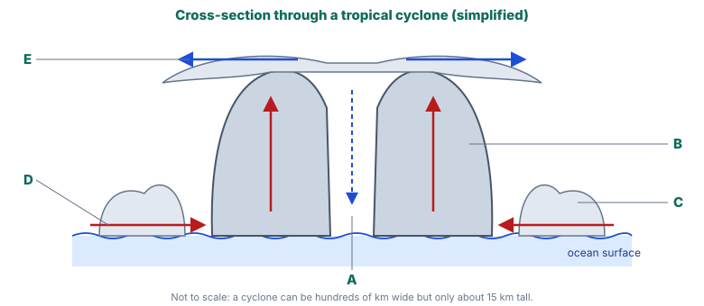

# Year 8 English — Week 31 Homework
## Topic: The science of cyclones · objective language · Greek and Arabic roots  ⏱ ~25 min

**Name:** ______________________ **Due:** ____________

## 1 · Read

> ### Inside a Cyclone
>
> **¶1** A tropical cyclone is an enormous, rotating system of storms around an area of very low air pressure. In the Atlantic Ocean the same kind of storm is called a *hurricane*, and in the north-west Pacific a *typhoon*; the name changes, but the science does not.
>
> **¶2** A cyclone works rather like an engine that runs on heat and moisture. Over an ocean that is about 26.5 °C or warmer, rapid evaporation adds huge amounts of water vapour to the air. Warm, moist air near the surface spirals in towards the centre, rises and cools, and its water vapour condenses into towering clouds. Condensation releases heat, which warms the air, makes it rise faster and draws in yet more moist air from the sea surface. High above, at around 15 kilometres, the air spreads outwards again.
>
> **¶3** Because Earth spins, moving air is deflected, an effect known as the Coriolis effect. As a result, cyclones in the Southern Hemisphere rotate clockwise, while those in the Northern Hemisphere rotate anticlockwise. The same effect is too weak near the equator, which is why cyclones almost never form within a few hundred kilometres of it.
>
> **¶4** At the centre of a mature cyclone lies the **eye**: a region of light winds and often clear sky, where air slowly sinks and warms. The eye is surrounded by the **eyewall**, a ring of tall cloud where the strongest winds and heaviest rain occur. Further out, **spiral rainbands** bring bursts of heavy rain and gusty wind. People who experience the eye passing over them may think the storm is over — but after a calm that can last from minutes to an hour or more, the winds return from the opposite direction.
>
> **¶5** Once a cyclone moves over land, it loses its supply of warm, moist air, and friction with the ground slows its winds. It weakens, often into a tropical low. Its rain, however, can continue far inland, which is why the most damaging effect of a cyclone is sometimes a flood hundreds of kilometres from the coast.

## 2 · Questions

**1.** Match each letter on the diagram to the correct part: *eye*, *eyewall*, *spiral rainband*, *warm moist air spiralling in*, *air spreading outwards at the top*.
A ____________ B ____________ C ____________ D ____________ E ____________

**2.** Using ¶2, explain in **two** steps why warm ocean water makes a cyclone stronger.

<!-- lines:3 -->

**3.** Why is it dangerous to go outside when the eye passes over? Use evidence from ¶4.

<!-- lines:3 -->

**4.** *(Week 4: analogy)* ¶2 compares a cyclone to an engine. What is the "fuel"? Where does the analogy break down?

<!-- lines:3 -->

**5.** *(Week 2: nominalisation)* Find **two** nominalisations in ¶2 (nouns made from verbs or adjectives). Rewrite one sentence that contains one, using a verb instead. Which version suits a science text better, and why?

<!-- lines:4 -->

**6.** *(This week: objectivity)* A news website runs this sentence: *"The deadly eye of the storm tricks people into stepping outside."* Identify the emotive or misleading words, then rewrite it as an objective sentence of no more than 20 words.

<!-- lines:3 -->

## 3 · Word origins

| Word | Origin |
|---|---|
| *cyclone* | Greek *kyklos* (circle, wheel). The word was coined in the 1840s by Henry Piddington, who studied storms at sea. |
| *tropic* | Greek *tropē* (a turning) — the latitudes where the Sun appears to "turn back" at the solstices |
| *monsoon* | Portuguese *monção*, from Arabic *mawsim* (season) |

**7.** a) Explain how *kyklos* links these words: *bicycle*, *recycle*, *encyclopaedia* (*enkyklios* = "all-round, general").

<!-- lines:3 -->
b) Explain why *cyclone* is a good name for the storm shown in the diagram.

<!-- lines:2 -->
c) Why is it fitting that *monsoon* originally meant "season"? Use what you learnt about the Kimberley in class.

<!-- lines:2 -->

## 4 · At home

**8.** Check your household's emergency preparation with someone at home (do **not** go anywhere unsafe to do this).
a) Tick what your household already has: ☐ a written or agreed emergency plan ☐ a meeting place ☐ a list of emergency contacts ☐ torch and spare batteries ☐ battery or wind-up radio ☐ first aid kit ☐ drinking water ☐ copies of important documents ☐ a plan for pets
b) Teach the person at home what *Advice*, *Watch and Act* and *Emergency Warning* mean. Write **one** question they asked and your answer.

<!-- lines:3 -->
c) Write a short, **objective** news brief (about 50 words) reporting what you found, as if for a household newsletter. Attribute any opinion to the person who said it.

<!-- lines:5 -->
