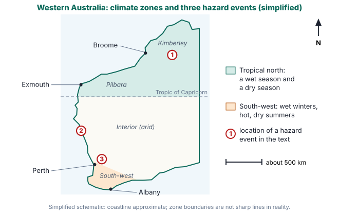
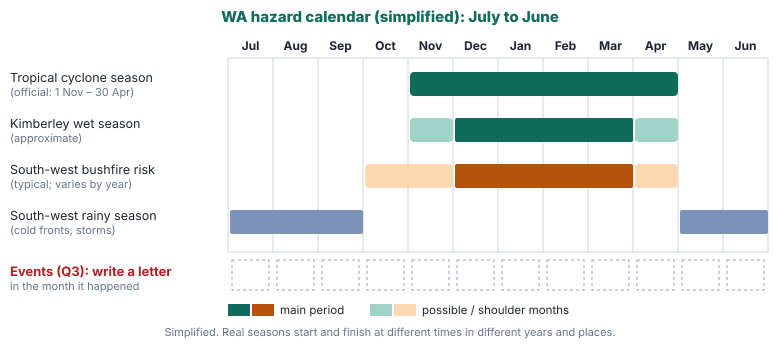
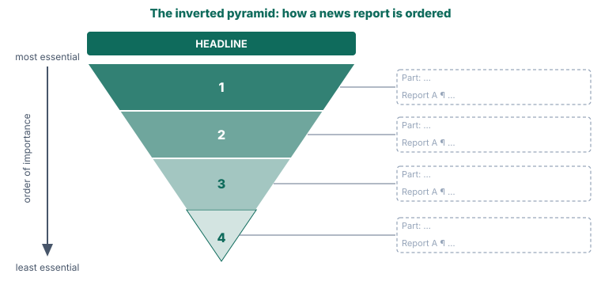

# Year 8 English — Week 31
## Content text: *Fire, Flood and Cyclone: Living with Hazards in Western Australia* (Geography — Landforms and landscapes: hazards)
## Literacy focus: News report structure · Objectivity and bias · Attribution

**Name:** ______________________ **Date:** ____________

**Learning intentions — by the end of this worksheet I can:**
- *(content)* explain why tropical cyclones and floods threaten northern WA while bushfires threaten the south-west, using climate, geography and seasons
- *(content)* describe how WA communities prepare for and respond to hazards, including the national Fire Danger Rating System and emergency warning levels
- *(skill)* identify the parts of a news report (headline, lead, inverted pyramid, quotes and attribution, background)
- *(skill)* tell objective reporting from biased reporting by analysing word choice, selection and omission, whose voices are heard, passive voice and headlines
- *(skill)* write an accurate, balanced news report that attributes every claim

---

## Part A · Warm-up: retrieval from Terms 1–3 ⏱ ~5 min

1. *(Week 2: passive voice)* Rewrite in the **active voice**, adding a sensible agent (doer):
   *Hundreds of homes were evacuated overnight.*

<!-- lines:1 -->

2. *(Week 7: modality and hedging)* This sentence claims too much. Rewrite it with **two** hedging choices so that it is defensible:
   *Climate change will make every WA summer more dangerous.*

<!-- lines:2 -->

3. *(Week 5: persuasive techniques)* Name the technique in each phrase: a) *"Every parent's worst nightmare"* __________ b) *"Nine out of ten residents agree"* __________ c) *"Will we really just sit back and wait for the next one?"* __________

4. *(Week 3: reliability)* A post on social media says a bushfire "was definitely lit on purpose". Give **two** questions you would ask before believing it.

<!-- lines:2 -->

---

## Part B · Read ⏱ ~10 min

> ### Fire, Flood and Cyclone: Living with Hazards in Western Australia
>
> **¶1** Western Australia covers about a third of the Australian continent and stretches more than 2000 kilometres from the tropical Kimberley to the cool southern coast near Albany. A state that large does not have one climate; it has several. As a result, Western Australians face different natural hazards depending on where they live. On the same summer day, a family in Broome may be watching the ocean for a cyclone while a family in the Perth Hills is watching the sky for smoke. Geographers make a careful distinction here: a *hazard* is a natural event that could cause harm, but it only becomes a *disaster* when it strikes a place where people, homes and infrastructure are exposed and unprepared. That is why preparation matters as much as prediction.
>
> **¶2** Tropical cyclones form over warm ocean water, generally where the sea surface is about 26.5 °C or warmer. Warm, moist air rises, cools and condenses into towering storm clouds, and the heat released as the water vapour condenses powers the system further. Because the seas off northern Australia are warmest in the hotter months, the official cyclone season runs from 1 November to 30 April. The Pilbara coast between Broome and Exmouth is regarded as the most cyclone-prone stretch of the Australian coastline. A cyclone brings three main dangers: destructive winds, which can strip roofs and turn loose objects into missiles; a storm surge, in which the sea rises well above the normal high tide and floods low-lying coasts; and very heavy rain. Once a cyclone crosses the coast it is cut off from its supply of warm, moist air and gradually weakens, but its remains can carry rain hundreds of kilometres inland.
>
> **¶3** That rain is the link between cyclones and floods. The Kimberley has a monsoonal climate: almost all of its rain falls in the wet season, roughly November to April, and very little falls in the dry season. When a tropical low or a weakening cyclone stalls over a river's catchment, enormous volumes of water drain into the river at once. In late December 2022 and early January 2023, the remains of Tropical Cyclone Ellie lingered over the Kimberley for many days. The Fitzroy River — known to many of its Traditional Owners as Martuwarra — rose to a record height at Fitzroy Crossing. Many residents had to be evacuated, homes and roads were damaged, and the Great Northern Highway bridge at Fitzroy Crossing was so badly damaged that it had to be replaced, cutting the region's main road link while temporary crossings and a new bridge were built. Many of the people affected live in Aboriginal communities whose families have cared for this country for many thousands of years, and community organisations and local knowledge were central to both the response and the long recovery.
>
> **¶4** The south-west faces a different threat. Its Mediterranean-type climate brings mild, wet winters and hot, dry summers. Winter and spring rain grows grasses, shrubs and forest undergrowth; summer heat then dries them into fuel. The most dangerous fire weather combines high temperatures, low humidity and strong winds. A change in wind direction is especially dangerous, because the long side, or flank, of a fire can suddenly become a wide new fire front. On 1 February 2021, a fire that began near Wooroloo, in the hills north-east of Perth, spread through parts of the Shire of Mundaring and the City of Swan. It destroyed more than 80 homes and burnt roughly 11 000 hectares, and it broke out while Perth was in a short COVID-19 lockdown, which made evacuation and sheltering more complicated.
>
> **¶5** Hazards do not always stay where people expect them. On the evening of 11 April 2021, Severe Tropical Cyclone Seroja crossed the coast near Kalbarri, about 500 kilometres north of Perth, as a Category 3 system. Cyclones rarely keep that much strength so far south. Its winds damaged a large share of the buildings in Kalbarri and Northampton and brought down power lines across the Mid West. Because these towns lie outside the region where building rules require cyclone-resistant construction, many homes had not been designed for such winds. Seroja was a reminder that planning rules are based on past patterns, and the past is not always a reliable guide to the future.
>
> **¶6** Most hazards can be forecast, at least partly. The Bureau of Meteorology tracks cyclones and issues weather forecasts and warnings, while the Department of Fire and Emergency Services (DFES) issues community alerts and warnings in WA, published on the Emergency WA website. Since September 2022, Australia has used a national Fire Danger Rating System with four levels — Moderate, High, Extreme and Catastrophic — each linked to an action, from "plan and prepare" to "for your survival, leave bushfire risk areas". When an emergency is actually under way, warnings use three levels: Advice, Watch and Act, and Emergency Warning. For cyclones, WA communities move through Blue, Yellow and Red alerts until an All Clear is given. Much of the response depends on volunteers: thousands of people across WA serve in volunteer bushfire brigades and the State Emergency Service (SES), many of them in regional towns where they are the first and sometimes only help for hours.
>
> **¶7** The risks are also changing. According to the Bureau of Meteorology and CSIRO, cool-season rainfall in south-west WA has declined since the 1970s, and dangerous fire weather has become more frequent across much of southern Australia. For cyclones, scientists expect fewer to form overall, but a larger proportion of those that do form may be intense — although they describe these projections with less confidence. Living with hazards therefore means accepting that they cannot be prevented, only prepared for, and that a community's safety depends as much on planning, building standards and neighbours as on the weather itself.

> **Glossary**
> **infrastructure** — roads, bridges, power lines and other shared systems a community needs · **condenses** — changes from a gas to a liquid · **catchment** — the area of land that drains into a river · **monsoonal** — having a strongly wet and a strongly dry season · **tropical low** — a low-pressure weather system in the tropics that is weaker than a cyclone · **humidity** — the amount of water vapour in the air · **Traditional Owners** — Aboriginal people with cultural responsibility for a particular area of land (country)

---

## Part C · Understanding the content ⏱ ~7 min

**1.** *(Literal)* Name the **three** main dangers a cyclone brings and give one effect of each.

<!-- lines:3 -->

**2.** *(Map)* Which event from the text happened at each numbered location on the map? Name the event and the hazard type.
① __________________________ ② __________________________ ③ __________________________

**3.** *(Calendar)* On the hazard calendar, write **S** (Seroja), **W** (Wooroloo) and **F** (Fitzroy River flood) in the month each event happened (or began). Then explain what the calendar suggests about the pressure on WA's emergency services each summer.

<!-- lines:4 -->

**4.** *(Inferential)* Using ¶1, explain the difference between a *hazard* and a *disaster*. Use Seroja as your example.

<!-- lines:4 -->

**5.** *(Inferential)* Give **two** reasons, one about the weather and one about people's decisions, why Seroja caused so much damage.

<!-- lines:3 -->

**6.** *(Evaluative)* The writer says preparation "matters as much as prediction". Do you agree? Use **two** pieces of evidence from different paragraphs.

<!-- lines:5 -->

### 🔗 Connections — geography, maths and science inside a news story ⏱ ~9 min
*The data below is from a **fictional** cyclone, Tropical Cyclone Harlow, which crossed the Pilbara coast at the fictional town of Port Hensley. Use it with the calendar, the map and ¶2.*

| Weather station (fictional) | Distance inland from where Harlow crossed | Strongest wind gust (km/h) | Rain in 24 hours (mm) |
|---|---|---|---|
| Port Hensley | 0 km (on the coast) | 178 | 212 |
| Spinifex Point | 0 km (coast, 60 km east) | 141 | 96 |
| Cooper Creek | 150 km | 87 | 164 |
| Red Hill | 300 km | 52 | 118 |

| Australian cyclone category (by strongest gust) | 1 | 2 | 3 | 4 | 5 |
|---|---|---|---|---|---|
| Strongest gust (km/h) | under 125 | 125–164 | 165–224 | 225–279 | 280 or more |

**7.** Which category do the gusts at Port Hensley match? ________ At Spinifex Point? ________

**8.** Describe the pattern in **wind** as distance inland increases, then the pattern in **rain**. Use ¶2 to explain **why** the two patterns are different.

<!-- lines:5 -->

**9.** a) Calculate the **mean** 24-hour rainfall of the four stations. ________ mm
b) A reporter writes: *"More than 200 mm of rain fell across the region."* Explain why this is misleading, then write an accurate replacement sentence that includes the figures and is attributed to the Bureau of Meteorology.

<!-- lines:5 -->

**10.** Weather reports at sea often use **knots** (1 knot = 1.852 km/h). Convert Port Hensley's strongest gust to knots, to the nearest whole number. ________ knots

**11.** *(Probability language)* A forecast says: *"There is a 70% chance of gale-force winds at Red Hill within 24 hours."*
a) What is the chance that gales do **not** occur? ________
b) A headline reads *"GALES TO HIT RED HILL"*. Explain why this is not objective, and rewrite it (maximum 10 words) so that it keeps the uncertainty.

<!-- lines:3 -->

---

## Part D · How news reports work ⏱ ~11 min

### Mini-lesson: the shape of a news report
- **Headline** — short, present tense, the most newsworthy fact (*Cyclone crosses Pilbara coast*). Small words (*a, the, is*) are often dropped.
- **Lead** (first paragraph) — answers as many of the **5Ws + H** as it can: *who, what, where, when, why, how*. A reader who stops here still has the story.
- **Inverted pyramid** — the body is ordered from **most** to **least** essential, so an editor can cut from the bottom without losing key facts.
- **Quotes and attribution** — facts and opinions are tied to a named source with a verb such as *said*, *reported* or *according to*. Neutral *said* is the default; verbs like *slammed*, *admitted* or *sobbed* add judgement.
- **Background** — earlier events and context, usually near the end.

### Mini-lesson: objectivity and bias
An **objective** report lets readers judge for themselves. A **biased** report steers them, through:
1. **word choice** — emotive (*monster, terrified, devastation*) instead of neutral (*severe, damaged*)
2. **selection and omission** — which facts are included and which are left out
3. **voices** — whose words are quoted, and whose are not
4. **agency** — passive voice can hide who did something (*mistakes were made*)
5. **vague attribution** — *experts fear*, *it is understood*, *questions are being asked*
6. **headlines** — exaggeration, capital letters, puns and fear

> ### Report A
>
> **Cyclone Harlow crosses Pilbara coast as Category 3 system**
>
> *FICTIONAL REPORT · Port Hensley, Tuesday*
>
> **¶1** Tropical Cyclone Harlow crossed the Pilbara coast near Port Hensley about 2 am today as a Category 3 system, damaging roofs and bringing down power lines. No serious injuries had been reported by 9 am.
>
> **¶2** The Bureau of Meteorology recorded a gust of 178 km/h at Port Hensley Airport before the weather station lost power.
>
> **¶3** The Department of Fire and Emergency Services (DFES) said about 40 homes had reported damage, mostly to roofs and fences. A DFES spokesperson said crews would check the town street by street today. "Please stay indoors until the All Clear is given, because fallen power lines are still a danger," she said.
>
> **¶4** Resident Tom Walsh, who sheltered in his bathroom with his two children, said the noise "was like a freight train going over the house for three hours".
>
> **¶5** Shire President Dana Ruiz said the evacuation centre had housed about 120 people overnight. "People acted on the Red Alert and went where they needed to go, and that made a real difference," she said. Some residents told reporters they would have liked earlier information about which streets were at risk of storm surge.
>
> **¶6** Harlow is expected to weaken as it moves inland, but the Bureau has warned of heavy rain and possible flooding in inland catchments over the next two days.
>
> **¶7** The last severe cyclone to affect Port Hensley crossed the coast nearby in 2008.

> ### Report B
>
> **TERROR IN THE NIGHT: MONSTER CYCLONE SMASHES HELPLESS TOWN**
>
> *FICTIONAL REPORT · Port Hensley, Tuesday*
>
> **¶1** Terrified families cowered in the dark last night as monster Cyclone Harlow tore through the tiny Pilbara town of Port Hensley, leaving a trail of devastation in its wake.
>
> **¶2** Homes were ripped apart by winds of almost 200 km/h, and furious locals say the warnings came far too late.
>
> **¶3** "It was the worst night of my life. We thought we were going to die," sobbed mother-of-two Kylie Brant, clutching her youngest child outside her wrecked home. "Nobody told us anything until it was nearly here."
>
> **¶4** It is understood that dozens of homes have been destroyed. Experts fear the worst is yet to come, with a wall of water now threatening towns further inland.
>
> **¶5** Power lines were brought down across the town overnight, and the evacuation centre was overwhelmed.
>
> **¶6** Questions are now being asked about whether enough was done to protect the community.
>
> **¶7** For the people of Port Hensley, the nightmare is far from over. How many more times must this forgotten town suffer?

**12.** In each box on the pyramid diagram, name the part of a news report that tier holds and write which paragraph(s) of **Report A** belong there. Then explain why an editor short of space would cut ¶7 first.

<!-- lines:2 -->

**13.** Analyse the lead of Report A (¶1).
Who? ________________ What? ________________ Where? ________________ When? ________________
Which of the 5Ws + H is **not** answered, and why is that acceptable in a first report?

<!-- lines:2 -->

**14.** Complete the table. For each fact, find how **Report B** expresses it and explain the effect.

| Report A (neutral) | Report B (emotive) | Effect on the reader |
|---|---|---|
| *damaging roofs* | | |
| *a gust of 178 km/h* | | |
| *about 40 homes had reported damage* | | |

**15.** *(Selection and omission)* Name **two** important facts in Report A that Report B leaves out. How does leaving them out change the impression of the event?

<!-- lines:5 -->

**16.** *(Voices and attribution)* List the sources quoted or named in each report. Then explain how vague phrases in Report B such as *"It is understood"* and *"Experts fear"* weaken its reliability.

<!-- lines:6 -->

**17.** *(Week 2 link: passive voice)* Look at Report B ¶6: *"Questions are now being asked about whether enough was done…"* Who is asking? Who should have done more? Explain how the passive voice lets the writer blame someone without evidence.

<!-- lines:5 -->

**18.** Report B's ¶3 quote may be completely genuine. Explain why a real, accurate quote can still make a report biased.

<!-- lines:4 -->

---

## Part E · Vocabulary: words of disaster ⏱ ~4 min

| Word | Origin | Literal meaning |
|---|---|---|
| *disaster* | Italian *disastro*, from Latin *dis-* (bad) + *astrum* (star) | "a bad star" |
| *catastrophe* | Greek *kata-* (down) + *strophē* (turning) | "an overturning" |
| *evacuate* | Latin *e-* / *ex-* (out) + *vacuus* (empty) | "to empty out" |
| *emergency* | Latin *e-* (out) + *mergere* (to dip, plunge) | "a rising out (of water)" |
| *meteorology* | Greek *meteōron* (thing high in the air) + *-logy* (study) | "study of things in the sky" |

**19.** *Disaster* comes from a belief about the stars. What belief do you think it was? How is that different from the way the text explains disasters in ¶1?

<!-- lines:3 -->

**20.** *Catastrophe* and *damage* can describe the same event. Which belongs in an objective news report, and why? When might *catastrophe* be the accurate word?

<!-- lines:3 -->

---

## Part F · Writing: news report ⏱ ~15 min

**Task:** Write a news report of **250–300 words** about the **fictional** bushfire below for a WA news website. Use only the facts in the fact file. You must decide which facts matter most, which voices to include, and what to leave out.

> **Fact file — Jarrah Ridge fire (fictional)**
> - Jarrah Ridge: fictional town of about 1500 people in the hills, roughly 70 km south-east of Perth
> - Saturday: Fire Danger Rating **Extreme**; temperature 41 °C; strong north-easterly winds; a south-westerly change arrived about 4 pm
> - Fire started about 11:30 am in bushland north of the town; cause **under investigation** (police have not commented)
> - DFES issued an **Emergency Warning** at 1:15 pm; downgraded to **Watch and Act** at 9 pm
> - About 1200 hectares burnt; 3 homes and 7 sheds destroyed (DFES, Sunday 8 am)
> - Two volunteer firefighters treated for heat exhaustion; both released from hospital Saturday night
> - About 300 people went to the evacuation centre at the Jarrah Ridge Recreation Centre
> - DFES Incident Controller Priya Nair: *"The wind change turned the eastern flank into a new front. Crews held the line on Ridge Road, which protected more than 200 homes."*
> - Volunteer brigade captain Sam O'Brien: *"Our crews were out for 14 hours straight. The community support has been incredible."*
> - Resident Mel Hart (her home was destroyed): *"We had our plan and we left at 1 pm. We lost the house, but we're all safe."*
> - Social media posts claim the fire was "definitely deliberately lit" — **not confirmed** by police or DFES
> - Background: the last major fire near Jarrah Ridge was in 2011

**Success criteria** (tick when done)
- [ ] a short, accurate headline (no sensationalism)
- [ ] a lead that answers at least four of the 5Ws + H in one or two sentences
- [ ] body ordered as an inverted pyramid, with background last
- [ ] at least **two** attributed quotes from **different** kinds of sources
- [ ] every figure and claim attributed (*DFES said…*, *according to…*)
- [ ] neutral word choice: no emotive adjectives in the reporter's own voice
- [ ] the unconfirmed claim is either left out or clearly reported as unconfirmed
- [ ] at least one hedge for uncertain information (*about, expected to, under investigation*)
- [ ] 250–300 words

<!-- lines:30 -->

---

## Part G · Challenge ⏱ ~8 min

**21.** *"Even Report A is not perfectly objective."* Find **two** choices in Report A (such as what it includes, the order, or which quotes it uses) that shape the reader's view. Argue whether the report is still fair. Write 80–120 words.

<!-- lines:11 -->

**22.** Report A also uses the passive voice: *"No serious injuries had been reported by 9 am."* Explain why the passive is acceptable here but not in Report B ¶6.

<!-- lines:3 -->

---
### Self-check

| I can… | 😀 | 🙂 | 😕 |
|---|---|---|---|
| explain why the north and the south-west face different hazards | | | |
| explain the Fire Danger Rating levels and the three warning levels | | | |
| label the parts of a news report and the inverted pyramid | | | |
| identify emotive language, omission, vague attribution and hidden agency | | | |
| turn data into an accurate, hedged, attributed sentence | | | |
| write an objective news report | | | |

---

## ⚡ Fast-finisher bank ⏱ ~40 min
*Work through in order. ⭐⭐⭐⭐ = Year 9–10 level.*

**F1 ⭐⭐ Neutral rewrite.** Rewrite Report B ¶1–3 as objective journalism (about 70 words). You may keep Kylie Brant's quote, but you must attribute it neutrally and balance it.

<!-- lines:8 -->

**F2 ⭐⭐ Headline workshop.** Write three headlines for the Wooroloo fire in ¶4: one neutral (≤10 words), one sensational, and one written as a question. Which would get the most clicks? Which would you trust most? Why?

<!-- lines:5 -->

**F3 ⭐⭐ Interview questions.** You are a reporter visiting Fitzroy Crossing six months after the 2023 flood. Write **five open questions** you could respectfully ask a community leader about the recovery. Then explain why open questions produce better quotes than closed ones.

<!-- lines:7 -->

**F4 ⭐⭐⭐ Headline patterns.** Many real headlines follow patterns. Explain the technique and its effect in each of these typical (invented) examples:
a) *Locals SLAM council over flood chaos*

<!-- lines:2 -->
b) *Is YOUR suburb next? Fire map reveals danger zones*

<!-- lines:2 -->
c) *Cyclone Harlow: what we know so far*

<!-- lines:2 -->

**F5 ⭐⭐⭐ From text to news.** Using **only** facts from ¶5 of the main text, write the headline and first two paragraphs of a news report about Seroja, dated 12 April 2021. Do not add any figure that is not in the text.

<!-- lines:10 -->

**F6 ⭐⭐⭐ Ethics of disaster reporting.** Should news outlets show photos and video of people at their most distressed after a disaster? Consider dignity, consent, the public's right to know and, for Aboriginal communities, cultural protocols about images of people. Write about 100 words.

<!-- lines:11 -->

**F7 ⭐⭐⭐⭐ Feature piece** *(Week 29 retrieval).* Write the opening of a feature article (about 200 words) titled *"Living in the cyclone belt"*, set in a Pilbara town. Blend a narrative hook with accurate information from ¶2 and ¶6. Unlike a news report, a feature may use description and a personal angle — but it must not invent statistics.

<!-- lines:20 -->

**F8 ⭐⭐⭐⭐ Argue it.** *"Perfect objectivity is impossible, so fairness is the real goal of journalism."* Respond in about 150 words, using Reports A and B as evidence. Include a concession (*Although…*) and a rebuttal.

<!-- lines:16 -->
