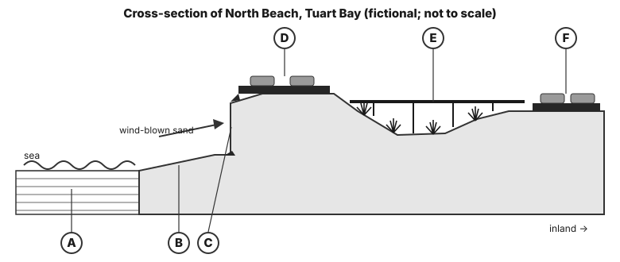
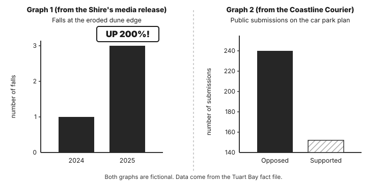
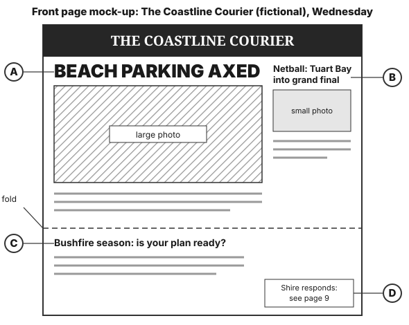

# Year 8 English — Week 32
## Content text: *Same Event, Different Story: Why a Free Press Matters* (Civics & Citizenship — freedoms in Australian democracy; Media literacy)
## Literacy focus: Framing · Selection and omission · Placement and prominence · News, analysis and opinion

**Name:** ______________________ **Date:** ____________

**Learning intentions — by the end of this worksheet I can:**
- *(content)* explain why a free and diverse press matters in a democracy, and what the High Court's implied freedom of political communication does and does not protect
- *(content)* explain why coastal dunes erode and why councils sometimes move infrastructure back from the coast
- *(skill)* identify how a report is framed through its headline, photo, lead, placement, selection and omission, sources, word choice and statistics
- *(skill)* tell news from analysis and opinion, and persuasion from framing
- *(skill)* explain how perspective and voice in a creative text shape the reader's sympathy
- *(skill)* write a comparative media analysis of two reports of the same event

**Text types this week**

| Text | Type | Where |
|---|---|---|
| 1 · *Same Event, Different Story* | Information text (civics) | Part B |
| 2 · Fact file: the North Beach decision | Fact file (data and quotes) | Part B |
| 3 · Reports 1, 2 and 3 | News reports (three outlets, one event) | Part D |
| 4 · *Bulldozing Our Beach* | Persuasive: opinion column | Part E |
| 5 · *What the Foredune Knows* | Creative: free-verse poem | Part E |

*Texts 2–5 are about the same **fictional** event in the fictional town of Tuart Bay. Text 1 is factual.*

---

## Part A · Warm-up: retrieval from Week 31 and Terms 1–3 ⏱ ~5 min

1. *(Week 31: news structure)* Number these parts of a news report in inverted-pyramid order (1 = top): ___ background ___ lead ___ further detail and human-interest quotes ___ key facts from official sources

2. *(Week 31 + Week 2: passive voice)* Rewrite in the **active** voice with a sensible agent, then say what the passive version hid.
   *Mistakes were made in the planning of the car park.*

<!-- lines:2 -->

3. *(Week 31: emotive language)* Rewrite as a neutral sentence: *Furious locals slammed the council's shock decision.*

<!-- lines:1 -->

4. *(Week 16: voting)* Voting in Australian federal elections is compulsory. Give **one** reason this makes accurate, varied news coverage especially important.

<!-- lines:2 -->

5. *(Week 8: graphs)* Name **one** way a bar graph can be drawn so that it misleads. ______________________________

---

## Part B · Read ⏱ ~10 min

> ### Same Event, Different Story: Why a Free Press Matters
>
> **¶1** Australians aged 18 and over must enrol and vote in federal elections, and voting at that level has been compulsory since 1924. But a vote is only as good as the information behind it. Most citizens will never sit in a parliament or a council chamber, read a budget line by line or visit the scene of a disaster. They rely on other people to watch, ask questions and report back. That is the job of the news media, and it is why a free press is so often described as one of the foundations of democracy.
>
> **¶2** Journalists are often said to play three roles. They **inform**, telling citizens what governments, businesses and communities are doing. They act as a **watchdog**, investigating people with power and revealing what those people would rather keep hidden. And they provide a **forum**, a public space where different groups can put their case. Investigative reporting can have serious consequences. In Queensland in 1987, reports in the *Courier-Mail* newspaper and on the ABC's *Four Corners* program about police corruption helped prompt the Fitzgerald Inquiry, which led to criminal convictions of a former police commissioner and several former state ministers, and to major reforms.
>
> **¶3** Many people are surprised to learn that Australia's Constitution contains no written guarantee of free speech or of a free press, unlike the First Amendment to the Constitution of the United States. However, in 1992 the High Court of Australia decided that a freedom of political communication is *implied* by the Constitution. Its reasoning was that the Constitution requires members of parliament to be "directly chosen by the people", and people cannot choose freely if they cannot discuss politics freely. The implied freedom is a limit on the power of parliaments to make laws, rather than a personal right that an individual can claim. It is also not absolute: laws about defamation, national security or court reporting, for example, can still restrict what is published, as long as the courts accept that they are a reasonable way of achieving a legitimate purpose.
>
> **¶4** A free press needs more than legal protection; it also needs **diversity**. If a few organisations owned most news outlets, a small number of editors could decide which stories most citizens ever saw. Researchers have often described media ownership in Australia as highly concentrated, and the rise of social media and the closure of many local newspapers have changed the picture again. Public broadcasters such as the ABC and SBS are funded largely by government but operate under laws designed to protect their editorial independence. Complaints about newspapers and news websites can be made to bodies such as the Australian Press Council, which publishes standards of practice for its members.
>
> **¶5** Even a report in which every sentence is true can steer its readers, because reporting always involves choices. The pattern made by those choices is called a **frame**. Media researchers describe framing as selecting some parts of reality and making them more prominent, so that a story seems to be *about* one thing rather than another. The same council decision might be framed as a conflict between a council and residents, as an economic story about local jobs, as an environmental story, or as a story of responsibility: who caused a problem, and who should fix it. A frame is built from many small decisions: the headline, the photograph, the first sentence, the order of facts, the people quoted first and last, the facts left out, and the numbers chosen to represent the situation.
>
> **¶6** Framing is not always deliberate, and it is not always dishonest. Space is limited, deadlines are short and journalists must decide what matters most. Often the frame comes from the sources: a report written quickly from a government media release may repeat the government's view simply because that was the information available. Good newsrooms try to keep three kinds of writing apart. **News** reports what happened and attributes every claim. **Analysis** explains why it happened and what it might mean, drawing on evidence. **Opinion** argues for a view and should be clearly labelled, for example as an editorial or a column. Problems arise when these are blurred, as when opinion is dressed up as news.
>
> **¶7** For citizens, the lesson is not that "all media is biased, so nothing can be trusted". That conclusion is as unhelpful as believing everything. A better habit is to read more than one account of an important event, notice whose voices are heard and whose are missing, check the numbers, and ask what the story would look like through a different frame. In a democracy, no single report has to tell the whole truth, as long as citizens are free to find, compare and question many reports.

> **Glossary**
> **implied** — not stated in words, but following logically from what is stated · **defamation** — publishing something untrue that damages a person's reputation · **editorial independence** — freedom to decide what to publish without being directed by owners or government · **media release** — a statement an organisation writes and sends to journalists, hoping they will report it · **prominent** — easy to notice; given importance · **foredune** — the first ridge of sand dunes behind a beach · **ACROD bay** — a parking bay reserved in WA for people with a disability permit

> ### Text 2 · Fact file: the North Beach car park decision
>
> *FICTIONAL. These are all the facts that were available to every reporter.*
>
> - **Place:** Tuart Bay, a coastal town of about 3500 people in WA's South West. Its population roughly triples in the summer holidays.
> - **Decision:** On Tuesday night the Shire of Tuart Bay council voted **5–4** to close the 120-bay North Beach car park, which was built on the foredune in the 1980s. It closes on **1 May** next year, after summer.
> - **Replacement:** a **90-bay** car park on Dune Road, **350 m** inland, joined to the beach by a 350 m boardwalk (about a 5-minute walk). **4 ACROD bays**, a **drop-off zone** and the **emergency vehicle track** stay at the beach entrance. The old car park will be removed and replanted with native dune plants.
> - **Cost:** **\$1.8 million**: State Government coastal grant **\$1.2 million**, Shire **\$600 000**. The Shire has about **2400** rateable properties.
> - **Erosion:** Shire surveys show the front of the dune retreated about **12 m between 2010 and 2025**. A storm in July 2025 undermined the car park's seaward edge; **8 bays** have been fenced off since then.
> - **Falls at the eroded edge** reported to the Shire: **1** in 2024, **3** in 2025 (one person broke a wrist).
> - **Car park use (Shire counts):** about **30%** full on an average weekday outside the summer holidays; **full by about 9 am** on summer weekends and public holidays.
> - **Public consultation:** **412** written submissions: **240** opposed, **152** supported, **20** neither.
> - **Shire media release (extract):** "The new car park will comfortably meet demand. Falls at the eroded edge rose by 200 per cent last year. The decision follows extensive community consultation."
> - **Quotes**
>   - Shire President **Cr Helen Marsh** (voted for): "Doing nothing was not an option. This gives us a safe, accessible beach for the next generation."
>   - **Cr Darren Pike** (voted against): "The community told us loud and clear what they wanted, and we ignored them."
>   - **Luca Moretti**, owner of the Dune Café beside the car park: "If people can't park, they won't stop for a coffee. Summer weekends keep us going all year."
>   - **Joan Whitby**, 78, resident: "I've parked here for forty years. I can't walk 350 metres in the heat."
>   - **Sam Okafor**, wheelchair user and local disability advocate: "Keeping the ACROD bays and the drop-off zone matters. I'd like some shade along the boardwalk too."
>   - **Mia Tran**, coordinator of Tuart Bay Coastcare: "Our volunteers have planted about 15 000 seedlings since 2018. Finally the dune gets room to recover."
>   - **Dr Anika Rao**, coastal scientist: "A foredune is like a sand bank account. Storms make withdrawals and calm seasons make deposits, but a car park on top stops the account being topped up."
>   - **Ben Carter**, president of the Surf Life Saving Club: "We were worried about getting rescue vehicles to the water, but the emergency track is staying, so we're satisfied."

---

## Part C · Understanding the content ⏱ ~5 min

**1.** *(Literal)* Name the three roles journalists are said to play (¶2). Which role does the Fitzgerald Inquiry example show?

<!-- lines:2 -->

**2.** Write **T** (true), **F** (false) or **NS** (not stated) for each claim about ¶3–¶4.
a) The Australian Constitution includes a written right to free speech. ____ b) The implied freedom comes from the requirement that parliament is "directly chosen by the people". ____ c) The implied freedom means no law can ever limit what is published. ____ d) The ABC is owned by a private company. ____ e) The Australian Press Council can fine newspapers. ____

**3.** *(Inferential)* Using ¶4, explain why legal freedom alone is not enough to give citizens a full picture of the news.

<!-- lines:3 -->

**4.** *(Evaluative)* ¶7 says no single report "has to tell the whole truth". Is this a comforting idea or a worrying one? Use evidence from **two** paragraphs.

<!-- lines:5 -->

### 🔗 Connections — science, maths and civics behind the story ⏱ ~8 min

**5.** *(Science/geography)* Match each letter on the cross-section to: *beach*, *boardwalk*, *erosion scarp (cut face of the dune)*, *new car park*, *old car park on the foredune*, *sea with storm waves*.
A __________ B __________ C __________ D __________ E __________ F __________

**6.** Use Dr Rao's "sand bank account" analogy and the diagram to explain why a car park on top of the foredune makes erosion worse. Where does the analogy break down? *(Week 4: analogy)*

<!-- lines:4 -->

**7.** a) What was the mean rate of dune retreat between 2010 and 2025, in metres per year? ________ m/year
b) A reporter writes: *"At this rate, the sea will reach the new car park in about 440 years."* Check the calculation, then explain why it needs hedging. *(Week 7: hedging)*

<!-- work:3 -->

<!-- lines:2 -->

**8.** *(Graph 1)* a) Show that "up 200%" is mathematically correct. b) Explain why a percentage change can mislead when the starting number is tiny, and write a fairer caption.

<!-- work:2 -->

<!-- lines:3 -->

**9.** *(Graph 2)* a) How many times more submissions opposed the plan than supported it (1 decimal place)? ________ b) Measured from the bottom of the axis, about how many times taller does the dark bar look than the hatched bar? ________ c) Name **two** ways Graph 2 misleads, including one fact it leaves out.

<!-- work:3 -->

<!-- lines:2 -->

**10.** *(Civics, Week 16)* Voting in WA local government elections is **voluntary**. Cr Marsh and Cr Pike will both face voters at the next council election. Explain why a voter who read only one report of this decision might vote differently from one who read three.

<!-- lines:3 -->

---

## Part D · Same event, three reports ⏱ ~12 min

### Mini-lesson: the framing toolkit
A report can be accurate in every sentence and still steer you. Look at:
1. **The frame** — what is the story *about*? (conflict, money, the environment, safety, responsibility)
2. **Headline and photo** — the first things you see, and often the only things
3. **Lead and placement** — what comes first, and what is buried at the end (where editors cut)
4. **Selection and omission** — which facts are included and which are left out
5. **Voices** — who is quoted, who is quoted first and last, who is named, who is missing
6. **Loaded vs neutral language** — *axed* vs *closed*; *unveils* vs *announces*
7. **Numbers** — which statistic, which comparison, which starting point
8. **Prominence** — on a page or a website, size and position tell you how much an editor thinks a story matters

> ### Report 1 · The Coastline Courier
>
> **Beach parking axed despite community outcry**
>
> *FICTIONAL REPORT · Tuart Bay, Wednesday · Photo: a long queue of cars waiting to enter the full North Beach car park on a January Sunday*
>
> **¶1** North Beach's popular car park will be closed and ripped up after a divided Shire of Tuart Bay council voted 5–4 on Tuesday night, despite almost 60 per cent of public submissions opposing the plan.
>
> **¶2** From May, beachgoers will be forced to park on Dune Road, 350 metres from the sand, and the new car park will have only 90 bays, compared with 120 now.
>
> **¶3** Dune Café owner Luca Moretti said the decision could hurt local businesses. "If people can't park, they won't stop for a coffee. Summer weekends keep us going all year," he said.
>
> **¶4** Resident Joan Whitby, 78, has parked at North Beach for forty years. "I can't walk 350 metres in the heat," she said.
>
> **¶5** Cr Darren Pike, who voted against the closure, said: "The community told us loud and clear what they wanted, and we ignored them."
>
> **¶6** The car park is full by about 9 am on summer weekends.
>
> **¶7** The $1.8 million project will be partly funded by the State Government.
>
> **¶8** The Shire says erosion has damaged the edge of the car park.

> ### Report 2 · EarthWire WA
>
> **Tuart Bay steps back from the edge to save its dunes**
>
> *FICTIONAL REPORT · Tuart Bay, Wednesday · Photo: broken bitumen hanging over a collapsed sand bank at the edge of the car park*
>
> **¶1** A car park built on an eroding sand dune at Tuart Bay will be removed and the land replanted with native plants, after the Shire voted on Tuesday night to move beach parking 350 metres inland.
>
> **¶2** Shire surveys show the front of the dune retreated about 12 metres between 2010 and 2025. A storm in July 2025 undermined the car park's seaward edge, and eight bays have been fenced off ever since.
>
> **¶3** Coastal scientist Dr Anika Rao said dunes protect the coast by storing sand. "A foredune is like a sand bank account. Storms make withdrawals and calm seasons make deposits, but a car park on top stops the account being topped up," she said.
>
> **¶4** Tuart Bay Coastcare coordinator Mia Tran said volunteers had planted about 15 000 seedlings since 2018. "Finally the dune gets room to recover," she said.
>
> **¶5** The State Government will contribute $1.2 million of the $1.8 million cost, which includes a 350-metre boardwalk.
>
> **¶6** Some residents and business owners raised concerns about parking during consultation.
>
> **¶7** Experts say coastlines across WA face growing pressure from erosion and rising sea levels.

> ### Report 3 · South West Daily
>
> **Shire unveils $1.8m North Beach upgrade with new boardwalk**
>
> *FICTIONAL REPORT · Tuart Bay, Wednesday · Photo: a smiling Shire President Helen Marsh pointing to an artist's drawing of the boardwalk*
>
> **¶1** Beachgoers at Tuart Bay will enjoy a new 90-bay car park and a 350-metre boardwalk under a $1.8 million upgrade approved by the Shire of Tuart Bay this week.
>
> **¶2** Shire President Helen Marsh said the project would protect both people and the coast. "Doing nothing was not an option. This gives us a safe, accessible beach for the next generation," Cr Marsh said.
>
> **¶3** According to the Shire, falls at the eroded edge of the existing car park rose by 200 per cent last year.
>
> **¶4** Shire counts show the car park is about 30 per cent full on an average weekday, and the Shire says the new car park will comfortably meet demand.
>
> **¶5** Four ACROD bays and a drop-off zone will remain at the beach entrance, and emergency vehicles will keep their access track.
>
> **¶6** The State Government has contributed $1.2 million to the project.
>
> **¶7** The decision was made following extensive community consultation, and works will begin in May.

**11.** Complete the table.

| | Report 1 | Report 2 | Report 3 |
|---|---|---|---|
| The story is "about"… (≤ 8 words) | | | |
| Key loaded word in the headline | | | |
| Whose view does the photo favour? | | | |
| First person or group quoted | | | |

**12.** *(Selection and omission)* Using the fact file, name **one** important fact each report leaves out, and explain how leaving it out helps that report's frame.

<!-- lines:6 -->

**13.** *(Voices — maths connection)* Count every person or organisation whose words or views each report gives (quoted or paraphrased; count each source once). Then work out the percentage of each report's sources that are **against** the plan.

| | Report 1 | Report 2 | Report 3 |
|---|---|---|---|
| Sources (list) | | | |
| Number against the plan | | | |
| % of sources against | | | |

Which **two** voices from the fact file appear in **none** of the reports? What does that suggest?

<!-- lines:2 -->

**14.** *(Placement)* Report 1 puts the Shire's reason for the decision in its **last** paragraph. Using what you know about the inverted pyramid (Week 31), explain **two** effects of this placement.

<!-- lines:3 -->

**15.** *(Prominence)* Rank stories A–D on the front page from most to least prominent. ______________ Name **three** design choices that signal prominence, and explain what placing story D where it is says to readers.

<!-- lines:4 -->

**16.** Each report describes the same consultation (412 submissions: 240 opposed, 152 supported, 20 neither) differently:
Report 1 *"almost 60 per cent of public submissions opposing"* · Report 2 *"Some residents and business owners raised concerns"* · Report 3 *"The decision was made following extensive community consultation"*
Which is most accurate? How do the other two mislead? In Report 3, what does the passive voice (*was made*) leave out?

<!-- lines:5 -->

**17.** Which report do you think was written mostly from the Shire's media release? Give **three** pieces of evidence.

<!-- lines:4 -->

---

## Part E · Other voices: opinion and poetry ⏱ ~9 min

> ### Text 4 · Opinion: Bulldozing Our Beach
>
> *FICTIONAL OPINION COLUMN · The Coastline Courier · by Kerry Dawson, Tuart Bay resident*
>
> Ask anyone in Tuart Bay where they learnt to swim, and they will point to North Beach. For forty years, families have pulled into that car park with eskies, boogie boards and sandy kids. Now, thanks to five councillors, it is being bulldozed.
>
> Let's be clear about who pays. The grandmother who can no longer walk to the water. The young family dragging a pram and three kids along a 350-metre boardwalk in 38 degrees. The café owner who has poured everything into his business and now watches his customers drive past. Is this what "planning" looks like?
>
> The Shire tells us the dune is eroding. Of course it is: it is a beach. Sand moves. It always has. Since when did we decide that a little sand on the move is worth more than the people who actually use the place?
>
> And here is the part that should make every ratepayer angry. More than half of the people who wrote to the council said no. Two hundred and forty of us. The council heard us, thanked us, and did exactly what it had planned all along.
>
> This is not a done deal. Write to your councillors. Come to the next council meeting. And when the council elections come around, remember the five names that voted to take our beach away. North Beach belongs to all of us.

> ### Text 5 · What the Foredune Knows
>
> *FICTIONAL · a free-verse poem in the voice of the dune*
>
> I am older than your town.
> I was here before the first road found me,
> before the bitumen lay down on my back
> like a heavy coat in summer.
>
> Every winter the sea comes to borrow.
> It takes my sand in grey armfuls
> and banks it on the bars offshore.
> Every summer it pays me back, grain by grain,
> and the wind carries the payment up my face
> to the spinifex, who hold it
> with a thousand small fists.
>
> But you parked on my shoulders.
> Nothing grows through tar.
> Nothing catches the wind's gift.
> So each winter I give, and give,
> and you watch my edge crack
> and call it *the sea's fault*.
>
> I do not hate your cars.
> I do not know how to hate.
> I only know how to move.
> Step back a little, and I will stand between you and the storm
> the way I always have.

**18.** *(News vs opinion)* Give **three** features that show Text 4 is opinion, not news. Compare it with Report 1: both oppose the plan, so how does **persuasion** (Text 4) differ from **framing** (Report 1)?

<!-- lines:5 -->

**19.** Identify a rhetorical question, an example of emotive language and the call to action in Text 4. Then find **one** claim in Text 4 that the fact file shows to be misleading, and explain.

<!-- lines:4 -->

**20.** *(Creative: perspective and voice)* Text 5 gives a voice to something that cannot speak. a) What does the dune want? b) Explain how **two** choices (first person, personification, the "borrowing and paying back" metaphor, the short lines, the last stanza) build the reader's sympathy. c) Which news report shares this poem's frame, and what does the poem make you feel that the report cannot?

<!-- lines:6 -->

**21.** *Compare the texts.* Complete the table in brief notes.

| Text | Purpose | Intended audience | Voice / perspective | Two key techniques |
|---|---|---|---|---|
| 1 · Information text | | | | |
| Report 1 | | | | |
| Report 3 | | | | |
| 4 · Opinion column | | | | |
| 5 · Poem | | | | |

---

## Part F · Vocabulary: words of the media ⏱ ~3 min

| Word | Origin | Literal meaning |
|---|---|---|
| *media* | Latin *medium* (middle), plural *media* | "things in the middle" |
| *journalist* | French *journal*, from Latin *diurnalis* (daily) | "a daily writer" |
| *bias* | French *biais* (slant, slope) | "a slant" |
| *propaganda* | Latin *propagare* (to spread, as gardeners spread plants), from a church committee founded in 1622 to spread the faith | "things to be spread" |

**22.** Explain why *media* ("in the middle") is a fitting name for the press in a democracy, and why *bias* ("a slant") is a good metaphor for framing.

<!-- lines:3 -->

---

## Part G · Writing: comparative media analysis ⏱ ~15 min

**Task:** Write an analytical response of **250–300 words** comparing how **Report 1** and **Report 3** frame the North Beach decision. Argue which report gives a reader the fairer picture, and why it matters for citizens.

**Plan**
- **Thesis:** *Although both reports …, Report 1 frames the decision as … while Report 3 frames it as …*
- **Body 1:** headline, photo and lead — what each wants you to notice first
- **Body 2:** voices, omissions and numbers — who is heard, what is missing, which statistics
- **Conclusion:** which is fairer, and why a citizen needs more than one report

**Comparison language:** *whereas · in contrast · similarly · both … yet · by foregrounding … the report downplays … · the effect is to position the reader to …*

**Success criteria** (tick when done)
- [ ] a clear thesis naming both frames
- [ ] at least **four** framing tools analysed (e.g. headline, photo, lead, voices, omission, statistics, loaded words)
- [ ] short, embedded quotations from both reports
- [ ] at least **one** fact from the fact file that shows an omission
- [ ] comparative connectives in every body paragraph
- [ ] a judgement about fairness, with a reason
- [ ] a link to why diverse news matters in a democracy
- [ ] formal, analytical register in the present tense; 250–300 words

<!-- lines:32 -->

---

## Part H · Challenge ⏱ ~7 min

**23.** Many readers would call Report 2 the "good" report. Find **two** examples of framing in Report 2, then explain why bias we agree with is harder to notice than bias we disagree with. Write 80–100 words.

<!-- lines:10 -->

**24.** *"Every sentence in Report 1 is true, so Report 1 cannot be biased."* Write a two-sentence rebuttal.

<!-- lines:3 -->

---
### Self-check

| I can… | 😀 | 🙂 | 😕 |
|---|---|---|---|
| explain why a free, diverse press matters and what the implied freedom is | | | |
| explain why foredunes erode and why car parks may be moved back | | | |
| spot a frame through headline, photo, lead, placement, voices and omission | | | |
| check a statistic or graph for a tiny base or a cut-off axis | | | |
| tell news from analysis, opinion and a media release | | | |
| explain how voice and perspective in a poem shape sympathy | | | |
| write a comparative media analysis | | | |

---

## ⚡ Fast-finisher bank ⏱ ~35 min
*Work through in order. ⭐⭐⭐⭐ = Year 9–10 level.*

**F1 ⭐⭐ Headline workshop.** Write three headlines for the Tuart Bay decision: one neutral (≤ 10 words), one framed around safety for surf lifesavers, one framed around accessibility.

<!-- lines:3 -->

**F2 ⭐⭐ Neutral lead.** Rewrite Report 3 ¶1 and ¶7 as one neutral lead of no more than 45 words that includes the vote and the consultation result.

<!-- lines:5 -->

**F3 ⭐⭐⭐ Two true sentences.** Using only the car-park-use figures, write one true sentence that supports closing the car park and one that opposes it. Then write one fair sentence that uses both figures.

<!-- lines:5 -->

**F4 ⭐⭐⭐ The missing voice.** Write a three-paragraph mini-report (about 80 words) that frames the decision around accessibility and leads with Sam Okafor's view. Which facts move to the top?

<!-- lines:9 -->

**F5 ⭐⭐⭐ Change the speaker.** Rewrite the first stanza of Text 5 in the voice of Luca Moretti's café, keeping the free-verse form (6–8 lines). What changes in the reader's sympathy?

<!-- lines:9 -->

**F6 ⭐⭐⭐ Your news feed.** Many people now get news through social media feeds that choose stories for them. Explain how a feed could act as a "frame" over many stories at once. Researchers disagree about how strong this effect is, so hedge your claims. About 100 words.

<!-- lines:11 -->

**F7 ⭐⭐⭐⭐ Implied, not written.** Explain why the High Court found the freedom of political communication *implied*, and argue whether Australia should add a written guarantee of free speech to the Constitution. About 150 words, with a concession and a rebuttal.

<!-- lines:16 -->

**F8 ⭐⭐⭐⭐ Write the analysis.** Write the headline and first 150–180 words of an **analysis** piece (not news, not opinion) explaining why the North Beach decision divided Tuart Bay. Use evidence from both sides and at least two figures from the fact file.

<!-- lines:19 -->
