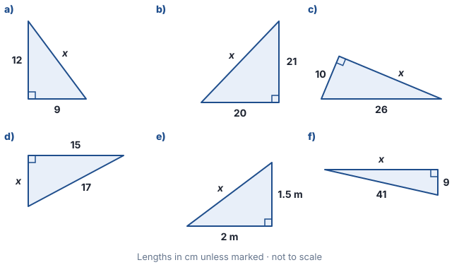
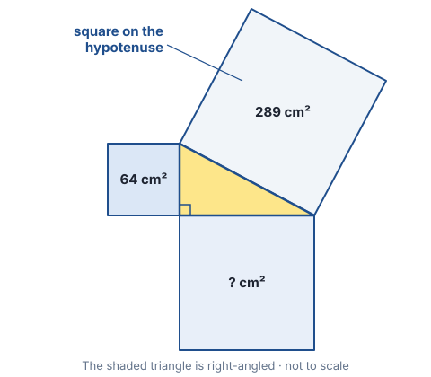
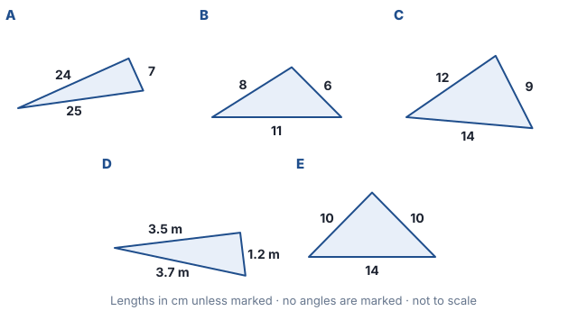
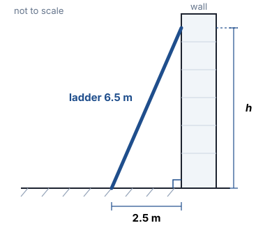
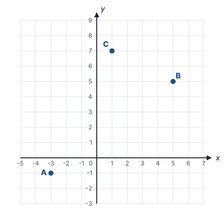

# Year 8 Mathematics — Week 31
## Topic: Pythagoras' Theorem — squares on the sides of a right angle

**Name:** ______________________ **Date:** ____________

**Learning intentions — by the end of this worksheet I can:**
- identify the hypotenuse of a right-angled triangle and explain why it is always the longest side
- use $c^2 = a^2 + b^2$ to find the hypotenuse or a shorter side, giving exact (surd) answers or rounded answers as asked
- use the converse of Pythagoras' theorem to test whether a triangle is right-angled
- recognise and generate Pythagorean triples, and explain why the theorem works using areas
- solve problems with ladders, ramps, diagonals, navigation and points on the Cartesian plane

---

## Part A · Warm-up (spaced retrieval) ⏱ ~7 min
*No calculator. These revisit Terms 1–3 — every one of them is used again later today.*

1. **(Week 1)** a) $13^2 =$ ______ b) $\sqrt{576} =$ ______ c) $\sqrt{0.49} =$ ______
2. **(Week 2)** Simplify, then evaluate: $\dfrac{5^7 \times 5^2}{(5^3)^2} =$ ______________________
3. **(Week 2)** Between which two consecutive whole numbers does $\sqrt{90}$ lie? ______ and ______ Is it closer to the smaller or the larger one? ______________
4. **(Week 3)** Circle the **irrational** numbers: $\sqrt{36}$  $\sqrt{40}$  $\dfrac{2}{7}$  $\pi$  $\sqrt{\tfrac{9}{16}}$  $0.\overline{3}$
5. **(Week 13)** A triangle has angles $x^\circ$, $2x^\circ$ and $90^\circ$. Find $x$. ______________
6. **(Week 14)** Which congruence test needs a right angle, the hypotenuse and one other side? ______________
7. **(Week 28)** Find the gradient of the line through $(-1, 3)$ and $(3, 11)$. ______________
8. **(Week 26)** Simplify $(3a)^2 + (4a)^2$. ______________ What do you notice about the answer?

<!-- lines:1 -->

---

## Part B · Learn ⏱ ~10 min

### 1. The hypotenuse
In a right-angled triangle the side **opposite the right angle** is the **hypotenuse**. It is always the **longest side** (it faces the biggest angle). The other two sides are often called the *legs* or *shorter sides*.

### 2. Pythagoras' theorem
> In any right-angled triangle, the **square on the hypotenuse equals the sum of the squares on the other two sides**:
> $$c^2 = a^2 + b^2 \qquad (c = \text{hypotenuse})$$

It is a statement about **areas**: if you draw a square on each side, the area of the big square equals the two smaller areas added together (see Q4).

### 3. Finding a side

| Finding… | Method | Example |
|---|---|---|
| the hypotenuse | **add** the squares, then square-root | legs 6 and 8: $c^2 = 36 + 64 = 100$, $c = 10$ |
| a shorter side | **subtract** the squares, then square-root | hypotenuse 13, leg 5: $a^2 = 169 - 25 = 144$, $a = 12$ |

> **Worked example 1 (exact and rounded):** legs 2 cm and 5 cm.
> $c^2 = 2^2 + 5^2 = 4 + 25 = 29$, so $c = \sqrt{29}$ cm **(exact — a surd)**.
> 🖩 $\sqrt{29} = 5.385\ldots \approx 5.39$ cm **(rounded to 2 d.p.)**.
> *Check:* $\sqrt{25} < \sqrt{29} < \sqrt{36}$, so the answer is between 5 and 6 ✔ (Week 2 estimation).

A **surd** is an irrational square root such as $\sqrt{29}$ (Week 3: it never terminates or recurs). Keep the surd unless you are told to round.

### 4. The converse — is it a right angle?
If the longest side $c$ satisfies $c^2 = a^2 + b^2$, the triangle **is** right-angled (the right angle is opposite $c$).
If $c^2 < a^2 + b^2$ the largest angle is **acute**; if $c^2 > a^2 + b^2$ it is **obtuse**.

> **Worked example 2:** sides 8, 15, 17. $8^2 + 15^2 = 64 + 225 = 289 = 17^2$ ✔ → right-angled, with the right angle opposite the 17 side.

### 5. Pythagorean triples
Three **whole numbers** that fit $a^2 + b^2 = c^2$: (3, 4, 5), (5, 12, 13), (8, 15, 17), (7, 24, 25) …
Any multiple of a triple is also a triple: (6, 8, 10), (30, 40, 50), and even (1.5, 2, 2.5) fits the rule (but is not a *triple*, because it isn't whole numbers).

---

## Part C · Practice ⏱ ~30 min
*No calculator unless a question is marked 🖩.*

### C1 ⭐ Fluency

**1. Name the hypotenuse.**
a) In $\triangle PQR$, $\angle Q = 90^\circ$. ______ b) In $\triangle LMN$, $\angle N = 90^\circ$. ______ c) In $\triangle ABC$, $\angle A = 90^\circ$. ______

**2. Find $x$ in each triangle.** *(These all use Pythagorean triples or their multiples — no calculator.)*

a) $x =$ ______ b) $x =$ ______ c) $x =$ ______ d) $x =$ ______ e) $x =$ ______ f) $x =$ ______

<!-- work:7 -->

**3. Exact answers.** A right-angled triangle has the sides given. Find the unknown side **as a surd**, then 🖩 round it to 2 decimal places.

| | Given sides | Exact answer | 🖩 Rounded (2 d.p.) |
|---|---|---|---|
| a) | shorter sides 1 cm and 1 cm | | |
| b) | shorter sides 2 cm and 3 cm | | |
| c) | hypotenuse 7 cm, one side 4 cm | | |
| d) | hypotenuse 10 cm, one side 5 cm | | |

<!-- work:5 -->

### C2 ⭐⭐ Understanding

**4. Why it works — squares on the sides.** A square has been drawn on each side of the shaded right-angled triangle.

a) Find the area of the third square. ______________ b) Find all three side lengths of the triangle. ______________

<!-- work:3 -->

c) Explain in your own words what Pythagoras' theorem says about the three squares, and why $c^2$ really does mean "an area".

<!-- lines:3 -->

**5. The converse.** Use the converse to decide whether each triangle is right-angled. If it is not, say whether its largest angle is acute or obtuse. For each right-angled triangle, state which side the right angle is opposite.

| Triangle | $a^2 + b^2$ (two shorter sides) | $c^2$ (longest side) | Right / acute / obtuse? |
|---|---|---|---|
| A | | | |
| B | | | |
| C | | | |
| D | | | |
| E | | | |

<!-- work:5 -->

Triangle E *looks* right-angled. Explain why "looks right" is not good enough.

<!-- lines:2 -->

**6. Find the error.** For a right-angled triangle with hypotenuse 13 cm and another side 5 cm, Jordan writes:
$x^2 = 13^2 + 5^2 = 194$, so $x = \sqrt{194} \approx 13.9$ cm.
Explain Jordan's mistake without doing any calculation first (*hint: which side should be longest?*), then find the correct value of $x$.

<!-- lines:3 -->

<!-- work:2 -->

**7. Pythagorean triples.**
a) Show that (20, 48, 52) is a Pythagorean triple. Which basic triple is it a multiple of? ______________

<!-- work:2 -->

b) The rule $\left(n,\ \dfrac{n^2 - 1}{2},\ \dfrac{n^2 + 1}{2}\right)$ makes a triple for any odd number $n \ge 3$. Complete the table.

| $n$ | 3 | 5 | 7 | 9 | 11 |
|---|---|---|---|---|---|
| $\tfrac{n^2 - 1}{2}$ | 4 | | | | |
| $\tfrac{n^2 + 1}{2}$ | 5 | | | | |

c) Check that your $n = 9$ triple works. What do you notice about the two larger numbers in every triple from this rule?

<!-- work:2 -->

<!-- lines:2 -->

### C3 ⭐⭐⭐ Reasoning

**8. Is the corner square?** A builder checks a corner using the "3–4–5" idea. She marks 60 cm along one wall and 80 cm along the other, then measures between the marks: 101 cm. Is the corner exactly $90^\circ$? If not, is it a little more or a little less than $90^\circ$? Justify with the converse.

<!-- work:3 -->

<!-- lines:2 -->

**9. Ladder.** A 6.5 m ladder leans against a vertical wall on level ground, with its foot 2.5 m from the wall.

a) How high up the wall does the ladder reach? *(No calculator — look for a triple.)* ______________

<!-- work:3 -->

b) 🖩 The foot slips so it is now 3.5 m from the wall. How far does the top slide **down** the wall? Give your answer to the nearest centimetre. Is it more or less than the 1 m the foot moved?

<!-- work:4 -->

c) 🖩 A common safety rule of thumb is "1 out for every 4 up": the foot's distance from the wall should be a quarter of the height reached. If the ladder obeys this rule exactly, the height is $h$ and the foot is $\tfrac{h}{4}$ from the wall. Form an equation and find $h$ to the nearest centimetre.

<!-- work:5 -->

**10. Distance on the Cartesian plane.** Use the points on the grid.

a) Write the coordinates: A ______ B ______ C ______
b) On the grid, draw a right-angled triangle with AB as its hypotenuse and horizontal and vertical legs. Find the length of AB. ______________

<!-- work:3 -->

c) Find the exact lengths AC and BC (leave as surds). ______________

<!-- work:4 -->

d) Use the converse to show that $\triangle ABC$ is right-angled. At which vertex is the right angle?

<!-- work:2 -->

<!-- lines:1 -->

### C4 🔗 Connections — Pythagoras inside earlier topics ⏱ ~10 min
*Pythagoras is often the "hidden first step" before an area, perimeter, equation, gradient, percentage or volume question you already know how to do.*

**X1. Shape A (area & perimeter, Week 9).** Find the height $h$ of the trapezium (*hint: draw a vertical line down from the top-right corner*). Then find its area and perimeter.

<!-- work:5 -->

**X2. Shape B (equations, Weeks 7 & 26).** Use Pythagoras to write an equation in $x$. Expand and simplify it — you should reach $x^2 - 2x - 15 = 0$. Find the positive whole-number value of $x$ that works (try values, or factorise), then find the area and perimeter of the triangle. What do you notice?

<!-- work:7 -->

**X3. Shape C (volume & capacity, Weeks 11–12).** Find the height of the tent's triangular cross-section, its area, the volume of the tent in m³, and its capacity in litres.

<!-- work:5 -->

**X4. Distance vs gradient (Week 28).** Use the grid from Q10.
a) Find the gradient of AB. Then explain why the gradient alone does **not** tell you the length of AB.

<!-- work:2 -->

<!-- lines:2 -->

b) Find the gradients of AC and BC. Multiply them. What do you notice, given what you found in Q10 d)?

<!-- work:2 -->

<!-- lines:1 -->

**X5. Percentages (Week 4).** A rectangle measures 6 cm by 8 cm.
a) Find its diagonal. ______
b) Both sides are increased by 25%. Find the new diagonal and the percentage increase in the diagonal. Also find the percentage increase in **area**.

<!-- work:4 -->

c) 🖩 Instead, only the 6 cm side is increased by 50%. Find the percentage increase in the diagonal (1 d.p.). Why is it *not* 50%?

<!-- work:3 -->

<!-- lines:2 -->

---

## Part D · Problem Solving ⏱ ~12 min
*🖩 Calculator allowed in this part. Give lengths to 2 d.p. unless told otherwise.*

**11. Netball court.** A netball court is a rectangle 30.5 m long and 15.25 m wide. A player runs from one corner to the opposite corner along the diagonal instead of along two sides. How far is the diagonal, and how much shorter is it than going along two sides?

<!-- work:4 -->

**12. Ramp.** Suppose a council rule says an access ramp must be no steeper than **1 in 14** (1 m rise for every 14 m horizontal run). A ramp must rise 0.7 m to a front door.
a) What is the shortest horizontal run allowed? ______________
b) How long is the sloping surface of that ramp, to the nearest centimetre? ______________
c) What is the gradient of the ramp as a fraction (Week 28)? ______________

<!-- work:4 -->

**13. Navigation.** A yacht leaves a marina and sails 7 km due north, then 24 km due east.
a) How far is it from the marina now? *(No calculator needed.)* ______________
b) It then sails 5 km due south. How far is it from the marina now? ______________
c) The skipper says, "We've sailed 36 km, so we're 36 km from the marina." Explain the error.

<!-- work:4 -->

<!-- lines:2 -->

---

## Part E · Challenge ⏱ ~12 min

**14. Proof by rearrangement.** Both big squares below have side $a + b$, and all eight shaded triangles are identical right-angled triangles with shorter sides $a$, $b$ and hypotenuse $c$.

a) What is the total white area in Arrangement 1? In Arrangement 2?

<!-- lines:2 -->

b) Explain why these two white areas must be equal, and why this proves $c^2 = a^2 + b^2$ for **every** right-angled triangle.

<!-- lines:4 -->

c) Now prove it with algebra: write the area of the big square in Arrangement 1 in two ways, $(a + b)^2$ and $c^2 + 4 \times \tfrac{1}{2}ab$, then expand and simplify.

<!-- work:5 -->

**15. Space diagonal.** A box is 12 cm long, 4 cm wide and 3 cm high. Find the diagonal of the base, then the length of the longest straight pencil that fits inside the box (from one bottom corner to the opposite top corner). Write a formula for the space diagonal of an $a \times b \times c$ box.

<!-- work:5 -->

**16. Euclid's formula.** For whole numbers $m > n$, the numbers $m^2 - n^2$, $2mn$ and $m^2 + n^2$ form a Pythagorean triple.
a) Find the triples for $(m, n) = (2, 1),\ (3, 2),\ (4, 1),\ (5, 2)$. ______________

<!-- work:3 -->

b) Prove the formula always works by expanding $(m^2 - n^2)^2 + (2mn)^2$.

<!-- work:4 -->

---
### Self-check

| I can… | 😀 | 🙂 | 😕 |
|---|---|---|---|
| identify the hypotenuse in any orientation | | | |
| find the hypotenuse or a shorter side, exactly or rounded | | | |
| use the converse to test for a right angle (and acute/obtuse) | | | |
| recognise and generate Pythagorean triples | | | |
| explain why the theorem works using areas | | | |
| spot Pythagoras inside area, volume, gradient and equation problems | | | |

---

## ⚡ Fast-finisher bank ⏱ ~35 min
*Work through in order. ⭐⭐⭐⭐ = competition / Year 9+ level. No calculator unless marked 🖩.*

**F1 ⭐⭐ Find $x$** (right-angled triangles; $c$ is the hypotenuse).
a) legs 0.9 m and 1.2 m, $x = c$ ______ b) $c = 3.4$, one leg 1.6, $x$ = other leg ______
c) legs $\sqrt{5}$ and 2, $x = c$ ______ d) $c = \sqrt{10}$, one leg 1, $x$ = other leg ______

<!-- work:4 -->

**F2 ⭐⭐ Simplifying surds.** Since $\sqrt{ab} = \sqrt{a} \times \sqrt{b}$, we can take out square factors: $\sqrt{18} = \sqrt{9 \times 2} = 3\sqrt{2}$. Use prime factors (Week 1) to simplify:
a) $\sqrt{50}$ ______ b) $\sqrt{72}$ ______ c) $\sqrt{75}$ ______ d) $\sqrt{200}$ ______
e) Rewrite your answers to Q3 d) and Q10 c) in simplest surd form. ______________

<!-- work:5 -->

**F3 ⭐⭐ Squares.** a) Find the exact diagonal of a square with side 6 cm. ______ b) A square has a diagonal of 10 cm. Find its **area** without finding the side length first. ______

<!-- work:3 -->

**F4 ⭐⭐⭐ Equilateral triangle.** An equilateral triangle has side 10 cm. Find its height exactly, then 🖩 its area to 2 d.p.

<!-- work:4 -->

**F5 ⭐⭐⭐ Isosceles triangles.**
a) An isosceles triangle has sides 13, 13 and 10 cm. Find its area.
b) Working backwards: an isosceles triangle has a base of 16 cm and an area of 120 cm². Find its perimeter.

<!-- work:5 -->

**F6 ⭐⭐⭐ Rhombus (Week 9).** A rhombus has diagonals of 10 cm and 24 cm. Find its side length, perimeter and area. *(Hint: the diagonals of a rhombus bisect each other at right angles — Week 15.)*

<!-- work:4 -->

**F7 ⭐⭐⭐ Chord of a circle.** A circle has radius 10 cm. A chord is 6 cm from the centre (measured perpendicular to the chord). How long is the chord?

<!-- work:3 -->

**F8 ⭐⭐⭐ Spiral of Theodorus.** Start with a right-angled triangle with legs 1 and 1. Its hypotenuse becomes a leg of the next triangle, whose other leg is 1, and so on.
a) Find the hypotenuses of the first four triangles. ______________
b) Which triangle has a hypotenuse of exactly 4? Explain.

<!-- work:3 -->

<!-- lines:2 -->

**F9 ⭐⭐⭐⭐** A rectangle has a perimeter of 34 cm and a diagonal of 13 cm. Find its area **without** finding the length and width separately. *(Hint: expand $(l + w)^2$.)*

<!-- work:4 -->

**F10 ⭐⭐⭐⭐ Equidistant point.** The point $P(x, 0)$ on the $x$-axis is the same distance from $A(0, 4)$ as from $B(8, 0)$. Form an equation using Pythagoras and solve it to find $x$. Check your answer.

<!-- work:5 -->

**F11 ⭐⭐⭐⭐ The ant and the box.** An ant is at one bottom corner of the 12 cm × 4 cm × 3 cm box from Q15 and wants to reach the opposite top corner, **walking only on the outside surfaces**. 🖩 By unfolding the box into a net, find the length of the shortest path (2 d.p.). Compare it with the space diagonal.

<!-- work:6 -->

**F12 ⭐⭐⭐⭐ Investigation — patterns in triples.**
a) List every Pythagorean triple $(a, b, c)$ with $a < b < c \le 30$. *(There are 11.)*

<!-- lines:4 -->

b) For each triple, find the product $abc$. What is the largest number that divides **all** of your products?

<!-- lines:3 -->

c) Explain why the two shorter sides of a triple can never both be odd. *(Hint: what is the remainder when an odd square is divided by 4? And an even square?)*

<!-- lines:4 -->
