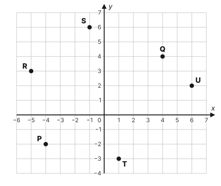
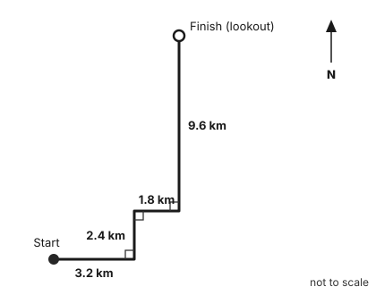
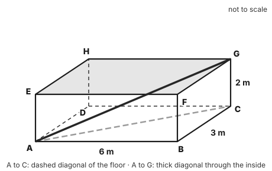
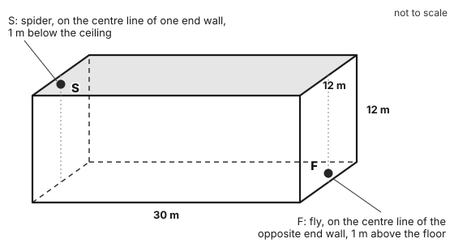

# Year 8 Mathematics — Week 32
## Topic: Pythagoras in action — applications and distance on the Cartesian plane

**Name:** ______________________ **Date:** ____________

**Learning intentions — by the end of this worksheet I can:**
- turn a worded problem (roofs, screens, kites, walks, ramps) into a labelled right-angled triangle and solve it in several steps
- find the distance between two points on the Cartesian plane by drawing a right-angled triangle, then by using the distance formula $d = \sqrt{(x_2 - x_1)^2 + (y_2 - y_1)^2}$
- find the midpoint of a segment and work backwards from a midpoint
- use side lengths to decide whether a triangle on the plane is right-angled, isosceles or scalene, and find perimeters with surds
- give exact (surd) answers and rounded answers, and know when each is wanted

---

## Part A · Warm-up (spaced retrieval) ⏱ ~7 min
*No calculator. Weeks 31, 2, 5, 9, 13, 27 and 28 all come back later today.*

1. **(Week 31)** a) A right-angled triangle has shorter sides 20 and 21. Hypotenuse $=$ ______ b) Hypotenuse 26, one side 24. Other side $=$ ______
2. **(Week 31)** Is a triangle with sides 9, 40 and 41 right-angled? Show the check. ______________________
3. **(Week 31)** A right-angled triangle has shorter sides 3 cm and 5 cm. Find the hypotenuse exactly: ______ It lies between ______ and ______ cm.
4. **(Week 2)** $(2^3)^4 \div 2^9 =$ ______
5. **(Week 5)** A cyclist rides 18 km in 45 minutes. Average speed in km/h: ______
6. **(Week 9)** A kite has diagonals 6 cm and 10 cm. Area: ______
7. **(Week 13)** An isosceles triangle has an apex angle of $40^\circ$. Each base angle is ______
8. **(Week 28)** Gradient of the line through $(2, -1)$ and $(6, 7)$: ______
9. **(Week 27)** Make $b$ the subject of $c^2 = a^2 + b^2$ (where $b > 0$). $b =$ ______________

<!-- work:2 -->

---

## Part B · Learn ⏱ ~10 min

### 1. Solving worded problems: SKETCH → LABEL → DECIDE → SOLVE → CHECK
1. **Sketch** the situation and find the right angle (walls are vertical, floors are level, north is at $90^\circ$ to east).
2. **Label** the known sides and the unknown. Mark the hypotenuse $c$ (opposite the right angle).
3. **Decide**: finding $c$ → *add* the squares; finding a shorter side → *subtract*.
4. **Solve** exactly first. Round only at the end, and only if asked.
5. **Check**: is the hypotenuse the longest side? Is the answer sensible for the context?

### 2. Distance between two points
To find the distance from $A(-2, 1)$ to $B(4, 9)$, draw a right-angled triangle with $AB$ as its hypotenuse:
- horizontal leg (the **run**) $= 4 - (-2) = 6$
- vertical leg (the **rise**) $= 9 - 1 = 8$
- $AB^2 = 6^2 + 8^2 = 100$, so $AB = 10$.

Doing this with letters gives the **distance formula**:

> $$d = \sqrt{(x_2 - x_1)^2 + (y_2 - y_1)^2}$$
> It is just Pythagoras, with the run $(x_2 - x_1)$ and the rise $(y_2 - y_1)$ as the two shorter sides.

> **Worked example 1 (exact and rounded):** $P(-3, 4)$ and $Q(2, -1)$.
> $x_2 - x_1 = 2 - (-3) = 5$ and $y_2 - y_1 = -1 - 4 = -5$.
> $PQ = \sqrt{5^2 + (-5)^2} = \sqrt{25 + 25} = \sqrt{50} = 5\sqrt{2}$ **(exact)** 🖩 $\approx 7.07$ **(2 d.p.)**.
> *Note:* a negative difference becomes positive when squared, so it doesn't matter which point you call "1" and which "2".

### 3. Midpoint (bonus)
The **midpoint** is halfway along a segment: **average** the $x$-values and average the $y$-values.

> $$M = \left(\frac{x_1 + x_2}{2},\ \frac{y_1 + y_2}{2}\right)$$
> **Worked example 2:** the midpoint of $A(-2, 1)$ and $B(4, 9)$ is $\left(\tfrac{-2 + 4}{2}, \tfrac{1 + 9}{2}\right) = (1, 5)$.

Careful: distance uses **differences**; midpoint uses **sums**.

### 4. Testing triangles on the plane
Work out the **squares** of the three side lengths (no square roots needed), then:
- two equal squares → two equal sides → **isosceles**
- longest$^2$ $=$ sum of the other two squares → **right-angled** (Week 31 converse); bigger → obtuse; smaller → acute.

> **Worked example 3:** $A(0, 0)$, $B(4, 2)$, $C(2, 6)$. $AB^2 = 16 + 4 = 20$, $BC^2 = 4 + 16 = 20$, $AC^2 = 4 + 36 = 40$.
> $AB = BC$ → isosceles; $20 + 20 = 40$ → right-angled at $B$ (opposite the longest side $AC$).

**Simplest surd form** (Week 31 F2): take out square factors, e.g. $\sqrt{50} = \sqrt{25 \times 2} = 5\sqrt{2}$. Either form is "exact"; simplest form is neater and easier to add, e.g. $\sqrt{8} + \sqrt{18} = 2\sqrt{2} + 3\sqrt{2} = 5\sqrt{2}$.

---

## Part C · Practice ⏱ ~30 min
*No calculator unless a question is marked 🖩.*

### C1 ⭐ Fluency

**1. Distance from a triangle on the grid.** For each pair of points, draw a right-angled triangle on the grid with horizontal and vertical legs. Write the run and rise, then the exact distance. 🖩 Round surds to 2 d.p.

| | Points | Run | Rise | Exact distance | 🖩 2 d.p. (if needed) |
|---|---|---|---|---|---|
| a) | $P$ to $Q$ | | | | |
| b) | $R$ to $S$ | | | | |
| c) | $T$ to $U$ | | | | |
| d) | $Q$ to $U$ | | | | |
| e) | $P$ to $T$ | | | | |

<!-- work:4 -->

**2. The distance formula.** No grid this time. Find the exact distance between each pair of points, then 🖩 round any surd to 2 d.p.
a) $(1, 2)$ and $(7, 10)$ ______ b) $(-3, -5)$ and $(9, 0)$ ______ c) $(-6, 4)$ and $(2, -11)$ ______
d) $(0, 0)$ and $(-5, 3)$ ______ e) $(2.5, -1)$ and $(-1.5, 2)$ ______ f) $(-7, -2)$ and $(-3, 6)$ ______

<!-- work:7 -->

**3. Midpoints.**
a) Find the midpoints of the segments in Q2 a), b) and c). ______________________

<!-- work:3 -->

b) $M(2, -1)$ is the midpoint of $AB$, and $A$ is $(-1, 3)$. Find $B$, then the length $AB$. Check that $AM$ is half of $AB$.

<!-- work:4 -->

### C2 ⭐⭐ Understanding

**4. Three mistakes.** Three students work with the points $(-2, 5)$ and $(4, -3)$.
- **Mia:** $d^2 = (4 - 2)^2 + (-3 - 5)^2 = 4 + 64 = 68$, so $d = \sqrt{68}$.
- **Sam:** the run is 6 and the rise is 8, so $d = 6 + 8 = 14$.
- **Ava:** midpoint $= \left(\tfrac{4 - (-2)}{2}, \tfrac{-3 - 5}{2}\right) = (3, -4)$.

Explain each mistake in one sentence, then give the correct distance and midpoint.

<!-- lines:4 -->

<!-- work:2 -->

**5. Classify the triangle.** For each triangle, find the **squares** of the three side lengths. Then classify it as scalene / isosceles / equilateral **and** right / acute / obtuse. If it is right-angled, name the vertex where the right angle is. *(Sketch on grid paper if it helps.)*

| Triangle | Side$^2$ | Side$^2$ | Side$^2$ | Classification |
|---|---|---|---|---|
| a) $A(1, 1)$, $B(5, 3)$, $C(3, 7)$ | $AB^2 =$ | $BC^2 =$ | $AC^2 =$ | |
| b) $D(-4, -1)$, $E(2, -3)$, $F(0, 3)$ | $DE^2 =$ | $EF^2 =$ | $DF^2 =$ | |
| c) $G(-3, 2)$, $H(3, 4)$, $K(4, 1)$ | $GH^2 =$ | $HK^2 =$ | $GK^2 =$ | |

<!-- work:6 -->

Why is it smarter to compare the **squares** of the side lengths rather than the side lengths themselves?

<!-- lines:2 -->

### C3 ⭐⭐⭐ Reasoning

**6. Is it a square?** The points $A(-1, -2)$, $B(2, 2)$, $C(6, -1)$ and $D(3, -5)$ are joined in order.
a) Show that all four sides are equal. What type of quadrilateral must $ABCD$ be at least?

<!-- work:4 -->

b) Find the lengths of both diagonals. Use them (Week 15: diagonal properties) to prove $ABCD$ is a square, then find its area.

<!-- work:3 -->

<!-- lines:2 -->

**7. A circle on the plane.** $A(-3, 2)$ and $B(5, 8)$ are the ends of a diameter of a circle.
a) Find the centre and the radius of the circle.

<!-- work:3 -->

b) Show that $C(5, 2)$ and $D(-2, 9)$ both lie on the circle.

<!-- work:3 -->

c) Show that $\triangle ABC$ is right-angled at $C$. Make a conjecture about any triangle drawn from the two ends of a diameter to a point on the circle.

<!-- work:2 -->

<!-- lines:2 -->

**8. In a straight line?** $A(-2, -1)$, $B(1, 1)$ and $C(7, 5)$.
a) Find $AB$, $BC$ and $AC$ in simplest surd form. ______________________

<!-- work:4 -->

b) Show that $AB + BC = AC$. What does this tell you about the three points? Confirm your answer using gradients (Week 28).

<!-- work:2 -->

<!-- lines:2 -->

### C4 🔗 Connections — distance inside earlier topics ⏱ ~10 min
*The distance formula joins up gradient, area, perimeter, equations and speed.*

**X1. Gradient and distance (Weeks 28 & 15).**
a) Find the gradient of each side of $ABCD$. Which pairs of sides are parallel? What type of quadrilateral is $ABCD$?

<!-- work:3 -->

<!-- lines:1 -->

b) Find the exact length of each side. Do your lengths agree with your answer to a)?

<!-- work:3 -->

c) Find the midpoints of the diagonals $AC$ and $BD$. What do you notice, and which Week 15 property does this show?

<!-- work:2 -->

<!-- lines:1 -->

d) Is $ABCD$ a rhombus? Give **two** different reasons using lengths or gradients.

<!-- lines:3 -->

**X2. Area and perimeter with surds (Week 9).**
a) Find the area of $ABCD$ (count the base and the perpendicular height on the grid). ______

b) Find the perimeter exactly, in simplest surd form, and 🖩 to 2 d.p. ______________

<!-- work:3 -->

c) ⭐⭐⭐ 🖩 The diagonal $AC$ splits $ABCD$ into two equal triangles. Using $AC$ as the base of $\triangle ABC$, find the perpendicular distance from $B$ to the line $AC$ (2 d.p.).

<!-- work:4 -->

**X3. Equations (Week 7).**
a) The distance from $A(1, -3)$ to $P(k, 9)$ is 13. Form an equation and find **both** possible values of $k$.

<!-- work:4 -->

b) The point $(2, m)$ is 10 units from $(-4, 1)$. Find both values of $m$. Explain, using a sketch idea, why these questions have two answers.

<!-- work:3 -->

<!-- lines:2 -->

**X4. Speed and unit rates (Week 5).** On a map grid where 1 unit = 1 km, a ferry travels in a straight line from the harbour $H(-3, -4)$ to an island jetty $J(9, 1)$. *(Hypothetical numbers.)*
a) How far is the trip? ______
b) At 26 km/h, how many minutes does it take? ______
c) 🖩 A jet ski does the same trip at 15 m/s. How long does it take, to the nearest second?
d) The ferry uses 0.4 L of fuel per km. How much fuel does a return trip use? ______

<!-- work:5 -->

---

## Part D · Problem Solving ⏱ ~12 min
*🖩 Calculator allowed in this part. Give lengths to 2 d.p. unless told otherwise. All prices and sizes are hypothetical unless stated.*

**9. Roof (panel A).** The roof is symmetrical.
a) Find the length of a rafter from the ridge to the top of a wall. *(No calculator needed — look for a triple.)* ______

<!-- work:3 -->

b) Each full rafter also includes the 0.6 m overhang. A roof has 12 trusses, each with two full rafters. Find the total length of rafter timber, and its cost at \$14.50 per metre.

<!-- work:3 -->

c) What is the gradient of the roof slope, as a fraction in simplest form (Week 28)? ______

**10. Screen sizes (panel B).** A TV's "size" is the length of the screen's diagonal in inches (1 inch = 2.54 cm exactly).
a) *(No calculator.)* An older TV has a 4 : 3 screen and is sold as "32-inch". Write the width and height as $4k$ and $3k$, and find them in inches.

<!-- work:3 -->

b) A modern TV is 16 : 9 and "65-inch". Write the width and height as $16k$ and $9k$, find $k$, then the width and height in **centimetres** (1 d.p.).

<!-- work:5 -->

c) The screen must sit in a cabinet opening 145 cm wide. Will the screen fit? What else would you need to know before buying it?

<!-- lines:2 -->

**11. Toy kite (panel C).** Binding tape runs around all four edges of the kite.
a) Find the length of each edge exactly, then the total length of tape to the nearest centimetre.

<!-- work:4 -->

b) How much fabric covers the kite, in cm² and in m² (Weeks 9 & 12)? ______________

<!-- work:2 -->

**12. A walk to the lookout.** A bushwalker follows a trail made of straight sections running due east or due north, as shown.

a) How far east and how far north of the start is the lookout altogether? Find the straight-line distance from the start to the lookout. *(No calculator needed.)*

<!-- work:3 -->

b) The walker averages 4 km/h. How long does the walk take along the trail? A rescue helicopter flies straight from the start to the lookout at 156 km/h. How many minutes does it take?

<!-- work:3 -->

c) Put the start at $(0, 0)$ with 1 unit = 1 km. Give the coordinates of the lookout and of the midpoint of the straight-line route. ______________

---

## Part E · Challenge — into three dimensions ⏱ ~12 min

**13. Space diagonal of a shed.** The shed is a rectangular prism 6 m × 3 m × 2 m.
a) Find the floor diagonal $AC$ exactly (simplest surd form). ______
b) Triangle $ACG$ is right-angled at $C$ (why?). Use it to find the space diagonal $AG$. *(Keep $AC^2$ exact — don't round it first.)*

<!-- work:4 -->

<!-- lines:1 -->

c) Can a straight 7.2 m length of pipe be stored inside the shed? Explain.

<!-- lines:1 -->

**14. The longest rod.** In Week 31 Q15 you found that the space diagonal of an $a \times b \times c$ box is $\sqrt{a^2 + b^2 + c^2}$.
a) A box measures 60 cm × 30 cm × 20 cm. What is the longest straight rod that fits inside it? Will a 72 cm fishing rod (in one piece) fit?

<!-- work:2 -->

b) Show that the space diagonal of a **cube** with edge $s$ is $s\sqrt{3}$. 🖩 What is the smallest cube box (edge to the nearest mm) that a 1 m rod fits into?

<!-- work:4 -->

**15. The distance formula in 3D.** In 3D, each point has three coordinates $(x, y, z)$.
a) Explain why the distance between two points is $\sqrt{(x_2 - x_1)^2 + (y_2 - y_1)^2 + (z_2 - z_1)^2}$. *(Hint: link it to the shed.)*

<!-- lines:3 -->

b) Find the distance between $(1, 2, 3)$ and $(7, 5, -3)$. ______

<!-- work:2 -->

**16. The ant on the shed.** An ant at $A$ wants to reach $G$, but it can only **walk on the outside surfaces** of the shed. Sketch the nets of two faces unfolded flat in each possible way, and 🖩 find the shortest path (2 d.p.). How much longer is it than the space diagonal?

<!-- draw:6 -->

<!-- work:4 -->

---
### Self-check

| I can… | 😀 | 🙂 | 😕 |
|---|---|---|---|
| turn a worded problem into a labelled right-angled triangle and solve it in steps | | | |
| find the distance between two points by drawing a triangle on the grid | | | |
| use the distance formula, including with negative coordinates | | | |
| find a midpoint and work backwards from one | | | |
| classify a triangle from coordinates using the squares of its sides | | | |
| give exact (surd) and rounded answers, and simplify surds | | | |
| find space diagonals of boxes | | | |

---

## ⚡ Fast-finisher bank ⏱ ~35 min
*Work through in order. ⭐⭐⭐⭐ = competition / Year 9+ level. No calculator unless marked 🖩.*

**F1 ⭐⭐ Quick distances.**
a) $(-1.5, 2)$ to $(2.5, -1)$ ______ b) the origin to $(-8, -15)$ ______ c) $(-2, -7)$ to $(4, 1)$ ______

<!-- work:3 -->

**F2 ⭐⭐ Working backwards.** $M(3, -2)$ is the midpoint of $PQ$, where $P$ is $(-1, 4)$. Find $Q$ and the length $PQ$ in simplest surd form.

<!-- work:3 -->

**F3 ⭐⭐ Perimeter and area on the grid.** A triangle has vertices $(0, 0)$, $(2, 6)$ and $(6, 2)$.
a) Show it is isosceles and find its exact perimeter in simplest surd form. 🖩 Round to 2 d.p.
b) Find its area by drawing a rectangle around it and subtracting the three corner triangles.

<!-- work:5 -->

**F4 ⭐⭐⭐ Finish the square.** Three vertices of a square are $(1, 1)$, $(4, 2)$ and $(3, 5)$. Find the fourth vertex, then prove your shape is a square and find its area.

<!-- work:5 -->

**F5 ⭐⭐⭐ Points on a circle.** A circle has centre $(0, 0)$ and radius 13.
a) Which of these points lie on it? $(5, 12)$  $(-12, 5)$  $(10, -8)$  $(0, -13)$ ______________
b) The point $(-5, y)$ is on the circle. Find both values of $y$. ______

<!-- work:3 -->

**F6 ⭐⭐⭐ Equidistant.** Find the point $P$ on the $y$-axis that is the same distance from $A(-4, 1)$ as from $B(6, 3)$. Check by finding both distances.

<!-- work:5 -->

**F7 ⭐⭐⭐ 🖩 Bigger screen?** Which has the larger screen **area**: a 55-inch 16 : 9 TV or a 50-inch 4 : 3 TV? Show your working (answers in square inches, 1 d.p.).

<!-- work:5 -->

**F8 ⭐⭐⭐ Cube from its diagonal.** A cube has a space diagonal of 12 cm. Find the area of one face **without** finding the edge length, then the total surface area of the cube.

<!-- work:3 -->

**F9 ⭐⭐⭐⭐ The spider and the fly.** A hall is a rectangular prism 30 m long, 12 m wide and 12 m high (hypothetical). A spider and a fly sit on opposite end walls as shown.

a) The obvious crawling path goes straight up the end wall, along the middle of the ceiling, and straight down the other end wall. How long is it? ______

b) The spider can do better by crossing **five** surfaces: end wall → ceiling → one side wall → floor → other end wall. Unfold those five faces into a flat net with the side wall in the middle, mark S and F on it, and find the straight-line distance between them.

<!-- draw:8 -->

<!-- work:3 -->

**F10 ⭐⭐⭐⭐ Lattice points (AMC style).** A *lattice point* has whole-number coordinates.
a) How many lattice points are exactly 5 units from the origin? ______
b) How many are exactly $\sqrt{50}$ units from the origin? ______

<!-- work:4 -->

**F11 ⭐⭐⭐⭐ 3D practice.** Find the distance between $(1, -2, 3)$ and $(5, 6, -5)$, and the midpoint of the segment joining them.

<!-- work:3 -->

**F12 ⭐⭐⭐⭐ Investigation — taxicab distance.** In a city laid out on a square grid, a taxi can only drive along grid lines. Its **taxicab distance** from $(x_1, y_1)$ to $(x_2, y_2)$ is $|x_2 - x_1| + |y_2 - y_1|$.
a) Find the ordinary (straight-line) distance and the taxicab distance from $(0, 0)$ to $(3, 4)$, $(5, 0)$ and $(-6, 8)$.

<!-- work:3 -->

b) When are the two distances equal? Explain why the taxicab distance can never be shorter.

<!-- lines:3 -->

c) Plot every lattice point with taxicab distance exactly 4 from the origin. What shape do they make? Compare it with the points at ordinary distance 4.

<!-- draw:6 -->

<!-- lines:2 -->
